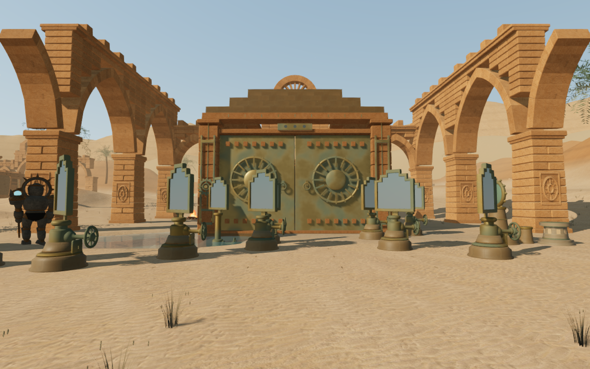
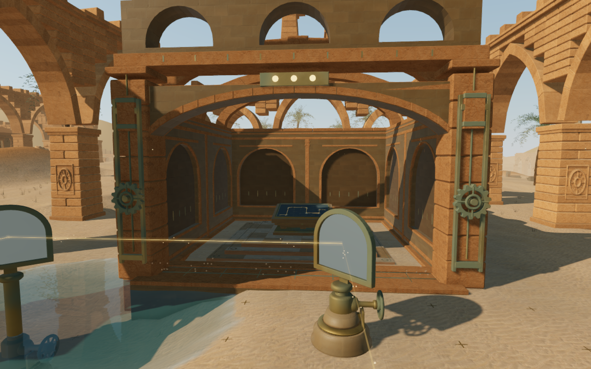
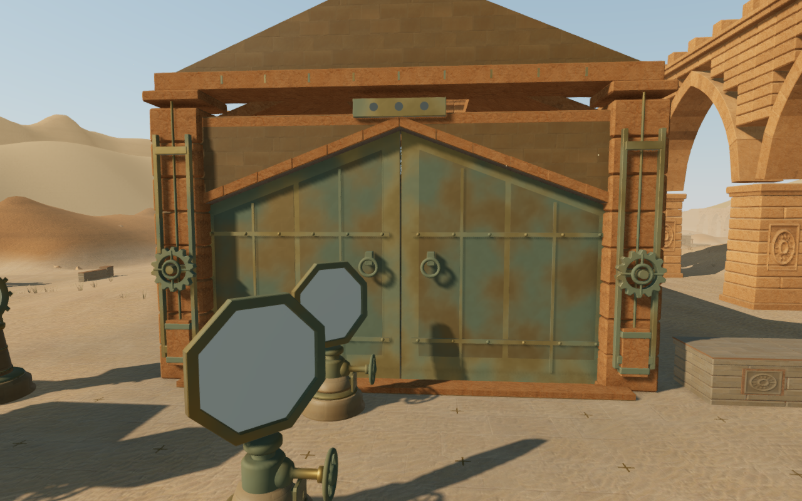

# Shaped desert entrances

The nine solar courts now have shaped shutters and fitted stone surrounds.
Previously, broad rectangular bronze leaves with identical sun emblems filled
most of each facade, hiding the differences between the sanctuary rooms. The
new assemblies change the actual openings and the stone occupying their upper
corners. They retain the existing roofs, drive wheels, counterweights, mirrors,
working positions and sliding threshold sequence.

| Court | Entrance construction |
| --- | --- |
| Balance hall | A broad lintel with two large plate fields and three bonding straps per leaf. |
| Dawn colonnade | A shallow segmental arch above narrow vertical plates. |
| Aqueduct vault | A deeper arch with individually seated facing stones. |
| Noon cleft | A pointed head following the split gable behind it. |
| Ephemeris hall | Two arched heads with a central stone pendant. |
| Eastern shadow | An asymmetric head descending from the western canopy. |
| Light well | Round light holes through the upper bronze leaves. |
| Relay gallery | Wide upper slots above bonded bronze plates. |
| Cool sepulchre | A stepped, corbelled opening echoing the room's roof courses. |

| Preceding last court | Revised last court |
| --- | --- |
|  |  |

These actual High game captures share the prepared player and camera coordinates
and scene time. Other animation can differ. All four documentation images
preserve their decoded source RGB pixels and dimensions through lossless WebP
conversion. No external model, bitmap, recording or dependency is added; existing
[asset attribution](asset-credits.md) remains applicable.

The weathered bronze plates, straps and rivets are seated on the structural
leaves. The upper light holes have complete reveals. Fixed stone surrounds use
finite triangle collision, and their facing stones batch into two material
meshes per court. Moving camera surfaces follow the shaped leaves and their
handles; the windows and the empty space above a lowered head remain clear.
The full-height stroke still coordinates with the covered floor slot.

## Recorded verification

- The combined verification covers 97 distinct passing checks. The main run
  passes 95 of its 96 checks; its fixed count of two moving camera boxes per
  court is replaced with ownership checks for the new leaf surfaces. The
  regional repeat passes all 26 tests, including a new raised-crossing observer
  regression. All 69 regional gates retain their checked centre passages.
- New tests inspect the closed delivered stone, bronze and window reveals
  after batching. Six moving-head queries retain actual empty camera space
  that the preceding rectangular proxy would occupy. Sixteen upper-window
  queries pass through lift cycles, and eight adjacent metal queries remain
  solid. Existing shutter/cover, threshold support, rooftop, optical-control,
  counterweight and audio regressions pass.
- Thirty-two final development images are reviewed: nine court fronts, nine
  near closed views, nine open views, three ordinary follow-camera views and
  two intermediate lift states. The wide aqueduct view retains foreground
  occlusion, with clear near coverage. HDR inputs are finite, shaders link and
  GL checks report zero errors.
- Thirty-six stopped standing/crouching poses following eighteen prepared
  local crossings inspect 1,731,420 delivered character vertices against the
  new construction. No sample exceeds the 15 mm overlap tolerance. The local
  controller legs cover 1,278 updates; combat is not stepped. These endpoint
  checks do not certify every moving body pose.
- All 161 environmental sound origins remain outside the new construction.
  Existing drive positions, distance falloff and adaptive chapter music remain
  in use. A comparison against the published gate builder retains identical
  geometry/material fingerprints, camera counts and gate sound sources for
  the other seven themes.
- Production keyboard/High at 1280 × 800 and actual portrait touch/Performance
  at 540 × 900 both turn, reset and activate the dawn puzzle. Complete saves
  survive the partial and completed reloads, apart from chapter timestamps.
  Native retreat covers 9.0 m / 9.6 m at health 100. All six release images are
  reviewed, without horizontal overflow. Loaded JS/CSS names match the current
  build and the development hook is absent. No page errors, missing resources
  or unexpected console warnings are recorded.
- All 426 runtime source hashes match both development capture sets and the
  reviewed source. The baseline image's source hashes match published `ecaff4d`.
  Owned browsers and development/production preview servers close after checks.
- The three CPU-budget checks and production build pass. Work uses the shared
  five-of-sixteen CPU set, lower priority, at most two test workers and one
  browser. The build retains its existing chunk-size advisory.

An initial follow-camera fixture used terrain height at the raised crossing and
is excluded. The replacement uses the actual support surface. The public gate
observer now does the same; its negative control reproduces the old false
blocked result and verifies restoration of prepared progress.

## Scope

The entrances now reveal the existing room identities more clearly. Shared
jamb drives, repeated arcades, broad court massing and sparse surrounding ground
still need work. Wider discovery and traversal coverage, continuous body
contact, listening evaluation and consumer-device performance remain open.
These scripted checks do not establish a complete human campaign playthrough
or AAA parity.
