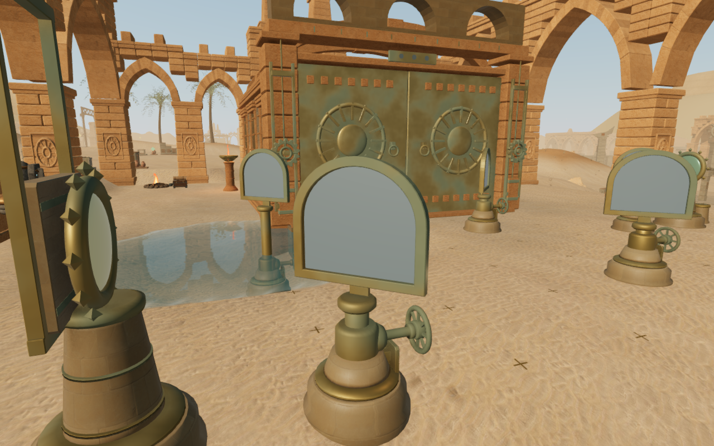
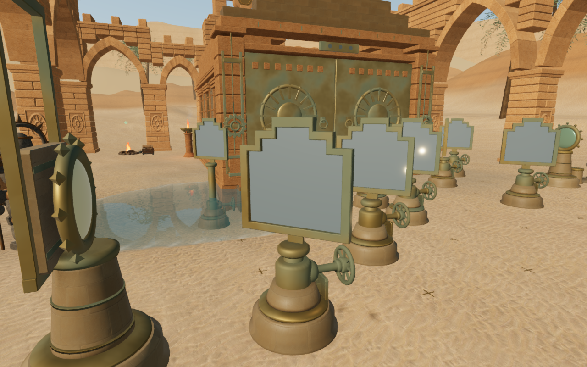
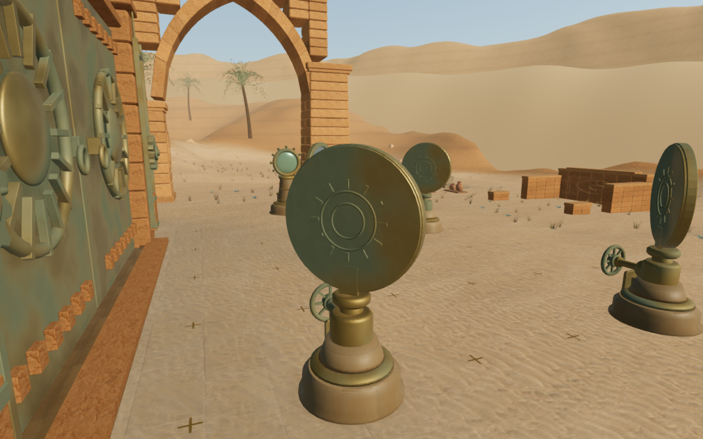

# Nine desert reflector forms

The desert's 68 turning mirrors now use nine physical silhouettes, following
what each court asks the explorer to do. The preceding ground survey showed
identical rectangular mirror cases across otherwise different optical routes.
The new silvered apertures, closed bronze bezels and rear castings vary together.

| Court | Reflector form | Rear casting detail |
| --- | --- | --- |
| Balance | Broad chamfered collector | Crossed braces and a balance bar |
| Dawn | Circular disc | Concentric dial and twelve marks |
| Aqueduct | Round-headed arch | Three vertical ribs and a crossbar |
| Noon | Octagonal filter | Eight-point dial |
| Ephemeris | Pointed hexagon | Hexagonal brace and central rib |
| Eastern shadow | Wing-shaped collector | Crossed braces |
| Light well | Wide oval oculus | Four-point dial |
| Relay | Clipped rectangular prism | Orthogonal grid |
| Sepulchre | Stepped crown | Four descending bars |

The optical centres remain on their original beam planes, and the two diagonal
normals still implement the existing reflection rules. Wheel axes, numbered
controls, receiver positions and saved puzzle values retain their existing
meaning. The supporting collars stop lower to clear the deeper apertures; rear
saddles connect the moving castings to those collars without crossing the glass.
The collision height covers each case's actual upper bound, including the
existing movement controller's step allowance.

Moving camera envelopes follow the cases through their turns. Round and angled
corners use convex planes instead of filled rectangular boxes. The stepped
crown's small upper notches use a conservative convex hull. The narrow rear
saddle has its own finite camera surface.

The existing source, receiver and bearing emitters, distance falloff and adaptive
desert score remain in use. This pass introduces original code-built geometry
using the existing credited materials, with no new external assets. The public
images are lossless encodings of actual paused High browser captures. Their
prepared observer positions inspect construction; combat is not stepped.

## Recorded verification

- All 38 selected regressions pass. They cover optical rules and saves, all
  working controls and camera arrivals, handwheel shafts, closed castings,
  aperture triangulation, collar/saddle contact, the delivered case bounds,
  adjacent optical tables, sanctuary construction and gate thresholds.
- Nine shaped apertures pass denser near-edge and interior opaque-mesh rays at
  five turn angles. Every delivered case vertex fits its camera box and convex
  planes, including the stepped crown's mitred corners. A disc-corner negative
  space query stays clear after movement and rotation.
- The loaded delivery passes 6,800 shaped-aperture rays across all 68 mirrors
  at five angles, 6,935 underside probes across 95 foundations and 693 clearance
  queries at the 77 controls. No missing glass, exposed footing or blocked
  working sample is recorded; the highest footing gap is −18.0 cm.
- All thirty final High captures are reviewed: eighteen near front/back views,
  nine court fronts and three ordinary follow-camera poses. The wide aqueduct
  view partly hides the lower instruments behind foreground terrain; its near
  views cover the cases. HDR inputs are finite, programs link and GL checks
  report zero errors. A closer noon rear view replaces an obscured first angle.
- All 77 prepared local walking legs reach their targets over 7,210 actual
  controller updates: nine short first-wheel approaches and 68 legs between
  controls. Each first approach is selected from legal points 1.5–3 m from the
  wheel. This is a local circulation check, not a continuous chapter route.
  Fixed ground starts at raised gate thresholds and a later outside-court
  fixture were invalid and are excluded from this result.
- Production keyboard/High at 1280 × 800 and actual portrait touch/Performance
  at 540 × 900 both turn, reset and activate the dawn puzzle. Each preserves
  the complete save through partial and completed reloads, apart from chapter
  timestamps. Native retreat covers 9.0 m / 9.6 m at health 100. All six release
  images are reviewed, without horizontal overflow; the production debug hook
  is absent and the loaded JS/CSS names match the current build. No page errors,
  missing resources or unexpected console warnings are recorded.
- All 425 runtime source hashes and both public observer hashes match the
  reviewed files. The three public WebPs preserve their source RGB pixels.
  Owned browsers and development/production preview servers close after checks.
- The three CPU-budget regressions and the production build pass. Verification
  uses the shared five-of-sixteen CPU set, lower priority, at most two test
  workers and one browser. The build retains the existing chunk-size advisory.

## Scope

This changes the repeated reflector hardware. The pedestals, shared gate leaf
composition and wider court massing still repeat. Broader scenery, continuous
body contact, discovery and traversal coverage, listening evaluation and device
performance remain open. These captures and scripted checks do not establish
AAA parity or a complete human playthrough.
