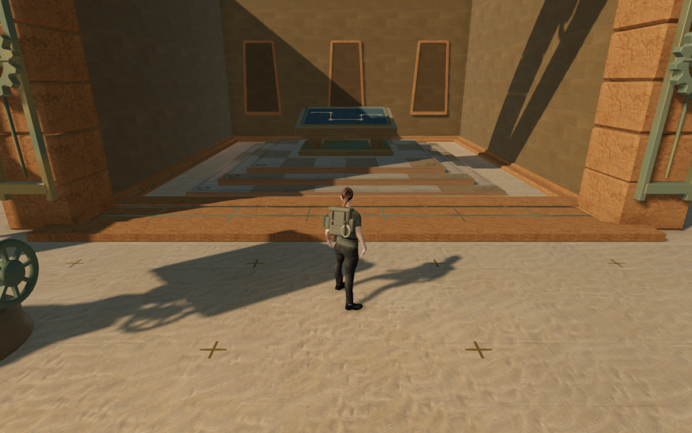
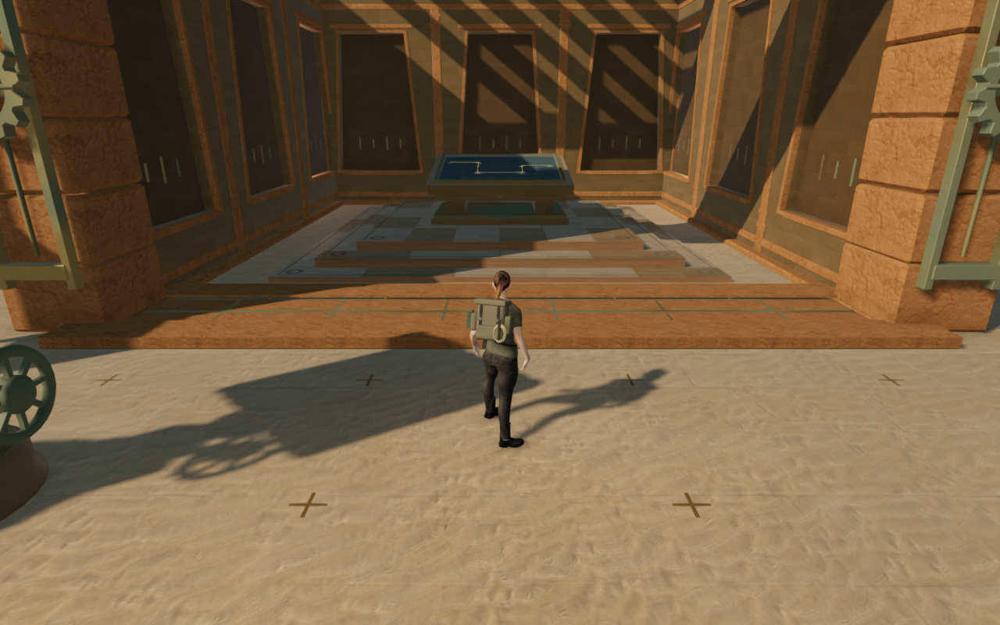
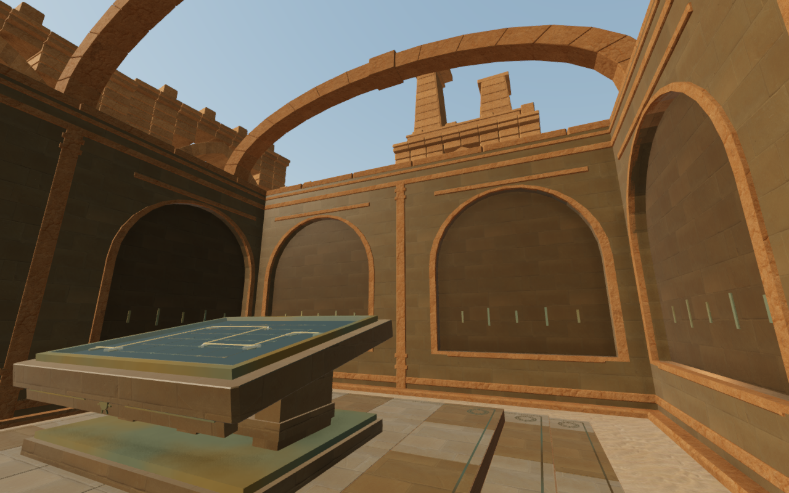
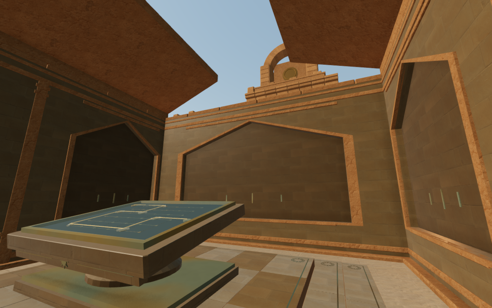
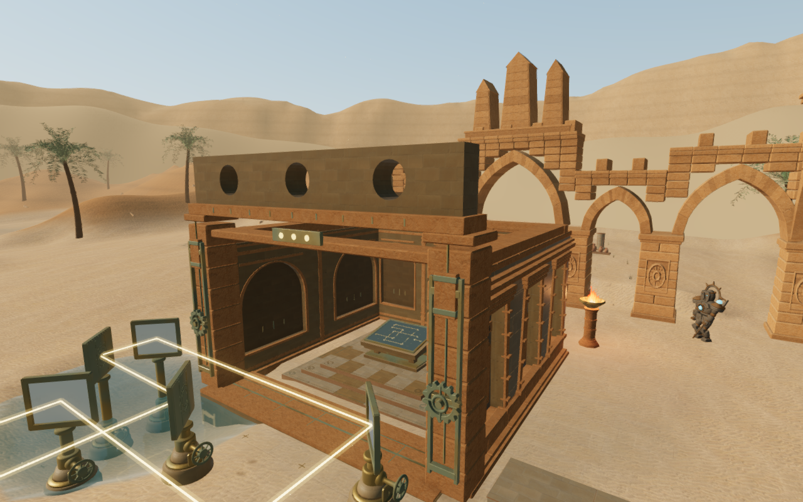
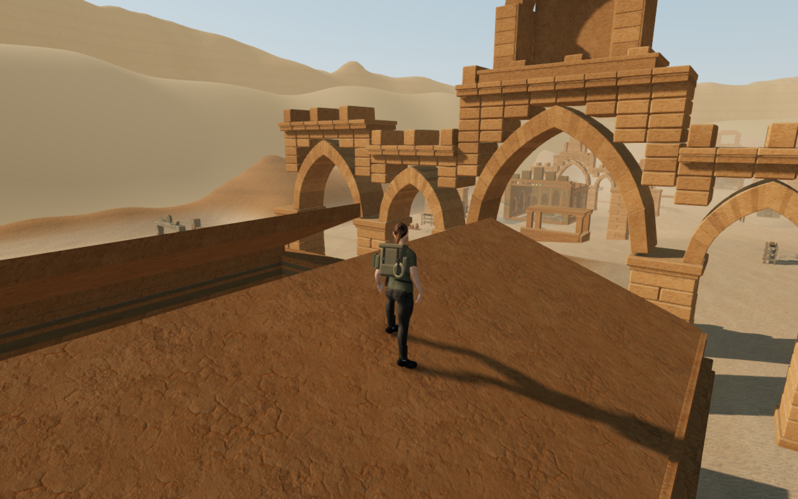
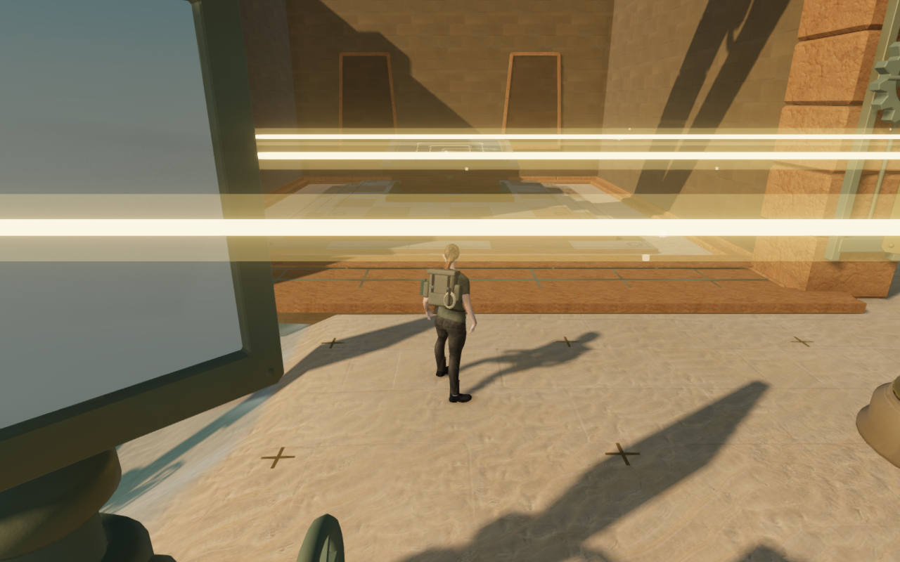
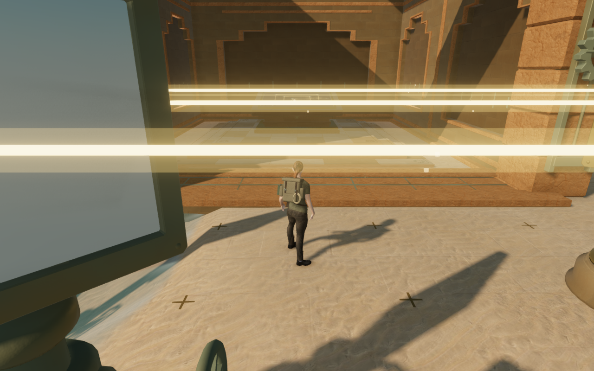

# Nine solar sanctuaries

The Desert's nine gated rooms now have individual roof structures, recessed
interior masonry and entrance crowns. Twenty-seven inner walls replace the
broad plain faces around their consoles. Open screens, vault ribs, a split
gable, an asymmetric canopy and a corbelled slit vary both the room silhouettes
and the sunlight falling across the paving.

| Sanctuary | Construction and light |
| --- | --- |
| Balance hall | Paired transverse beams, tapered niches and twin entrance pylons frame the counterweights. |
| Dawn colonnade | Seven broad stone slats cast a striped screen across tall recessed bays. |
| Aqueduct vault | Three keyed, open arches echo the cooling aqueduct; the entrance has three real arch apertures. |
| Noon cleft | Two sloping roof halves frame an open central strip above a broad pointed recess. |
| Ephemeris hall | Ascending ribs stand on fitted bearings above five stepped rear records. |
| Eastern shadow | A projecting western canopy shifts the room's shadow toward one side. |
| Open light well | A large square opening and circular entrance apertures keep the central area open to the sky. |
| Relay gallery | Crossed roof rails and rectangular entrance apertures frame the restored circuit. |
| Cool sepulchre | Four corbel courses on each side narrow the opening over a stepped false-door recess. |

The roofs bear on the existing coping; their entrance girders seat on both
jamb caps. Dressed edges catch the light while closed backs seal the recesses.
The vault keys join their half-arches at the apex. Real camera partitions
preserve the empty niches, roof openings and perforated crowns after batching.
Existing sandstone maps and bronze fittings tie the new construction to the
chapter's exterior architecture.

The rooms retain the existing controls, counterweights, paving, shutters and
sliding thresholds. Support around the beams matches the body clearance. The
noon roof uses its real sloping plane to fit both feet, while the surrounding
masonry retains separate body collision. The ordinary character motion can
land on each checked roof without horizontal relocation. These are prepared
landing checks, not evidence that a player has
reached every roof through an unassisted route.

All 145 selected tests pass. New checks inspect 1,437 closed construction pieces,
146 interior/crown camera rays, 693 roof support and camera queries (254 stone
surfaces and 439 open-sky positions), 86 independent roof/coping contacts and
297 shutter/counterweight poses. A raised-structure negative control detects
lost bearing. Nine falling-character cases retain clear roof landings at their
original horizontal positions, including the noon slope. The threshold floor
observer now limits its support query to the space below its downward ray's
origin, keeping overhead roofs separate from the crossing being inspected.
Existing regressions retain mirror approaches, complete counterweight routes,
all 69 regional gates, camera behavior, field-station support, audio and water
sound behavior.

All 31 final development views are reviewed: nine High approaches, nine High
interiors, five construction views, three closed entrances, three Performance
approaches and two prepared roof landings. Shaders link and HDR buffers remain
finite, with no application errors or warnings. Fifty-four standing/crouching
poses and nine roof landings inspect 3,029,985 delivered body records against the
new construction; none exceed the observer's 15 mm overlap tolerance. Independent
triangle queries cover 4,752 sole samples across all eighteen checked feet, with
no missing roof surfaces and minimum contact gaps of about 6 mm per foot.

Eight prepared local routes complete 64 movement legs. All nine restored optical
circuits remain aligned and all 77 checked controls retain legal working
positions. All 161 environmental sound origins remain outside the new geometry.
All 36 tracked sanctuary geometries dispose exactly once on an inspected chapter
replacement. Existing material and texture objects are reused. The build passes
with its existing large-chunk advisory. Verification uses the shared locked
five-of-sixteen CPU allowance, two test workers at most and one browser at a time;
owned browsers, workers and previews close afterward.

Final production checks use native keyboard controls at 1280 × 800 High and
touch controls at 540 × 900 Performance, starting from prepared chapter progress.
Both retain a partial mirror turn through reload, reset and align the circuit,
advance from stage 1 to stage 2, and return 9.0 m and 9.6 m respectively with
health at 100. A prepared save from the observed sloping-roof landing retains
its earned height and saved look. Native input then walks 1.8 m downhill while
remaining on the roof; the new position survives another reload. All six
complete-store comparisons pass, excluding only the per-chapter `lastPlayed`
timestamp. Loaded bundles match the build, the development hook is absent,
layouts fit both widths, and application errors and warnings remain empty.
All ten production captures are reviewed. These checks cover local interactions
and persistence from prepared states; they do not establish an unassisted
chapter playthrough.

The eight 1280 × 800 High documentation exports preserve decoded source pixels
and dimensions through lossless WebP conversion, without cropping or retouching.
The two before/after approaches share their prepared player and camera positions.
Baseline runtime hashes match published `58a54fc`; revised figures match the
new application. Other figures use construction views and a prepared roof
landing. Existing [asset attribution](asset-credits.md) remains applicable; no
external model, bitmap, recording or dependency is added.

This pass revises the nine sanctuary rooms. The surrounding arcades, exterior
court composition, wider scenery and continuous campaign contact remain open
in the [visual audit](visual-audit.md). These assisted checks do not establish
consumer-device performance, subjective audio quality or a complete campaign
playthrough.
