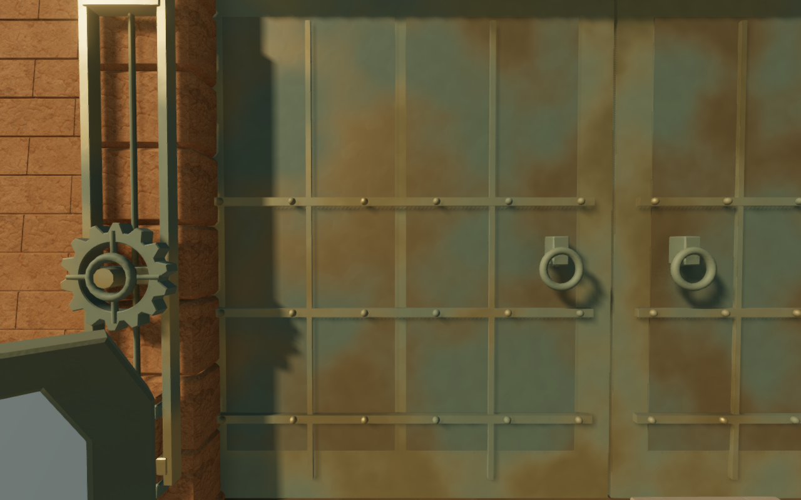
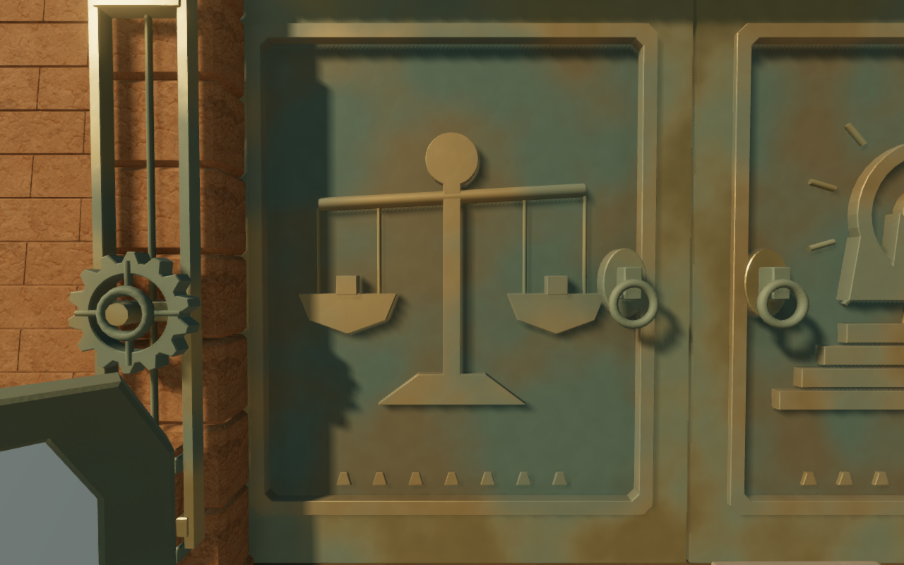
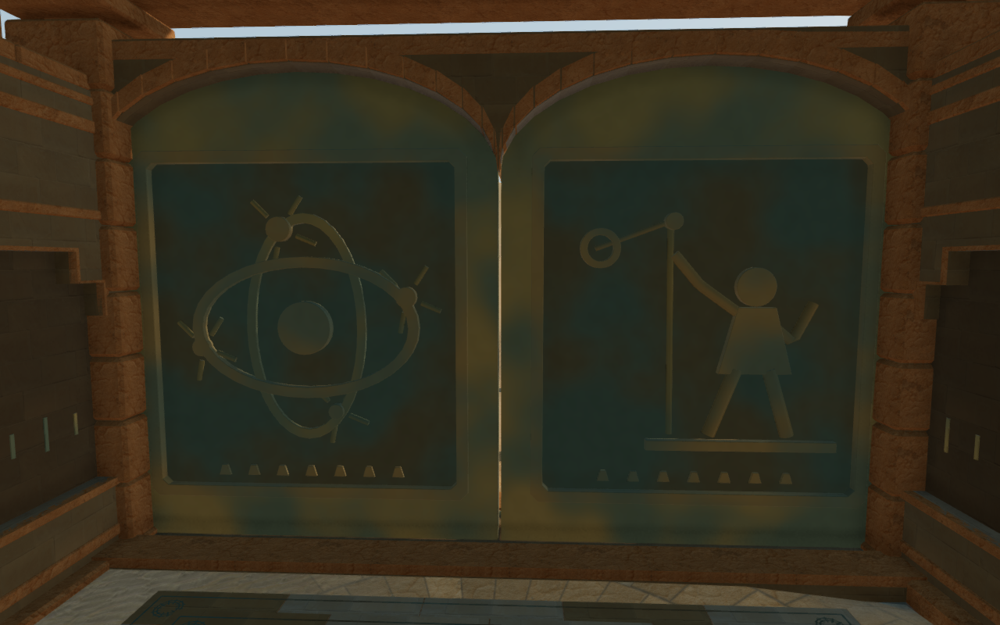

# Cast records on the Desert shutters

The eighteen Desert shutter leaves previously repeated narrow bronze plates
and straps on their fronts, with bare mottled backs. Recessed cast records now
accompany all nine courts. Scales and a crowned sun introduce the balance hall;
lotuses and a bird mark the dawn; waterworks, a light filter, an astronomer,
a hauling frame, a light well, relay towers and a funerary barque give the
subsequent entrances their own scenes. Both sides carry the records.

These direct High captures share the prepared camera, player coordinates and
scene time at 1280 × 800, with the explorer hidden. The comparison includes
nine full fronts, nine backs and six closer leaf views before and after the
revision. Foreground reflectors obscure parts of several fronts. The shaded
interior faces remain darker; the first chamber also retains its existing
objective marker. These views do not establish complete foreground composition
or all moving-camera directions.

The fields have sealed backing and bevelled cast rims. Rounded ropes and
channels, incised masonry courses and vessel bands, feather marks and small
foundry strokes give the records physical depth. Cast bosses seat the retained
pull mounts against the recessed fields. The imagery accompanies the fiction;
it introduces no new combination, interaction or saved-state requirement.

The shaped shutter heads and their round or rectangular upper openings retain
their profiles. Moving camera prisms cover the revised front and rear reach;
the covered floor slot retains its stroke and support. Room, feature, sound
and court-plan records retain their baseline values.

The assembled leaves, including their retained fine handles, rise from 29,028
to 120,748 triangles, an increase of 91,720. Their rendered mesh batches rise
from 76 to 90. The new cast roots contribute 113,908 triangles in three shared
material batches per leaf; the fine handles remain separate. One additional
shared bronze material supplies the recess backing. This is an explicit
geometry and draw increase, not a measured consumer-device performance gain.
No external asset or dependency is added.

## Verification

The delivered-world observer records eighteen leaves and thirty-six decorated
faces, with 676 closed outward cast pieces, 207 recessed-face probes, 162 pull
support probes and 604 bonded scene elements. All recorded checks pass. The
regression repeats the face observations at five stroke positions and includes
filled-recess and missing-socket negative controls. Individual piece tags retain
closed-component verification after batching, including the joining fillets
whose shared edges make the old whole-batch manifold count unsuitable.

Aligned openings in the aqueduct record exposed unmatched triangulation joins
in the first draft. Splitting cap edges at their existing vertices closes those
joins while preserving the silhouette and total cap area. The original cap is
a failing control; removing a delivered triangle also fails the observer.
Rounded open strokes have complete end caps.

All 161 sound origins remain clear of the revised shutters and surrounds. Eighteen
prepared crossings use 1,278 controller updates, followed by thirty-six stopped
standing/crouching observations. None of the 1,731,420 character vertices
inspected against the shutter and portal meshes exceeds the 15 mm overlap
tolerance. These are assisted local crossings
and endpoint poses, rather than complete continuous-body acceptance.

All nine restored full optical circuits and eight miniature circuits align;
the assisted table walks complete 64 legs and 4,720 movement updates. Nine
normal follow-camera preset views, two intermediate shutter states and the
coastal replacement view are also reviewed. High and Balanced HDR inputs are
finite, shaders link and the recorded GL checks pass. Performance observations
check ordinary output rather than establish HDR acceptance.

Chapter replacement disposes all 57 tracked resources exactly once: 54 geometry
buffers and three shared materials. Gate and camera records are replaced, with
no cast shutters retained in the coastal chapter. Independent construction
comparisons preserve geometry/material fingerprints, camera counts and gate
sound records in the other seven themes.

All 131 selected tests across twenty relevant files, three CPU guard checks
and the production build pass. The build retains its existing chunk-size
advisory. All 458 runtime source hashes match the final development observations
and release build. Owned development helpers close under the shared
five-of-sixteen CPU allowance.

The production build passes native keyboard/High at 1280 × 800 and simulated
touch/Performance at 540 × 900. Both cases turn, reset and activate the dawn
circuit, retaining partial and completed progress through four complete-store
reload comparisons, except for last-played timestamps. Retreat movement covers
9.0 m and 9.6 m at full health. All eight release captures are reviewed; six
include diagram or pause overlays. The loaded JS/CSS names match the build,
the development hook is absent, and no application errors, unexpected warnings
or horizontal overflow are recorded. Owned release helpers close after checks.
The broader eight-world composition, continuous contact, interior lighting,
listening and consumer-device audit remains open. This local art pass does not
establish AAA graphics.
