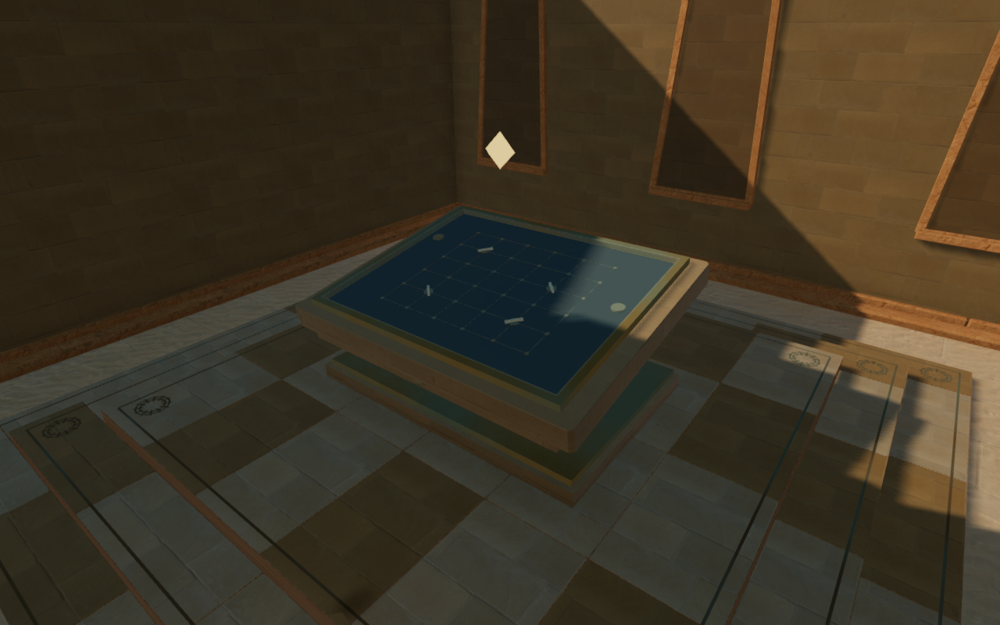
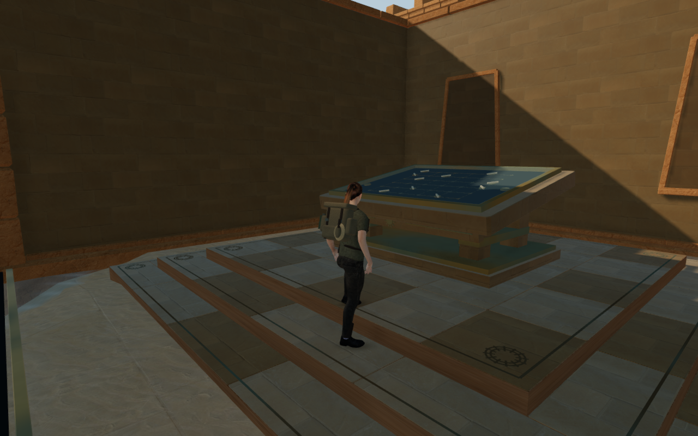
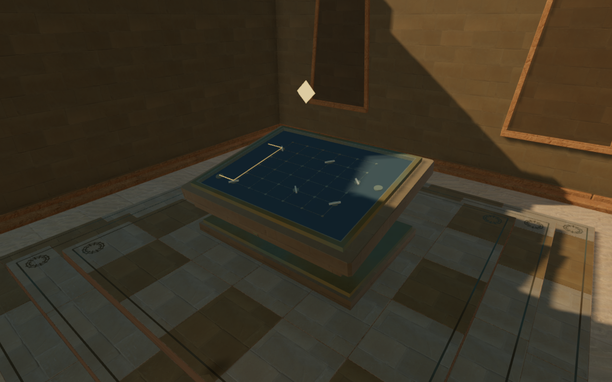
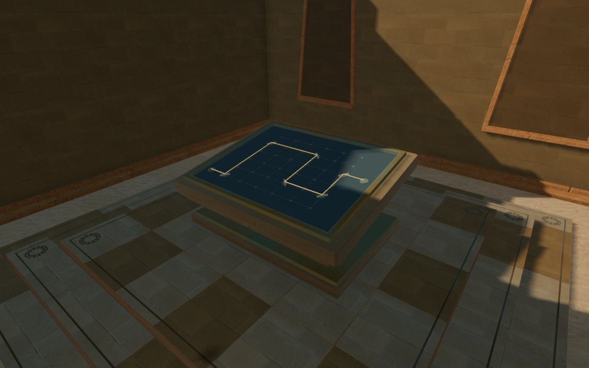
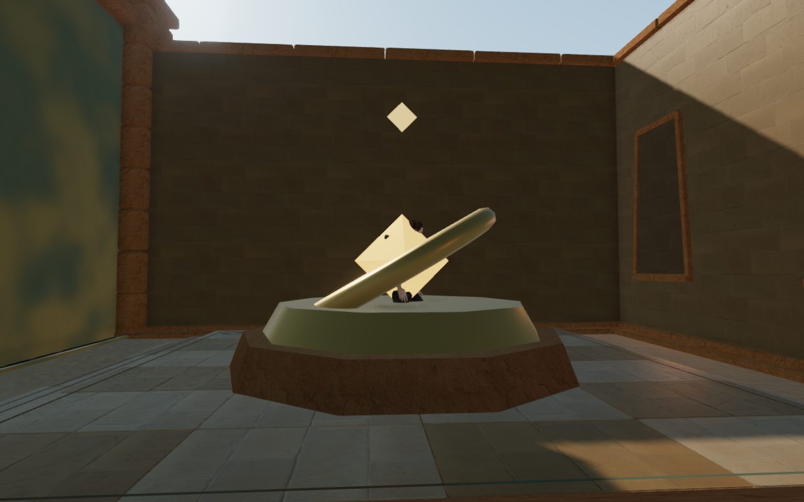
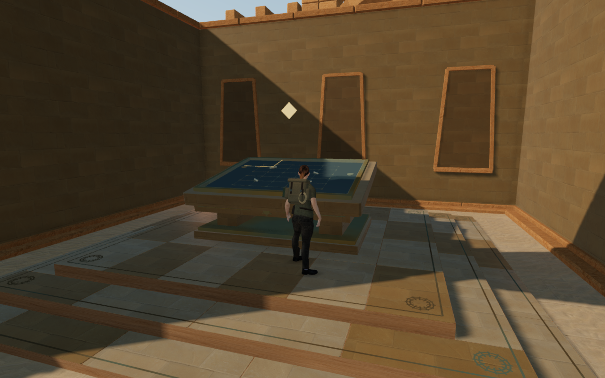

# Optical tables for the desert courts

Eight later Desert stands now use sandstone optical tables in place of the
repeated gold rings and floating crystals. Dawn piers, an aqueduct arcade,
a turned noon drum, stepped ephemeris courses, eastern pylons, an open light-well
trestle, a circuit colonnade and a sepulchral coffer give their supports different
silhouettes. Lower sloping decks carry coordinate grids beneath fitted glass
and bronze borders, with the city's sun mark on their front friezes.

Each miniature shows its chamber's real mirror arrangement. Its mirror marks
follow the delivered reflectors throughout a turn; its light strips use the
actual chamber beam segments, including interruptions and clipped ends.
Dormant courts show no invented beam. Partial saves restore the mirror values,
and completed sectors display their restored targets. The ordinary world
handwheels, receivers and diagram controls remain available.

The preceding eight stands had no body surfaces at their raised centres. A
prepared supported stance entered each one; the first recorded stance showed
the explorer's body crossing the stone, ring and crystal.

The two arrival figures use different camera and player positions because the
old stance is rejected by the new geometry. All figures are actual prepared
state renders, rather than complete campaign playthrough evidence.

The feet enter the paving at its 0.515 m raised construction datum. Exact
triangle kernels retain all 212 structural pieces and sloping support after
batching. Deck slopes are baked into those triangles, preserving upright
physics placements. The movement support footprint matches body clearance, retaining
vertical landings on the glass and smooth departures without a sideways
recovery. Separate convex camera envelopes retain the open spaces under the
tables; the turned drum uses its conservative outer hull. Glass covers enclose
the moving marks and light strips. Markers clear the decks, and mechanical hum
origins sit outside their fronts. Shared sandstone maps reuse the chapter's
existing texture objects. Unchanged displays retain their transforms.

All 102 selected tests pass. New coverage checks eight distinct physical
silhouettes, closed paired edges and positive volumes, 2,304 independent
render/physics ray pairs and 1,800 vertical support comparisons. It also covers
raised-floor contact, occupied arrivals, approaches and returns, drops and
front departures, partial-save restoration, interrupted mirror turns and
miniature segment endpoints. Existing regressions retain all nine solved
optical routes, 77 solar-control arrivals, counterweights, camera behavior,
Meridian consoles and sound behavior.

Eighteen final development views are reviewed: eight High front approaches,
three construction views, three Performance views, two optical-progress states,
and the supported landing and departure. All captured shaders link and HDR
buffers remain finite, with no application errors or warnings. Eight prepared
routes pass 64 legs over 4,720 movement frames around the tables and through
the opened gates. All nine completed-sector optical circuits remain lit and
all 77 solar controls retain their checked working positions. These assisted
checks do not establish a complete chapter playthrough or continuous campaign
motion acceptance.

All 118 tracked table resources dispose exactly once on an inspected chapter
replacement. Source counts match the preceding scene, no existing sound anchor
enters a new table, and the stone maps share the chapter's texture objects.
The production build passes with its existing chunk-size advisory. Checks use
the shared locked five-of-sixteen CPU allowance; each owned browser, worker
and temporary preview closes after its check.

Production keyboard/High and portrait touch/Performance cases pass from
prepared stage-1 field progress. Both exercise mirror turns, reset, alignment,
stage 1-to-2 advancement and two complete-save reload comparisons. A fifth
complete-save comparison passes for an older occupied arrival; only per-level
`lastPlayed` timestamps are excluded. That arrival moves 2.25 m clear of the
table, retains its 0.515 m floor and saved look, and permits a 9.0 m return with
health at 100. The keyboard and touch returns cover 9.0 m and 9.6 m, also with
health at 100. All eight release images are reviewed. Loaded assets match the
built bundles, the development interface is absent, and the keyboard/touch
cases keep horizontal page fit. No application errors or warnings occur.

The six 1280 × 800 High documentation exports preserve decoded source pixels
through lossless WebP conversion, without cropping or retouching. Baseline
runtime hashes match published `613e732`; the final scene and fresh arrival
share 398 hashes matching the revised application.

No external model, bitmap, recording or dependency is added. Existing
[asset attribution](asset-credits.md) remains applicable. Broader court
composition, continuous motion/contact, subjective listening quality and
consumer hardware performance remain open in the [world audit](visual-audit.md).
The final departure also shows a broad near-black strip at an opened court
threshold, recorded there for mesh, material and floor-contact investigation.
