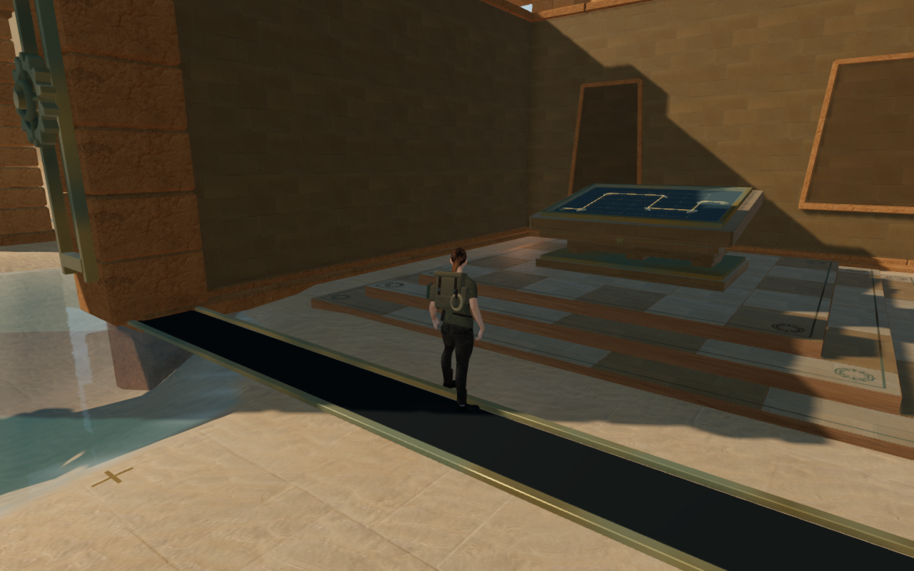
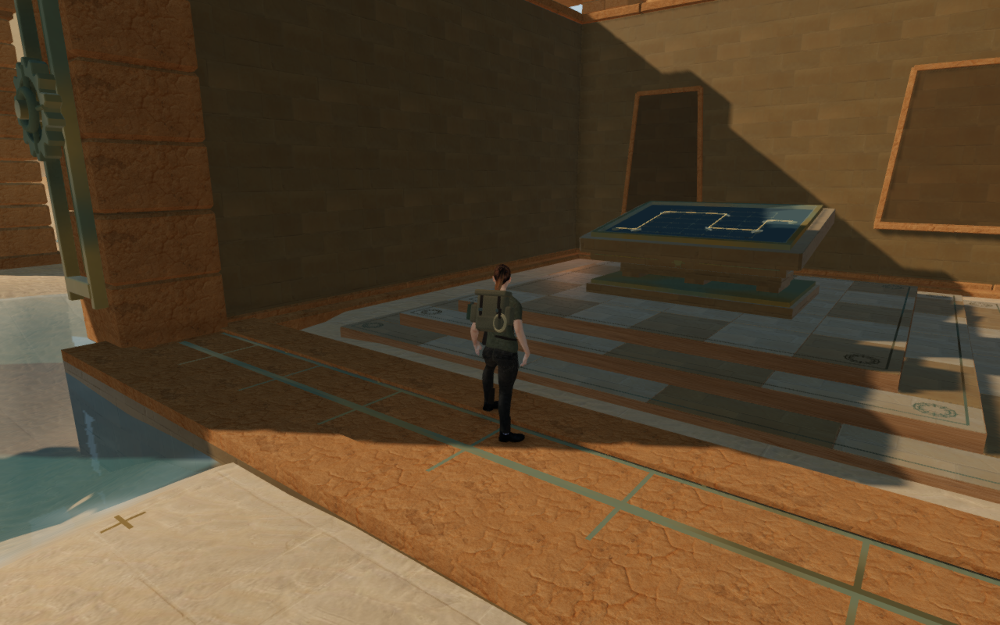
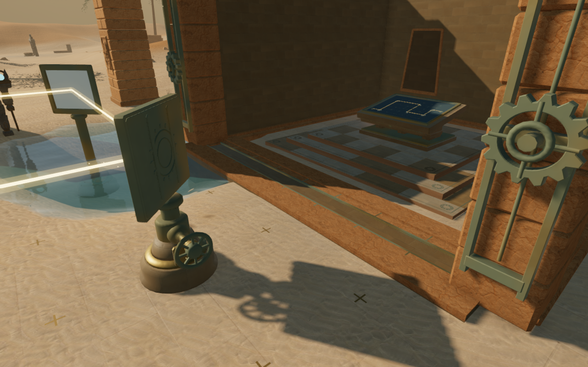
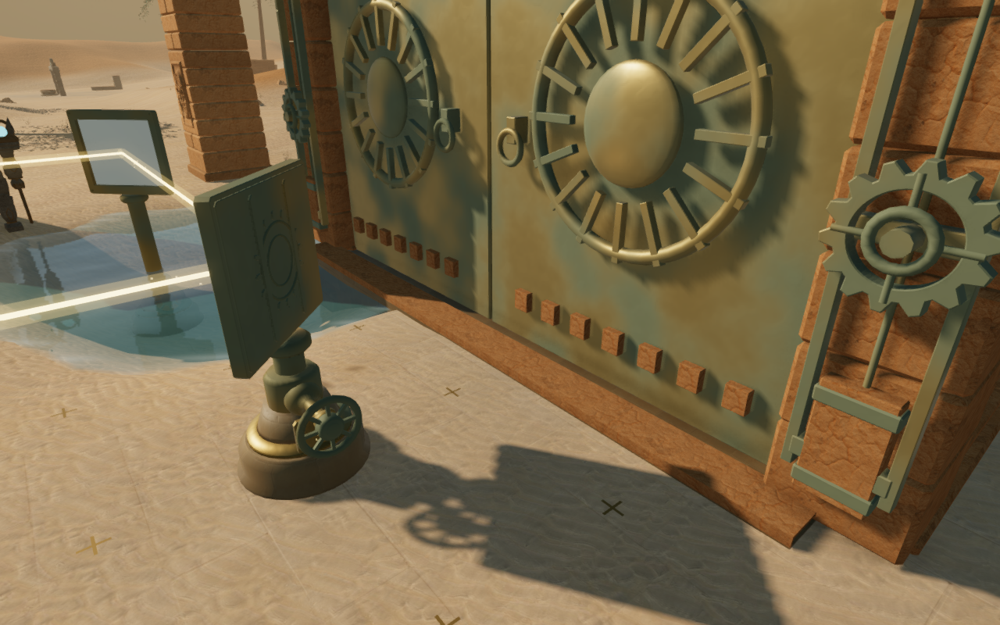
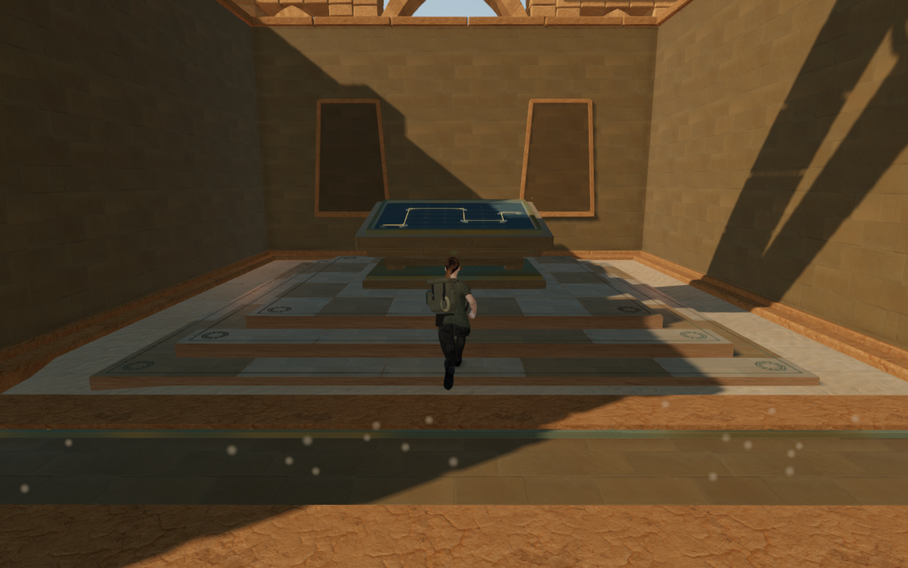

# Sliding thresholds for the desert courts

Nine Desert shutters now descend into fitted sandstone beds. Once the bronze
leaves have sunk below the crossing, two framed stone covers slide together
over their slot. The reverse sequence retracts the covers before raising the
shutter. Different numbers of flush stone panels follow the courts' existing
bronze and sandstone palette.

The preceding strip was an authored dark slot mesh. Forty pixel-ray observations
identified its material and gate owner. Its thin top sat about 47 mm above the ground, but the centre of each
of the nine slots still supplied only soil support. The revised bed has a buried
foundation across its full 12.8 × 2.65 m footprint. Two 12.45 m framed covers
provide a 1.3125 m wide crossing; their tops sit 0.10 m above the gate datum.
The coping is 0.175 m high. The covers extend beneath the coping's inner lips,
and their parked positions clear the delivered bronze relief and storage ribs.

The first 84 percent of the existing opening parameter lowers the shutter;
the remaining 16 percent closes the covers. Physical bounds and camera surfaces
follow the actual cover translation. The coping, bearing ribs and foundation
retain their individual collision pieces after material batching. Rendered
cover edges meet at the same exact centre seam used by point support.
The older floor-slot builders in other chapters are outside this change.

Older soil saves on the new shallow crossing rise onto its real support before
the generic arrival search. Their horizontal position and saved look remain
intact. Earned raised-floor saves retain their height.

All 139 selected tests pass. New threshold checks cover three outward, closed
slab meshes, 3,618 opening and reverse poses across all nine gates, 693 independent
render/support and camera probes, 54 terrain walking/jump legs and both older
soil and earned-height arrivals. A deliberately premature closure intersects
the delivered leaf's bounds, providing a negative control for the motion
separation check. Existing regressions retain all 69 chapter gates, the Desert mirror
controls and counterweight routes, Meridian thresholds, camera behavior,
water sound behavior and audio.

Twenty revised development views are reviewed: nine High front approaches,
three Performance approaches, four construction states, the matched departure
and three controller-crossing states. Their shaders link and HDR buffers remain
finite, with no application errors or warnings. Fourteen posed body checks
through the opening inspect 1,346,660 records against the delivered shutter and
new floor; none exceed the observer's 15 mm overlap tolerance. Eighteen actual
controller bank approaches reach clear, grounded landings with health at 100.
Five start in 0.64–0.76 m wading water; these cases do not cover deep swimming.

All 161 environmental sound origins remain outside the new construction.
Across 9,945 footprint samples, foundation bottoms stay at least 0.18 m below
the sampled terrain. All 45 tracked threshold geometries dispose exactly once
on an inspected chapter replacement. Existing material and texture resources
are reused. The build passes with its existing chunk-size advisory. Checks use
the shared locked five-of-sixteen CPU allowance, at most two test workers and
one browser at a time; owned workers, browsers and previews close afterward.

The release passes keyboard/High and portrait touch/Performance checks from
prepared stage-3 progress, including older soil arrivals on the new crossing.
Both preserve the recorded position and look, save the real 0.10 m support
height and permit local movement with health at 100. The keyboard crossing
covers 4.20 m and the touch return 3.87 m. Five complete-save reload comparisons
pass, excluding only per-level `lastPlayed` timestamps. The fifth retains a
separate earned 0.515 m floor and saved look. Loaded assets match the built
bundles, the development interface is absent, and both page sizes retain
horizontal fit. No application errors or warnings occur. Guards are prepared
as defeated to isolate these floor and persistence checks.

The six 1280 × 800 High documentation figures preserve decoded source pixels
through lossless WebP conversion, without cropping or retouching. The first two
share the recorded camera. The revised explorer stands on the new support;
inspection cameras and prepared progress vary for the other figures. Baseline
runtime hashes match published `de0c00d`; revised hashes match the new source.
These assisted checks do not establish a full campaign playthrough, continuous
body contact across the world, subjective audio acceptance or consumer hardware
performance. Broader court composition remains open in the
[visual audit](visual-audit.md). No external model, bitmap, recording or
dependency is added; existing [asset attribution](asset-credits.md) applies.
