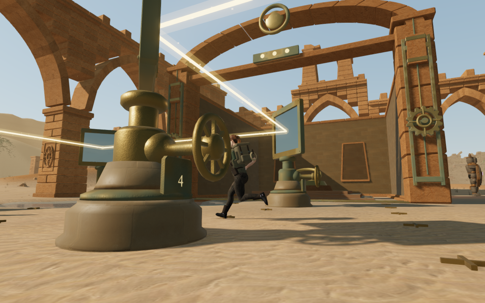
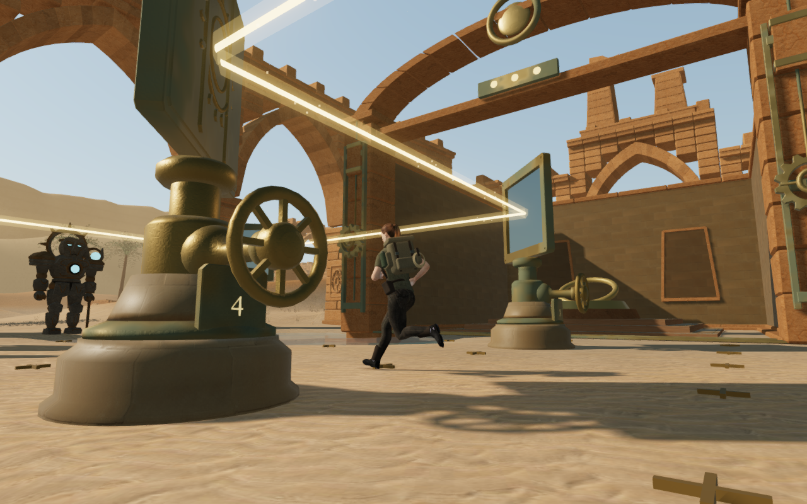
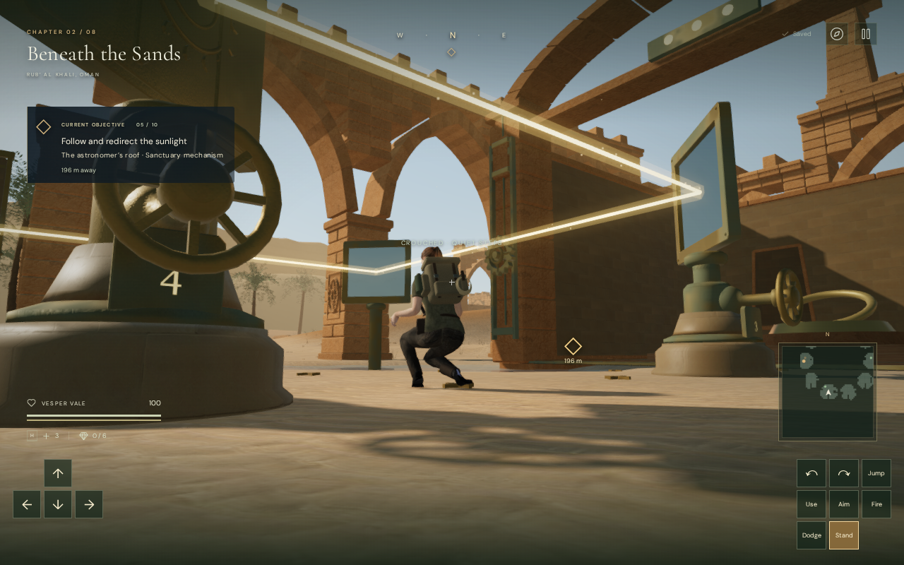
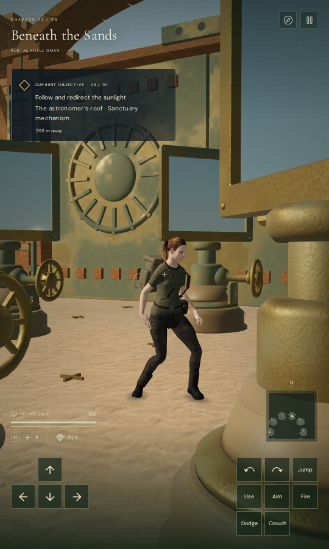

# Clear views beside solar handwheels

The desert walking camera now includes the solar handwheel rims, spokes, hubs
and connecting castings when choosing a clear view of the explorer. A moving
approach could previously leave clothing behind a wheel even though all of the
camera's joint probes reported clear lines. The camera now sees the omitted
metal and uses its existing nearby-view recovery.

| Omitted wheel bounds                                                                                | Revised wheel bounds                                                                                      |
| --------------------------------------------------------------------------------------------------- | --------------------------------------------------------------------------------------------------------- |
|  |  |

These are assisted browser captures at the same update in the same prepared
walking sequence. The control omits the newly registered wheel and mounting
bounds from the current camera index; it does not replace the whole runtime
with an earlier game build. The explorer pose, world geometry, puzzle state,
input yaw and pitch stay the same. Combat is not stepped.

## Metal and open spaces

Each of the 68 wheels has twelve short tangential rim bounds, four spoke bounds
and a rounded hub bound. The cast housing and horizontal axle also have rounded
bounds. Wheel bounds follow the actual turning parent. Their conservative
clearance encloses the metal without filling the entire circular opening.
Point rays between the spokes remain clear in the delivered geometry and camera
index after four tested turns; rim and hub controls remain blocked.

The temporary rim meshes only supply bounds during construction. They are
removed and their geometries disposed immediately. No new rendered geometry,
material, texture, sound, dependency or physical movement obstacle is added.
The existing body probes, swept camera arm and nearby recovery select the view;
input look and saved player positions remain under the player's control.

A release reload also exposed a saved-look defect: choosing a safe arrival
orbit changed the stored yaw by 30 degrees. Arrival now retains validated saved
yaw and pitch, keeping the orbit offset in the existing camera recovery state.
A delivered-solar regression reproduces the preceding yaw change and verifies
three repeated complete-store saves with exact input angles, clear full camera
arms and a separate detour. Fresh arrivals can still choose an initial heading.

## Independent observation

The [posed-surface observer](../scripts/inspect-explorer-camera-browser.js)
checks actual clothing and equipment triangles against opaque solar, arcade
and forecourt meshes. It includes the moving metal wheels at their delivered
transforms, rather than excluding animated fittings. It does not use the
controller's joint probes as its occlusion result.

Inspection preparation refreshes scene visibility before its initial camera
query, then updates presentation during each normal controller step. The
earlier forced court captures could query a solar root while it was still
hidden by its preceding distance state, then enable it for the screenshot.
Those views were not equivalent to a continuous live approach. The corrected
walking check still exposes the separate missing-wheel obstruction addressed
here.

Three legal 3 m approaches reach the previously inspected positions in courts
four, seven and nine. Each sequence has thirty walking updates followed by
standing and crouching. The omitted-bound control records 20 blocked surfaces
out of 7,906 body hits across its 45 sampled states. The revised index has zero
blocked or invalid surfaces out of 7,852 body hits across the corresponding 45
states. The recorded walking view falls from 20 of 343 blocked samples to zero.
Six independent geometry rays also identify the wheel as the foreground metal;
the regression verifies that omitting its moving bounds misses all six rays.

Intermediate snapshots use a 16 by 24 sampling grid; arrival, settled standing
and settled crouching use 32 by 48. All eighteen comparison captures have linked
shaders, finite HDR output, legal healthy grounded explorers and legal cameras.
All eighteen comparison captures are reviewed.

The controller still applies immediate inward corrections at solid contact.
The largest revised per-update camera movement in these approaches is 0.454 m;
the preceding index reaches 0.436 m in the other two courts. This repair does
not certify smooth motion through every instrument arrangement. Wider contact
continuity remains under review.

The subsequent [camera contact pass](solar-camera-contact.md) reduces the
recorded corrections with an earlier, gentler detour and terrain-conforming
floor marks. Its denser comparison retains the full current wheel index in both
modes. The movement measurements above remain the evidence for this earlier
wheel-bound milestone.

## Release checks and scope

The release-build keyboard/High and CDP touch/Low cases exercise movement,
crouching, looking, jumping, map access and two complete-store reloads each.
They move 3.300 m and 3.900 m and finish with health 100 on the ground. Both
retain the imported yaw/pitch exactly, and the repeated stores ignore only play
timestamps. Fetched scripts and styles match the current build, its development
hook is absent, and no failed responses or application errors or warnings occur.
All fourteen current native captures are reviewed. These use prepared progress;
the touch viewport is 540 by 900, rather than a physical-device performance test.

| Release keyboard / High                                                                         | Release touch / Low                                                                      |
| ----------------------------------------------------------------------------------------------- | ---------------------------------------------------------------------------------------- |
|  |  |

All 185 selected regressions across 21 files pass with one test worker.
They cover camera behavior, the delivered explorer, solar controls, crown
support, field contact, chapter startup, the other machinery themes, campaign
storage and audio. The 77-control arrival test also passes after refreshing
scene visibility at every prepared start. The production build passes with its
existing large-chunk advisory. Eight additional survey regressions pass. Both
authored sight lines remain clear against the current arcade, solar and gate
index with the introductory gates closed and with completed progress; this is
four checks at the two fixed survey origins, not an unrestricted sight survey.

The four published images are actual game captures converted losslessly to
WebP, with decoded RGBA pixels and dimensions checked against the PNG sources.
Verification uses the shared nine-of-sixteen CPU set, a single test worker and
one browser at a time. Temporary browsers, workers and preview servers are
closed after their checks.

The geometric observer samples the stated opaque constructions; it does not
reproduce every raster pixel, alpha mask, actor, instanced plant or camera angle.
Prepared progress and native input checks do not establish a human playthrough.
The complete eight-chapter visual acceptance target, broader world composition,
contact continuity, listening review and consumer-device performance remain open.
