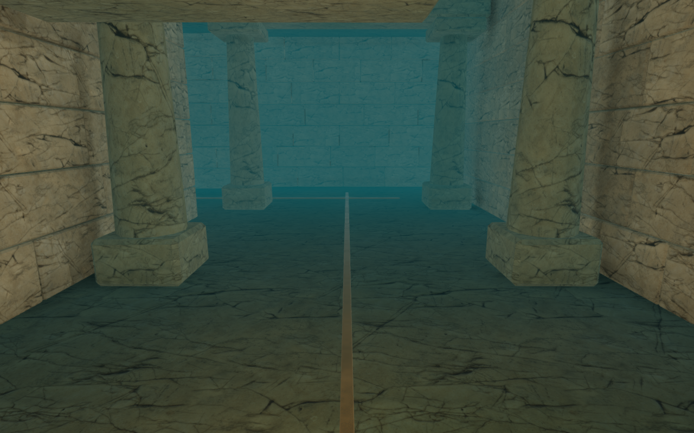
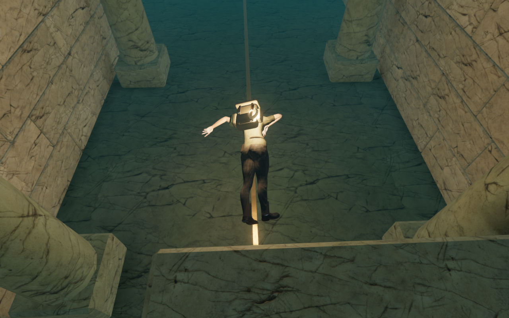
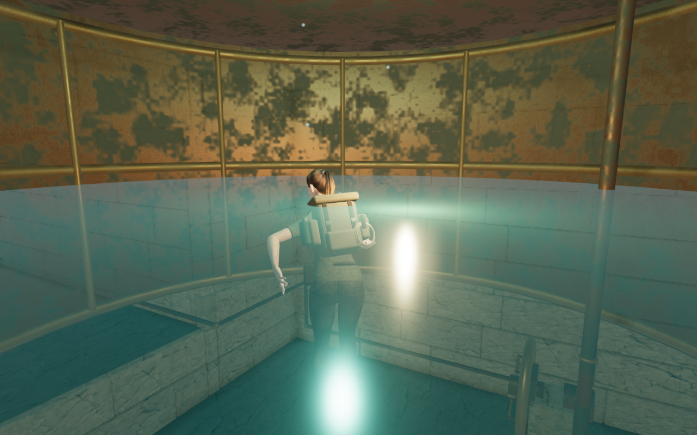
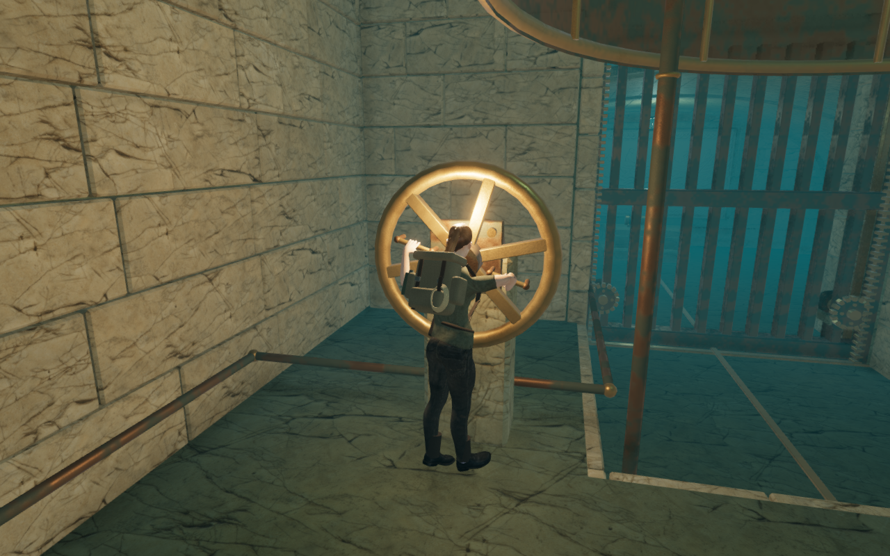
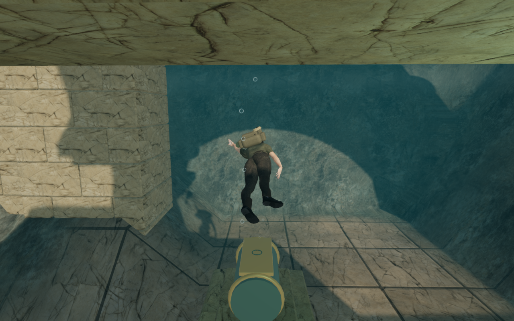
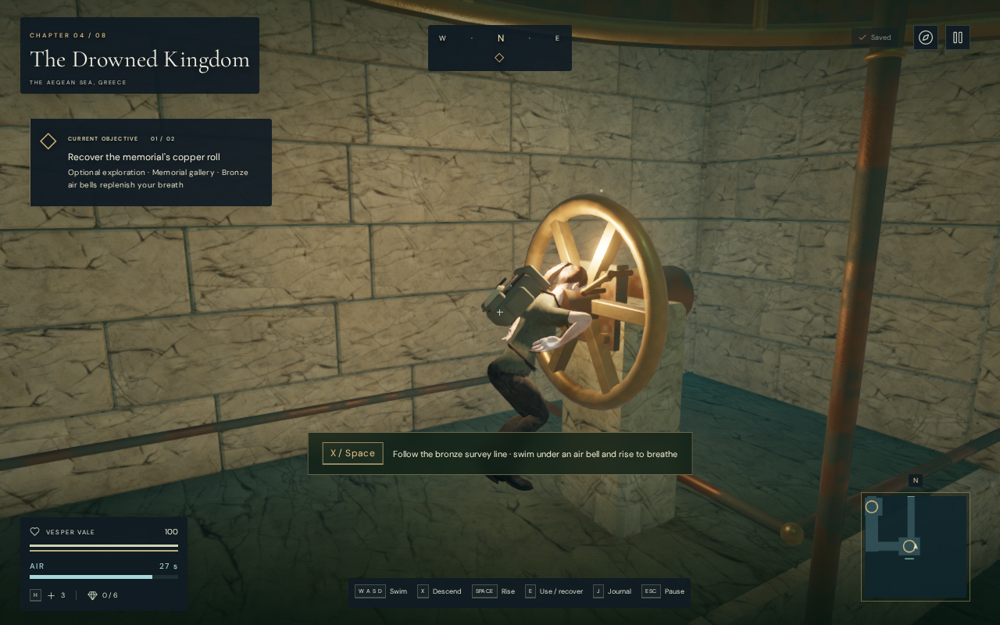
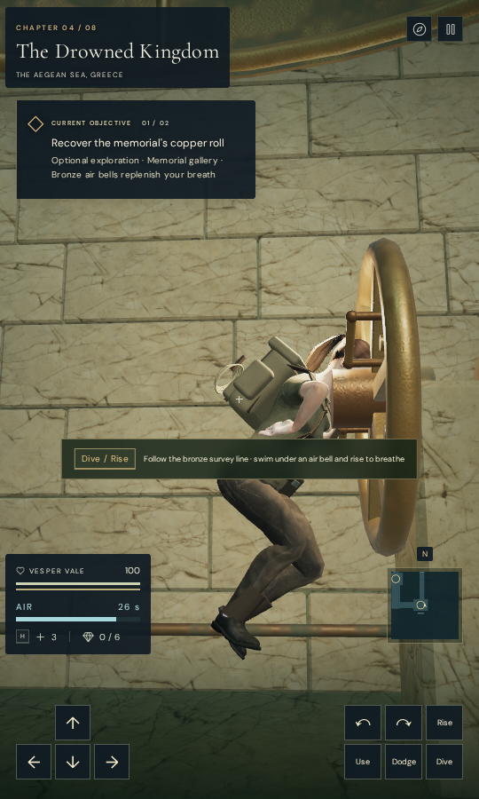

# Submerged explorer framing

The memorial gallery's camera could retract into the character fade range at
the colonnade descent and emergency wheel. Confined swimming now checks the
posed explorer against the gallery's physical solids, hollow bronze bells and
wheel, then follows a clear neighboring view. The recorded gallery loop keeps
the explorer fully opaque throughout.

| Earlier colonnade descent | Revised descent |
| --- | --- |
|  |  |

The camera sampler refreshes attached skin bindings before reading animated
arm and hand positions. Previously, movement between draws could leave those
CPU samples displaced by an extra player translation. Joint margins now include
vertical screen edges while swimming, alongside actual arm and hand extrema.
Dry lower-body and terrain framing retain their existing samples.

Finite camera panels follow the actual gallery shell, including its open well
aperture. They reserve lens clearance without filling the hollow interior.
When a rising well view would cross the gallery roof, the lens first leaves
through that aperture, then rises outside it. The temporary plan does not alter
player movement or stored look angles.

Floating swimmers retain a torso-height focus inside the air bells. A separate
blend restores the standing focus when leaving water, while the dive-distance
transition remains smooth. Clear, opaque views may extend toward a comfortable
endpoint without an exhaustive search for another angle. Surface buoyancy does
not forecast continued ascent into the cap.

The wheel view moves toward its working side during the brace, before the
releasing head moves behind the rim. Naturally covered contact hands do not
trigger avoidance of the wheel's conservative envelope; head, torso, legs,
stand and world checks remain. Ordinary views resume when clear. The entrance
guide lamp now engages a side pier instead of sitting on the return view's
central axis, and its actual bounds reserve camera clearance.

| Working-side wheel view | Return to the well |
| --- | --- |
|  |  |

## Verification

All 108 selected checks pass across fifteen camera, explorer, gallery, swimming,
water-sound and campaign test files. Three CPU-guard checks and the production
build pass. The build retains its existing large-bundle advisory.

The ten gallery-camera cases cover live gate bounds, hollow bell sight,
delivered shell panels and their aperture, two posed explorer squeezes, skin
translation between draws, three well-rise look angles, wheel grip/release,
bell surfacing and the lamp's mounting and clearance. The translated-skin
control reproduces the stale-binding error before verifying the correction.
Independent rays use delivered shell triangles and posed character surfaces.

The well-rise cases retain full opacity and legal lens positions at pitches
0.13, -0.4 and 0.55. Maximum measured turn is 0.05 radians per update and lens
movement stays below 0.225 m. The upward case follows both aperture and rise
stages before releasing its plan. The actual wheel operation completes hand
release and gate opening with a maximum 0.05-radian turn and 0.191 m lens step.
Player position and look remain unchanged in the static squeeze checks.

The bell regression counts work instead of imposing a hardware time limit:
its maximum is 1,655 scenery queries per update, below the 5,000-query guard.
A rejected clear-extension implementation made over 70,000 queries in the
corresponding diagnostic. In a separate full-world 140-update bell check, the
largest instrumented camera update falls from about 3.14 seconds to 98 ms
under the shared CPU allowance. These diagnostic timings do not establish
consumer frame rates or eliminate other route hitches.

A continuous assisted controller loop covers 185.88 m and 4,496 updates through
all nine gallery regions. It breathes in both bells, operates the wheel, opens
both gates, recovers the memorial and returns to the well surface at health
100. Minimum remaining air is 15.48 seconds. Every recorded body and lens
query is legal; minimum opacity is 1 and minimum target-to-lens arm is 2.2103 m.
The route uses supplied waypoints from the well and omits enemy updates.

Independent posed-surface grids at the descent, wheel turn and opened wheel
find zero blockers among 114, 166 and 203 body rays respectively. Those stopped
observations do not establish zero occlusion throughout movement. All 41 High
route captures, two preset views and two anchor observer views are reviewed.
High, Medium and Low link their shaders and retain finite inputs with no GL
error. Chapter replacement releases all 14 tracked gallery draw resources
exactly once and leaves no old gallery sound source.

Production keyboard/High at 1280 × 800 and simulated portrait touch/Low at
540 × 900 pass diving, movement, interrupted wheel operation and gate opening.
Four full-store reload comparisons preserve unopened/opened progress, health,
active time and settings, with only visit timestamps and the documented exact
return-to-bell position allowed to differ. All six release images are reviewed.
These use a prepared save, muted audio and desktop Chromium; touch performs
diving, movement and Use, with keyboard pause in both cases.

| Keyboard production view | Portrait touch production view |
| --- | --- |
|  |  |

Both cases load the exact built JS/CSS assets, with no development hook,
horizontal overflow, failed resource, page error or unexpected console warning:
`index-aqZUSzF0.js`, `game-RzX8s2jf.js`, `three-CsvFtkjV.js` and
`index-B8Rg8Jto.css`. Browser contexts, Chromium and temporary Vite servers
close normally after the checks.

## Remaining work

The full route still records a 1.4845-second camera update while moving away
from the wheel and a 0.10746-radian turn near the entrance passage. These remain
open as VA-254; the focused bell and release improvements do not fix every
camera search or turn. An attempted additional view-retention change failed
the independent static-wheel observer and was rejected.
The opened-wheel portrait view also leaves part of the head behind the rim;
the landscape observer results do not establish portrait framing acceptance.

The initial and final exterior well-surface captures do not clearly show the
swimmer despite opacity 1. Their surface pose, framing and water visibility
need investigation in VA-255. Full opacity alone does not prove a readable
character in every rendered view.

Large flat floors and ceilings, boxed collapse forms, coarse bell patina,
repeated architecture, sparse surroundings and wider campaign contact remain
under review. Existing distance falloff and quiet adaptive music remain in
place; these muted checks do not establish subjective listening quality,
physical-phone performance, chapter pacing or completion of the full-game
polish target.

Existing [asset attribution](asset-credits.md) applies. No external model,
texture, recording, score or dependency is added. Documentation images are
complete game captures converted losslessly, without retouching. Verification
uses the locked shared five-of-sixteen CPU allowance, lower priority, at most
two test workers and one browser, with staging kept inside the ignored local
directory. Owned browser and server helpers close after their checks.
