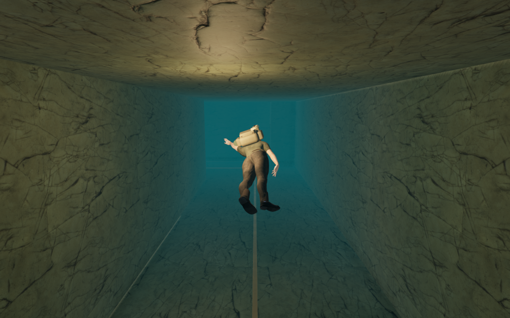
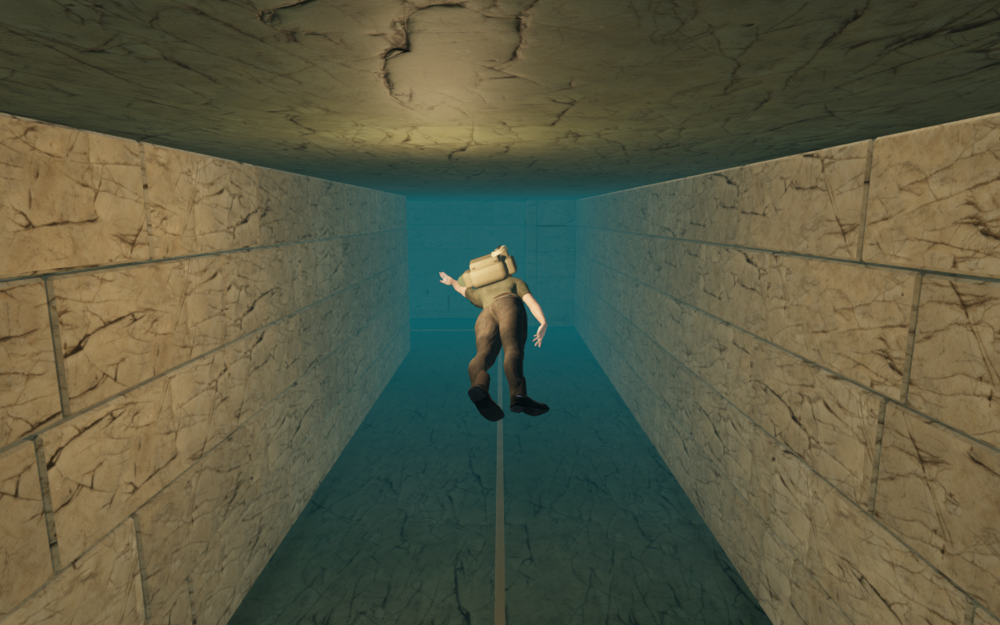
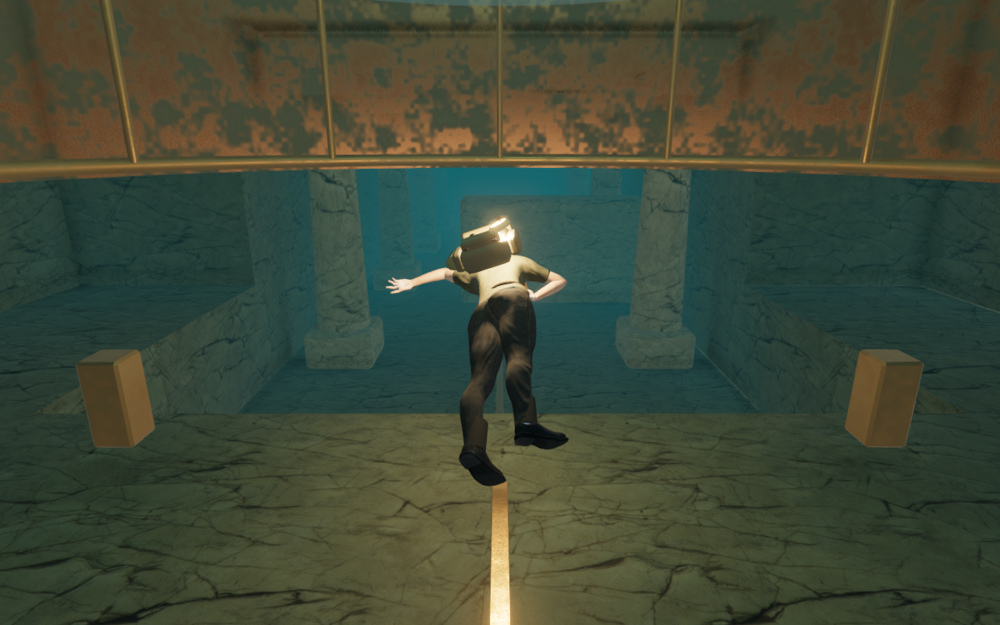
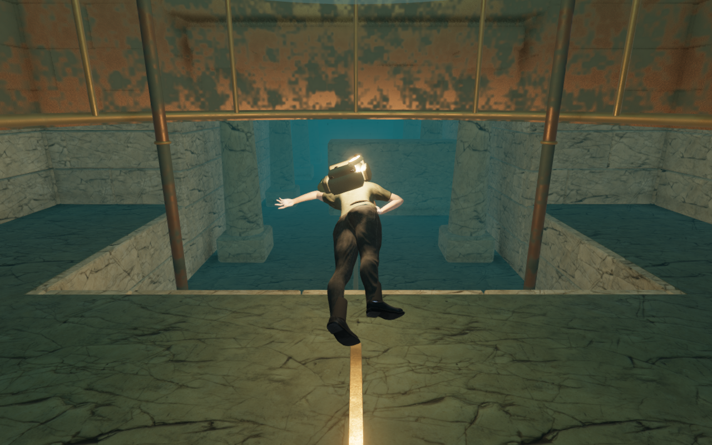
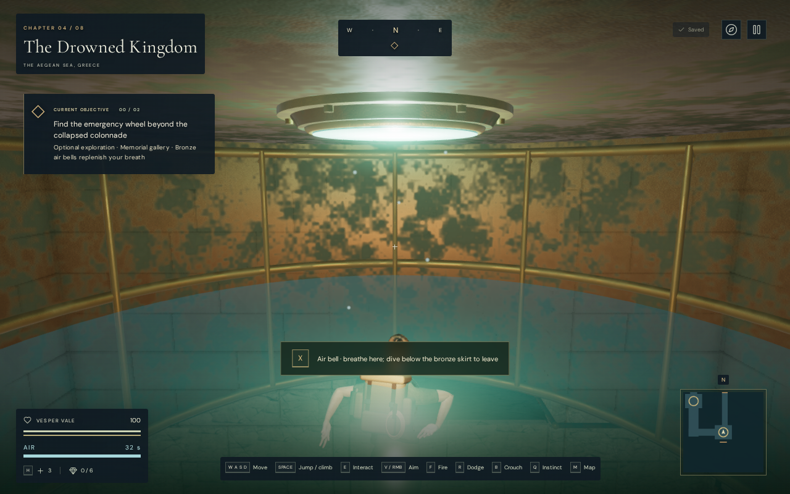
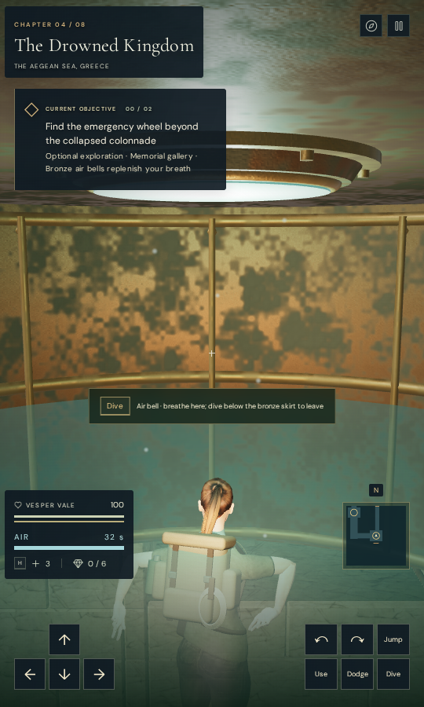
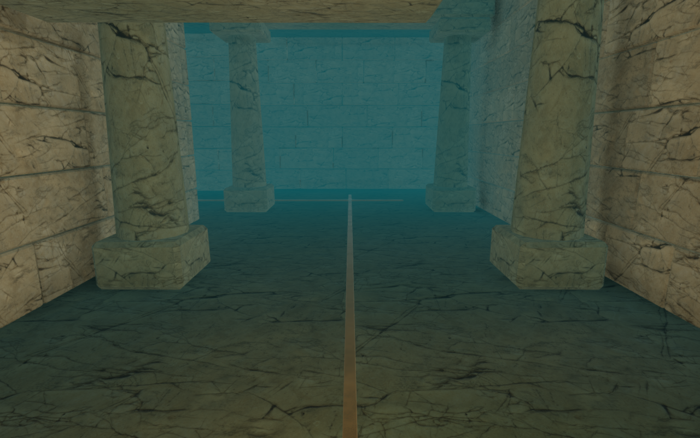

# Submerged gallery stonework

The memorial route's long passages previously used one continuous cracked-stone
finish, and four bronze fixtures floated beneath its air bells. Coursed
limestone now follows the actual passage walls, with bonded corners and narrow
mortar beds. Four continuous anchor ties connect grounded shoes to the bronze
bell caps.

| Published entrance passage | Revised entrance passage |
| --- | --- |
|  |  |

The facing follows 47 wall runs, including the steps between rooms. Thirty-six
bonded corners close perpendicular courses without overlapping their bed faces.
The retained shell backs the mortar joints. Chipped stones have hard normals
fitted to their delivered triangles and use the existing credited stone maps
with varied tint and texture offsets.

| Published bell approach | Revised bell approach |
| --- | --- |
|  |  |

Each shoe uses the interior floor at its actual location, including the lower
floor where room volumes meet. Rods, collars and cap flanges overlap; the
flanges engage the existing bell cap. The ties sit away from both principal
swim axes and the emergency-wheel approach. Each visible anchor part has its
own collision bounds, keeping the narrow rod clear of an invisible shoe-width
column. Facing collision uses one conservative bound per continuous run or
corner; the body radius spans the small mortar joints.

## Verification

- All 38 selected tests pass across seven files, including the complete
  gallery route, both gates, wheel operation/release, air recovery, saved
  anchors, terrain/ocean cuts, aperture visibility, rendered swimmer clearance,
  water sound and immersion. Three CPU-budget checks and the production build
  pass. The build retains its existing bundle-size advisory.
- The delivered, batched stonework contains 1,483 closed pieces. Independent
  face checks cover positive area, outward winding, lighting-normal agreement,
  finite coordinates and noncollapsed UVs. Every piece has balanced shared
  edges. Rays bracket the retained backing wall between actual stone faces,
  with more than 6 cm of stone on either side of a sampled engagement. Stone
  bounds do not intersect one another; an overlapping-bounds control is
  rejected.
- Four anchor checks follow the actual rendered shaft continuously from floor
  to cap. Rays find the delivered floor beneath every shoe and the existing
  bronze cap within every flange. Removing the shaft from the queried draw
  set exposes the break. Collision bounds retain the visible rod's narrow
  width.
- Construction comparison retains the gallery profile, terrain height array,
  water positions/metadata and initial saved progress. The original shell,
  retained stonework, gates, pinions, wheel and handles retain their geometry
  comparisons. All four gallery sound-source records are identical. This is
  a gallery comparison, rather than a complete-world geometry comparison.
- A continuous assisted controller loop covers 185.88 m and all nine interior
  regions. It breathes in both bells, operates the wheel, opens both gates,
  recovers the memorial and returns through the eastern passage to the well
  surface at health 100. Minimum remaining air is 15.48 seconds. Body and
  camera-space queries remain legal throughout the recorded updates. The
  check starts at the well with supplied waypoints and does not step enemy AI.
- All 41 High route views, two additional preset views and two anchor observer
  views are reviewed. High, Medium and Low produce linked shaders and finite
  inputs with no GL error. Low's direct draw is additionally checked in a
  temporary half-float target. The anchor inspections use a wider lens and
  hide the explorer while retaining a legal camera position.
- Chapter replacement releases all 14 tracked new draw resources exactly once:
  thirteen geometries and the facing material. The replacement world contains
  no old gallery or gallery sound sources. No new texture is allocated.

The gallery grows from 26 to 39 mesh objects and from 58,390 to 125,866 source
triangles. Attribute/index arrays grow from 7,012,796 to 16,736,700 bytes. These
counts include hidden scene objects and describe source work, rather than
submitted draw calls, measured GPU memory or device frame rates. The facing
shares one batched material; each anchor retains three material batches.

Native production keyboard/High at 1280 × 800 and simulated portrait
touch/Low at 540 × 900 dive, swim to the emergency wheel and open the gates.
Four reload comparisons retain the unopened/opened states, health 100,
recorded active time, settings and the rest of the stored data. Only visit
timestamps and the documented return-to-bell position differ from the saved
dive; the restored bell position is checked exactly against the initial anchor.
The touch case uses touch for diving, movement and Use, with keyboard pause
in both cases. These are desktop Chromium checks with a prepared save and
muted audio, rather than physical-phone or full-chapter playthroughs.

| Keyboard release from the air bell | Portrait touch release from the air bell |
| --- | --- |
|  |  |

All six release captures are reviewed. Loaded JS/CSS names match the current
build, with no development hook, horizontal overflow, failed asset, page error
or unexpected console warning. The release loads `index-BxttMUYB.js`,
`game-pLtR4QUd.js`, `three-CsvFtkjV.js` and `index-B8Rg8Jto.css`.

The four comparison images use the same prepared route viewpoints in the
preceding and revised builds; moving scenery can differ. All documentation
images are lossless conversions of actual browser captures, with decoded
pixels and dimensions checked. Existing [asset attribution](asset-credits.md)
applies. No external model, texture, recording, score or dependency is added.

## Remaining work

The subsequent [submerged camera revision](submerged-camera.md) repairs the
recorded underwater fade and wheel framing described below. It documents the
remaining motion and exterior surface-readability work separately. The following
observations retain the evidence from this stonework milestone.

The route review also records a pre-existing camera squeeze while descending
between the two colonnade obstructions. The lens can approach within about
1.06 m of the player's position and fade the explorer completely. It occurs in
both the preceding and revised builds; this stonework change preserves that
result. It is tracked as VA-253,
so legal camera positions do not establish continuous character visibility.
The native wheel checks also expose a squeezed view with the explorer hidden
when looking straight past the wheel stand. That view joins the camera audit;
its cause needs a matched investigation rather than an assumption that the
new facings caused it.

Ceiling/floor treatment, broad tunnel shapes, coarse bell patina and wider
chapter composition still need review. Distance falloff and the quiet adaptive
diving score remain in place; this pass does not establish subjective listening
quality. Full-world traversal, consumer-device acceptance and the full-game
polish target remain incomplete.

Verification uses the shared locked five-of-sixteen CPU allowance, lower
priority, at most two test workers and one browser. Temporary browser profiles,
captures, saves and reports stay in ignored workspace staging; helpers close
after their checks.
