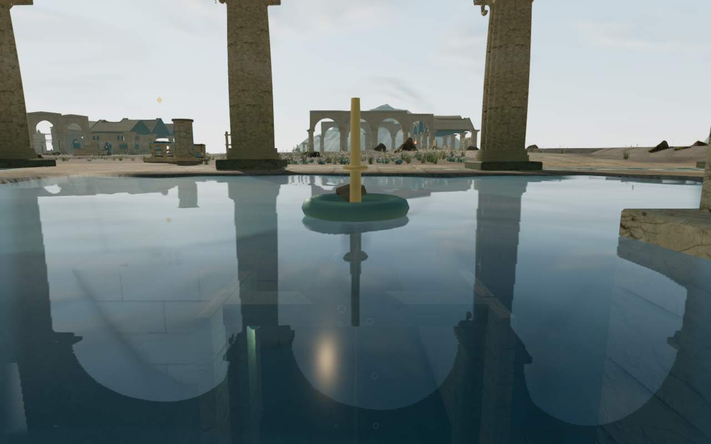
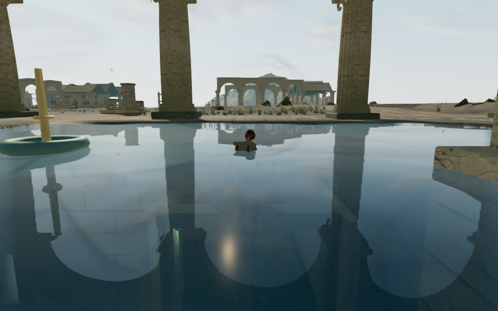
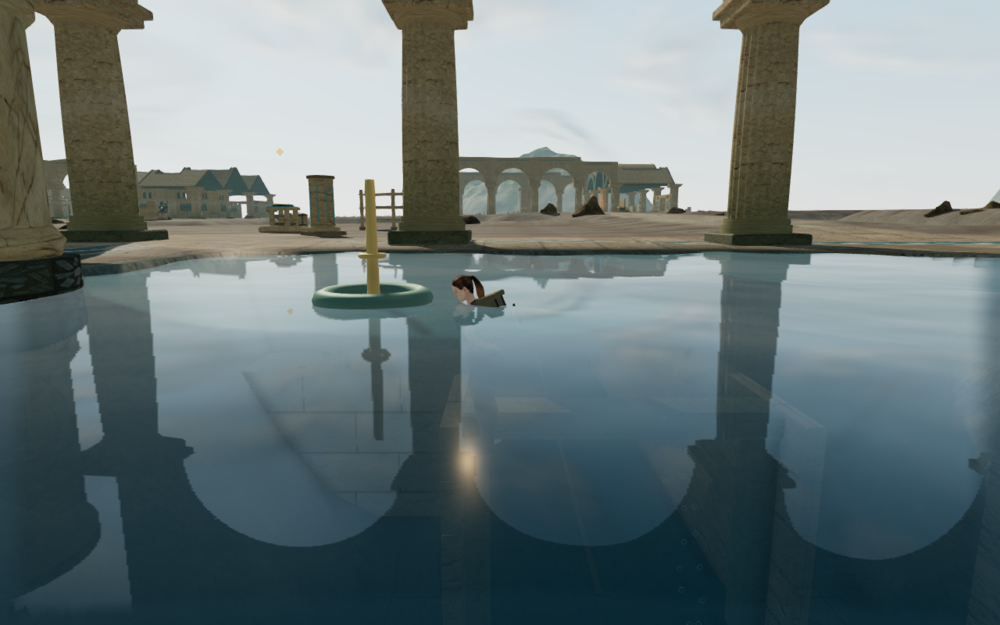
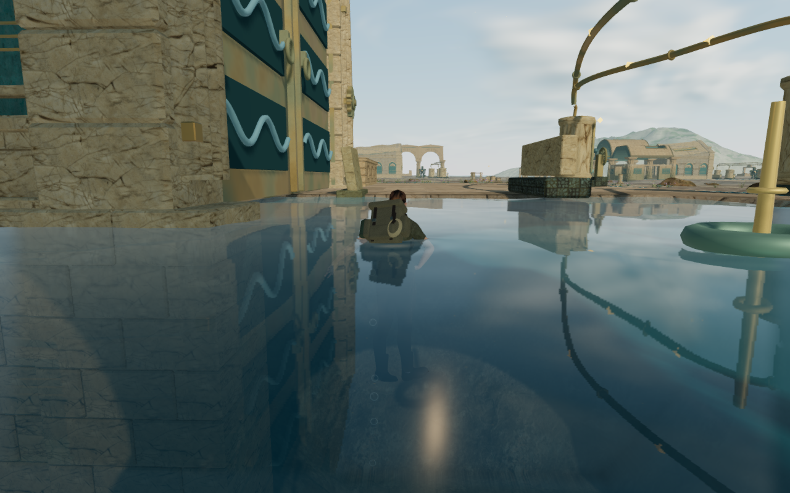
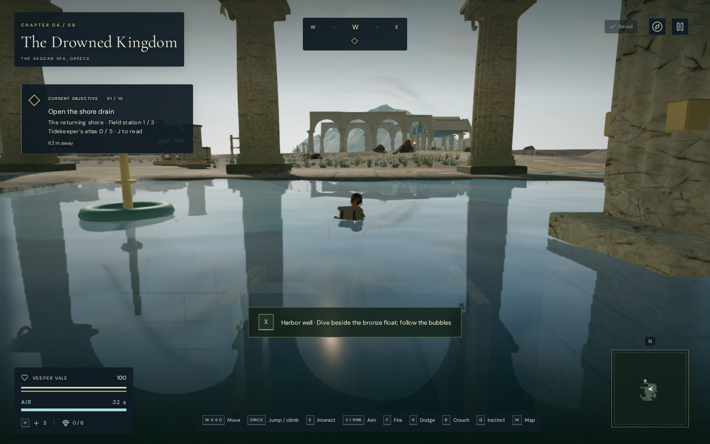
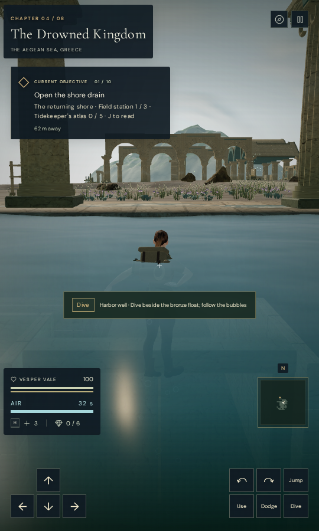

# Surface swimming and sounding floats

The exterior harbor-well views could hide the explorer behind a sounding float
while the resting face remained almost level with the water. Resting swimmers
now tread upright, and all five floats sit beside their wells' central dive
and bubble paths. Traveling and diving retain the prone stroke.

| Earlier surface view | Revised surface view |
| --- | --- |
|  |  |

The resting pose blends from the traveling stroke and limits its leg drop
against the actual bed height. Shallow pools retain a shorter stance. The
existing air-bell float also gains five centimetres of upper-body lift, keeping
the sampled face clear of wave crests. The water material, reflection rules,
camera fade threshold and swimming speed retain their existing behavior.

The five bronze floats retain their geometry, materials and distinct sounding
marks. Each moves three metres along its well, within the basin, leaving the
archive case and bubble source at their existing locations. The nearby hint
now directs the explorer to dive beside the float and follow the bubbles.

Finite circular body bounds reserve the ring and marked staff; camera
envelopes follow the delivered ring, collars and pole. Both follow bobbing and
drainage. A swimmer can dive beneath the structure, and collecting its archive
record hides the float and releases its bounds. An older save inside a float
can recover into nearby water, preserving depth and look while checking the
complete swim footprint against other scenery.

A separate reload defect also placed saved swimmers against submerged floor
furniture before restoring their water height. At the first archive bench it
moved the saved horizontal position by 1.5 m. Arrival now restores the water
surface before that ground search, then validates the swim footprint before
falling back to standing recovery. Earned arrivals above the water retain the
existing raised-platform handling. The save format remains compatible.

## Verification

All 130 selected tests pass across nineteen files, including camera framing,
gallery traversal, swimming, water sound, archive bubbles, saved arrivals and
the campaign. Three CPU-guard checks and the production build pass. The build
retains its existing large-bundle advisory.

The new surface tests inspect delivered, deformed character vertices across
four water depths, three bed slopes and twelve stroke phases. The lowest
sampled eye/upper-face point stays 9.57 cm above the water plane, beyond the
water shader's 5.1 cm maximum geometric wave amplitude. The lowest sampled
garment or sole remains at least 2.35 cm above the bed. Traveling and diving
recover their prone stroke.

All five floats retain a clear central surfacing and camera path. Independent
rays compare the rendered torus with its circular camera envelope, including
diagonal approaches that would expose a filled-box error. Physical and camera
bounds follow drainage and release after collection. Occupied-save recovery
finds a fitting nearby position and rejects a closed surrounding barrier.

Full and drained arrival cases cover all five wells. The original ground
search supplies a control that moves around the submerged bench; restoring
water first preserves horizontal position at the effective fluid surface.
Existing raised-arrival checks and all 21 cable routes across eight chapters
also pass.

The assisted memorial loop again covers 185.88 m and 4,496 updates at health
100, breathing in both bells, opening both gates, recovering the memorial and
returning to the well. Minimum remaining air is 15.48 seconds, opacity stays
at 1, and all body and lens queries remain legal. Independent stopped posed
surfaces have zero blockers among 114 descent, 163 wheel-turn and 203 opened
wheel rays. This uses supplied waypoints and omits enemy updates.

All 45 route/preset/anchor images and ten focused well images are reviewed.
The focused views include every well, an assisted surface approach through the
game controller, an occupied-save recovery, drainage, Medium and Low. Their measured upper-face
clearance exceeds 9.5 cm, with no sampled character vertex inside the floats'
conservative physical cylinders. The source of these rendered frame/pose and
float paths is unchanged by the subsequent startup-order correction.

Chapter replacement releases all 25 tracked float geometries and both shared
float materials exactly once. No old float or archive-bubble source remains.
The gallery's fourteen tracked draw resources also release once. Camera
metadata adds no rendered proxy mesh or new texture.

Current production keyboard/High at 1280 × 800 and simulated portrait touch/Low
at 540 × 900 start at the saved well centre, dive, restore full breath on
surfacing, and stop beside the float. Four complete-store reload comparisons
preserve position, look, settings, health 100, recorded time and progress; only
visit timestamps are excluded from equality. All eight release captures are
reviewed. Touch performs diving, rising and movement, with keyboard pause in
both cases. These are prepared saves in desktop Chromium with muted audio.

| Keyboard after surfacing | Portrait touch after surfacing |
| --- | --- |
|  |  |

Both cases load the current built assets: `index-q6XxgGzX.js`,
`game-D6GroPJ4.js`, `three-CsvFtkjV.js` and `index-B8Rg8Jto.css`. There is no
development hook, horizontal overflow, failed asset, page error or unexpected
console warning. Contexts, Chromium and temporary servers close normally.

## Remaining work

The gallery route still records a 1.4264-second camera update while leaving
the wheel and a 0.10746-radian turn near the entrance. VA-254 also retains the
previous portrait wheel-rim coverage observation. These fixes do not establish
smooth follow or unobstructed framing throughout every camera approach.

Large plain floors and ceilings, coarse bronze patina, repeated structures,
sparse surroundings and wider contact still need work. Subjective listening,
consumer-device performance, human chapter pacing and the full eight-chapter
polish target remain unverified. The existing distance-sensitive soundscape
and quiet adaptive music remain in place; these checks use muted audio.

Documentation images are complete game captures converted losslessly without
retouching. Existing [asset attribution](asset-credits.md) applies; no external
model, bitmap, recording, score or dependency is added. Verification uses the
locked shared five-of-sixteen CPU allowance, lower priority, no more than two
test workers and one browser. Staging remains inside the ignored local folder,
and owned helpers close after their checks.
