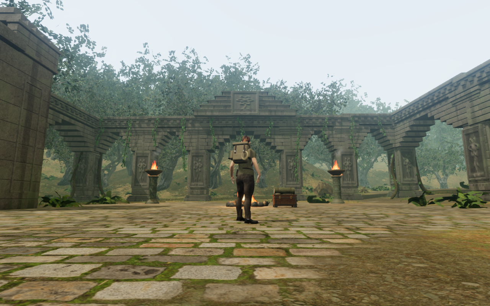
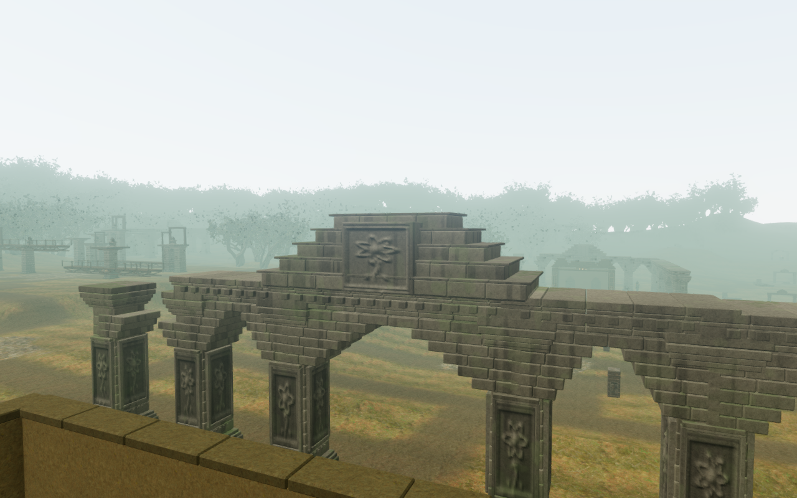
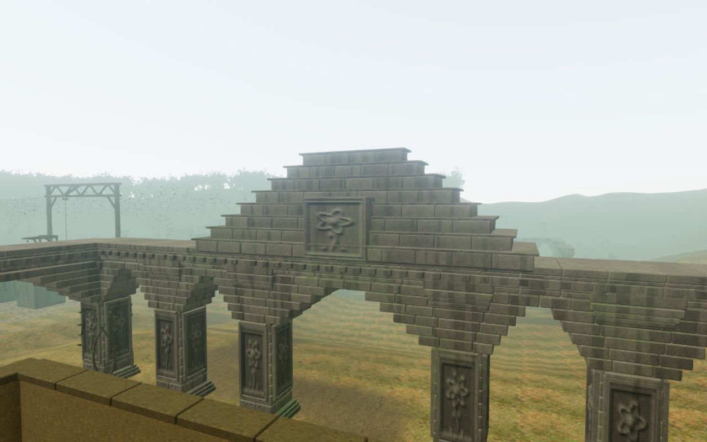

# Jungle temple crown bearings

The nine larger jungle temples placed their crowns relative to the court-centre
ground, although the supporting arcade followed two different pier heights.
Rendered rays measured a 7.82 cm gap at the eighth temple; several other crowns
sank into their roofs. Their tall botanical panels also lacked continuous backs
where the dressed pediment stepped inward.

The crowns now follow their supporting roof heights. Overlapping closed cores
seal the dressed courses, and a seated stone stele backs each panel through its
full height. The existing five-course profiles and taller final profile remain;
this repairs construction before broader silhouette and gallery variation.

## Geometry and contact

New cores use independent seeds and colours. Hashes retain the preceding
arcades' delivered position, normal, UV and colour buffers, and all 122 original
temple navigation records, including rubble. Lower piers, wings, carvings,
bird-perch anchors, instruments and progress identifiers stay intact.

The repair adds 57 closed pieces and 2,508 rendered triangles. Each temple root
still batches to one stone mesh. Existing credited temple materials and
procedural generators supply the art; no new external model, texture, recording,
score or dependency is introduced. These geometry figures do not establish
consumer frame rates.

Each crown owns one exact physical query over the union of its closed pieces.
Separate placements preserve overlapping core/facing interiors. The query keeps
CPU triangles after batching disposes the original render geometry. Camera
surfaces include the dressed stone and its backing. Nine separate carving
contacts follow detail visibility without becoming tiny body landings; the
structural bodies and supports remain when fine detail retires.

## Verification

- All 13 focused architecture, crown, court-foundation and bird checks pass.
  Three new regressions retain the original arcade/navigation hashes and check
  792 backing probes from delivered recess planes, 162 bearings against actual
  roof rays, and 135 physical-support heights against delivered masonry rays.
  A crown cannot admit a crouched body through overlapping core/facing, and its
  original ground passage stays clear. The camera detects the new stone after
  batching and rebuilding its surfaces.
- Thirteen standing context captures cover all nine temples on High and the
  first/final temples on Medium and Low. All were reviewed. Crown bounds project
  within the selected frame; standing roots remain legal, grounded and healthy,
  camera space and registered body targets are clear, programs link and GL
  errors are zero. High/Medium HDR input is finite; Low uses its ordinary path
  with bloom disabled. Some foreground piers and chamber walls obscure portions
  of the crowns, so framing alone does not prove full surface visibility.
- Three elevated construction cameras inspect the first, eighth and final
  crowns without those foreground obstructions. All three captures were
  reviewed, including the eighth at full size. Their complete crown bounds fit
  the frame, camera space is clear, and HDR/program checks pass. These are
  inspection cameras, rather than reachable player poses.
- All 18 normal-controller passage/return legs through the nine rear arcades
  pass, with 18 reviewed route captures and full health. The complete jungle
  climbing loop passes. Fifty control approaches, 42 drum-source sight lines
  and 16 drive-source listening approaches remain clear. Progress is prepared
  and enemy simulation disabled for these local checks; they do not establish
  earned chapter progression or subjective audio quality.
- The production build passes with the existing bundle-size advisory. Its game
  bundle is `game-BjkPefUe.js`. The three documentation images use lossless WebP
  with decoded pixel and dimension parity against their source game captures.
- The repaired release passes emulated portrait touch/Low at the final reader:
  reading, inspection, reversible turns, reset, return, manual look and 2.10 m
  of native movement. Two paused whole-store reload comparisons ignore only
  visit timestamps; saved camera angles remain unchanged. All five captures
  were reviewed. Release assets match the build, the development hook is absent,
  application/HTTP errors and warnings are empty, and the page has no horizontal
  overflow. The check is muted and does not prove physical-phone performance
  or listening quality.

Verification uses the shared locked nine-of-sixteen CPU allowance, at most two
test workers and one browser. Owned browsers and preview servers close after
their checks. Raw captures, profiles, saves and helper results stay in ignored
workspace staging.

The initial close observer survey framed walls or cropped the upper silhouette
at several temples. It is retained privately as an observation limitation;
the later context and construction views support the claims above. Wider temple
silhouettes, gallery and chamber footprints, sparse surroundings, complete
discovery/traversal coverage and listening/device review remain open. This
repair does not establish whole-campaign visual acceptance or AAA parity.
