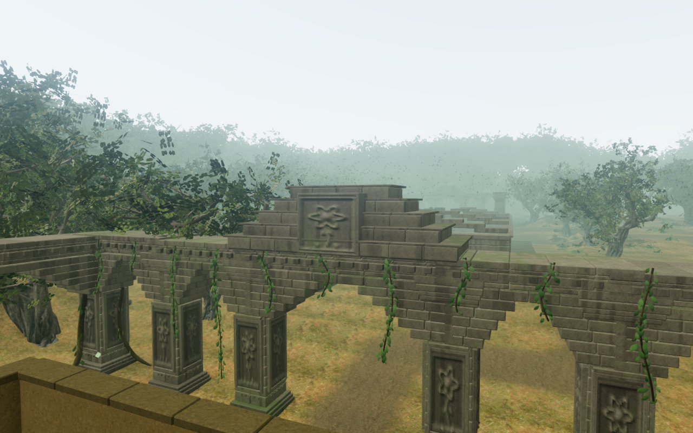
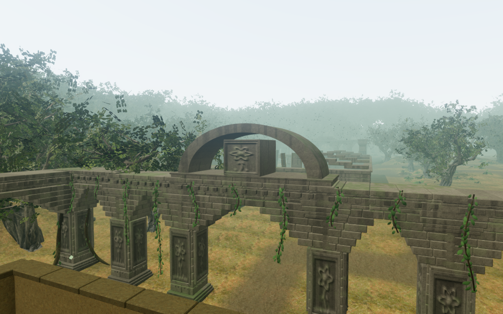
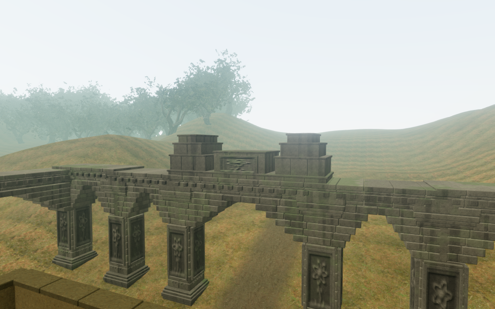
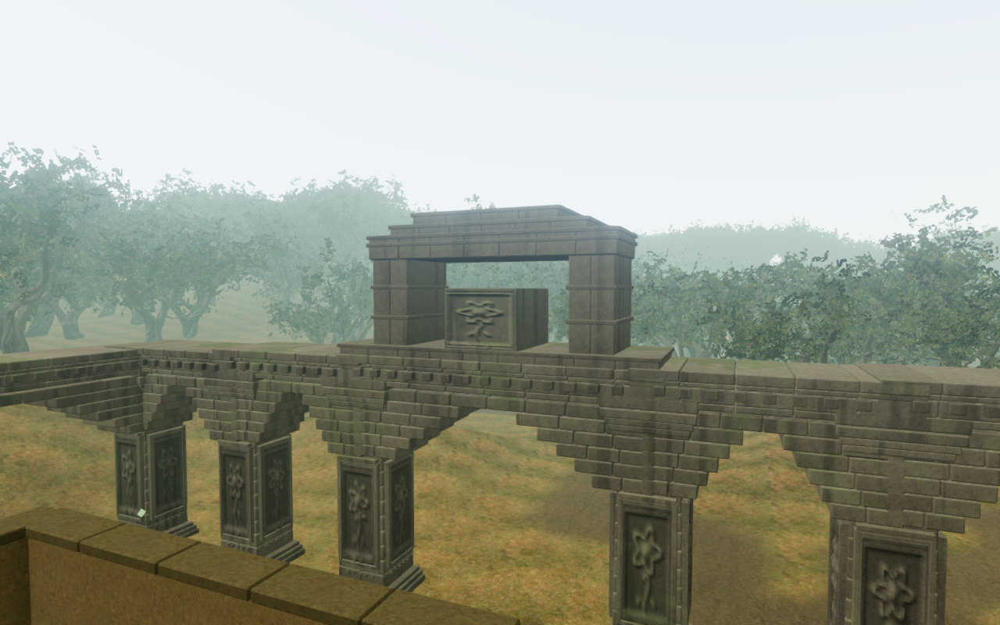
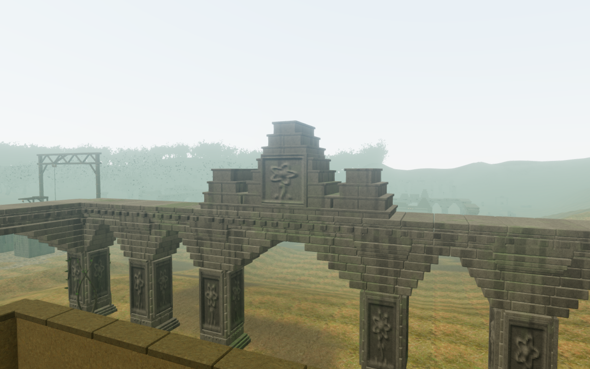
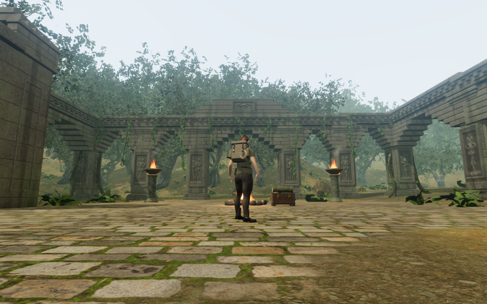

# Distinct jungle temple profiles

This record describes the crown-profile milestone at `8ad729a`. The subsequent
[jungle gallery layouts](jungle-galleries.md) intentionally change the lower
arcades and navigation, so the unchanged-arcade hashes and lower geometry counts
below apply to that earlier milestone. The distinct crown profiles remain.

The jungle chapter's nine larger temples previously shared a stepped crown,
with a taller version at the final court. They now have different roof volumes
associated with the arrival and eight covenants. Their repaired roof bearings
and complete carving backs remain part of the construction.

| Court | Profile |
| --- | --- |
| Arrival | Low lotus porch with three broad courses |
| Keeper's First Covenant | Five shallow sun terraces |
| Rootbound Promise | Paired root towers around a lower tablet |
| Rainkeeper's Order | Seventeen closed stones around a curved rain vault |
| Reservoir Covenant | Offset garden terraces and a lower western shoulder |
| Eastern Witnesses | Low western and taller eastern stelae |
| Moonlit Procession | Joined posts and a roof beam around an open lantern |
| Inner Sanctuary's Oath | Tall central sanctuary over broad lower courses |
| Heart's Final Covenant | Three crowns with a taller central sanctuary |

The rainkeeper's preceding profile, from an elevated construction camera:

The new vault from the exact same camera position and target:

The low arrival porch from a normal standing gameplay observer:

## Construction and retained gameplay

Each profile starts on a continuous plinth seated into the existing central
arcade. Recessed cores seal the dressed joints; projecting cornices cover the
vertical course joins without overlapping dressed skins on one exposed plane.
Separate tower footprints retain real spaces between them. The lantern's posts
overlap its carried beam, and the rain vault uses closed stones with matching
angular edges. Closed columns and embedded plates back the resized carvings.

The constructor retains the original crown's seed and colour consumption while
building the new art independently. Hashes preserve every preceding arcade's
delivered position, normal, UV and colour buffers, and all 122 original temple
navigation records, including rubble. Lower piers, wings, bird-perch anchors,
instruments, progress identifiers and save fields remain intact.

Crown masonry decreases from 660 pieces and 29,040 triangles to 445 pieces and
19,444 triangles. All nine reliefs retain their existing grid resolution and
34,560 combined triangles. The complete upper art therefore decreases by 9,596
triangles; each temple root still batches to one stone mesh. These counts do
not establish consumer frame rates. Existing credited materials and original
generators supply the art; no external asset or dependency was added.

Exact physical queries retain the union of separate closed pieces after render
batching. Only the curved arch supplies slope clearance; lower landings do not
suppress real overhead collision. Carving contacts follow detail visibility
without becoming body landings. Structural bodies and supports remain when
fine detail retires.

## Verification

- All 15 focused architecture, crown, court-foundation and bird checks pass.
  Two new regressions require nine different physical height signatures,
  independent authored plans, a real lantern opening with correct beam
  headroom, and walkable rain-vault slopes. Existing checks retain the arcade
  and navigation hashes, 792 backing probes, 162 rendered roof bearings and
  135 rendered cap-support comparisons.
- All nine preceding and updated construction views were reviewed. Camera
  positions and targets match exactly. Complete crown bounds fit the frame,
  camera space is clear, HDR input is finite, programs link and GL errors are
  zero. These elevated inspection cameras are separate from reachable player
  poses; they expose surfaces that foreground walls and piers obscure.
- Thirteen updated standing contexts cover all nine temples on High and the
  first/final temples on Medium and Low. All were reviewed. Their player,
  camera, yaw and pitch match the preceding bearing pass exactly. Roots are
  legal, grounded and healthy, registered body targets and camera space are
  clear, and complete crown bounds project within the frame. High/Medium HDR
  input is finite; Low uses its ordinary path with bloom disabled. Some
  foreground structures still obscure portions of the crowns.
- Three assisted raised poses cover both outer rain-vault slopes and the
  lantern roof. All were reviewed. The normal controller settles on legal
  grounded support with full health and clear camera space. Rays against
  delivered masonry put the lowest sampled outsole point of every boot about
  6 mm above the stone; curved toe/recovery points have larger clearances.
  HDR/program checks pass. These poses do not establish earned access to the
  roofs or complete posed-body coverage.
- All 18 local passage/return legs through the nine rear arcades pass, with
  18 reviewed route captures and full health. The complete jungle climbing
  loop passes. Fifty control approaches, 42 drum-source sight lines and 16
  drive-source listening approaches remain clear. These local checks use
  prepared progress and disabled enemy simulation.
- The production build passes with the existing bundle-size advisory. Its
  game bundle is `game-DZ-lvVTF.js`. Emulated portrait touch/Low at the final
  reader passes reading, inspection, reversible turns, reset, return, manual
  look and 2.10 m of native movement. Two paused whole-store reload comparisons
  ignore only visit timestamps; saved camera angles remain unchanged. All five
  release captures were reviewed. Assets match the build, the development hook
  is absent, application/HTTP errors and warnings are empty, and horizontal
  page overflow is absent. The muted check does not prove listening quality or
  physical-phone performance.
- The six documentation captures use lossless WebP, with decoded pixel and
  dimension parity against their source game captures.

Verification uses the shared locked nine-of-sixteen CPU allowance, at most two
test workers and one browser. Owned browsers, preview servers and watchers close
after each check. Raw captures, profiles, saves and helper output remain in
ignored workspace staging.

Gallery and chamber footprints, sparse surroundings, full discovery/traversal
coverage, moving/underwater and broader posed-body views, and listening/device
evaluation remain open. This local silhouette work does not establish
whole-campaign visual acceptance or AAA parity.
