# Terrain and camp camera framing

The walking camera now checks the explorer's posed boot edges and lower
clothing against foreground terrain, alongside its existing joint margins.
Large opaque camp supplies are registered before their render geometry is
merged. The correction changes the camera detour while preserving the player's
position and input look.

## Why the old view failed

A clear line from the chest to the camera does not guarantee that boots remain
visible over a foreground bank. Joint centres also miss an outsole extending
downhill and clothing bent away from its bone. The old solver could prefer a
partially clear next step whose destination remained obscured, preventing it
from reaching a clearer view.

The camera now reads delivered, posed skin vertices for the boots and lower
clothing. Terrain rays inspect the shared floor sampler at grid edges and
terrain diagonals. Scenery and terrain visibility are scored separately so
additional clear clothing rays cannot dilute a blocked scenery ray. Higher
pitch alternatives join the search, and both the interpolated position and
safe destination contribute to its score.

Camp supplies formerly bypassed the general primitive-capture builder.
Substantial solid parts now retain their transformed camera bounds before
batching. Fine fittings and transparent flames are not general camera walls.
The camera registry releases its original mesh references after rebuilding.

A synchronous solve shares one refresh of moving-prop transforms across all
its rays. The scope ends even on failure; the next query still reads current
transforms. This avoids repeating the refresh hundreds of times per update.

## Regression checks

The selected suite contains 54 passing cases across six files. Sixteen delivered
character bank poses cover four positions, two headings and both standing and
crouching. Independent rendered-surface rays report zero terrain obstruction,
with unchanged roots and input yaw/pitch. Three hundred independent triangle
rays agree with the terrain predicate. All eight chapter camp builders retain
camera obstruction by delivered supply bodies and ignore their hidden batches.
Moving-prop regressions cover nested refresh scopes, transform changes between
solves and failure cleanup. Existing arm, contact, aim and traversal tests pass.

The preceding camera fails the delivered-bank regression, and the preceding
camp builder fails the rendered-supply obstruction regression. These controls
detect the reproduced faults rather than just requiring the new API.

## Rendered review

Thirty High-quality captures at 1280 × 800 cover all eight chapters. Twelve
matched comparisons cover four bank positions and two camp approaches, each
standing and crouching. Three further camp approaches have current-only stance
pairs. All eighteen revised views have zero terrain and camp obstruction across
5,606 independent posed-surface body rays for each scenery set. Their 865,710
body-vertex floor queries have positive gaps. Camera origins are legal, character
opacity is one, shaders link and HDR output is finite in all thirty captures.

| Recorded view         | Previous terrain obstruction, standing / crouching | Previous camp obstruction, standing / crouching | Revised obstruction |
| --------------------- | -------------------------------------------------: | ----------------------------------------------: | ------------------: |
| Desert bank           |                                           100 / 72 |                                           0 / 0 |                   0 |
| Cavern bank           |                                            29 / 11 |                                           0 / 0 |                   0 |
| Second cavern corner  |                                              0 / 0 |                                           0 / 0 |                   0 |
| Jungle bank           |                                              6 / 5 |                                           0 / 0 |                   0 |
| Sky camp approach     |                                              0 / 0 |                                       295 / 393 |                   0 |
| Eclipse camp approach |                                              0 / 0 |                                       295 / 393 |                   0 |

The independent observer casts through actual posed body triangles and the
delivered terrain or opaque camp meshes. It does not use the solver's collision
bounds. Perspective changes the number of body hits between comparisons;
reported values are obstruction counts. Instanced foliage is outside this
geometric observer's scope.

The preceding views reconstruct the old camera solver and remove the new camp
bounds in the current runtime. Terrain, scene geometry, character pose, root and
input yaw/pitch are retained. The normal camera settles for 180 updates; no
documentation orbit or opacity override is imposed. Progress is prepared,
enemies removed and world timers stopped. These are assisted scene checks,
not complete chapter playthroughs. All thirty captures were visually reviewed.

| Desert bank before                                                                               | Desert bank after                                                                   |
| ------------------------------------------------------------------------------------------------ | ----------------------------------------------------------------------------------- |
| 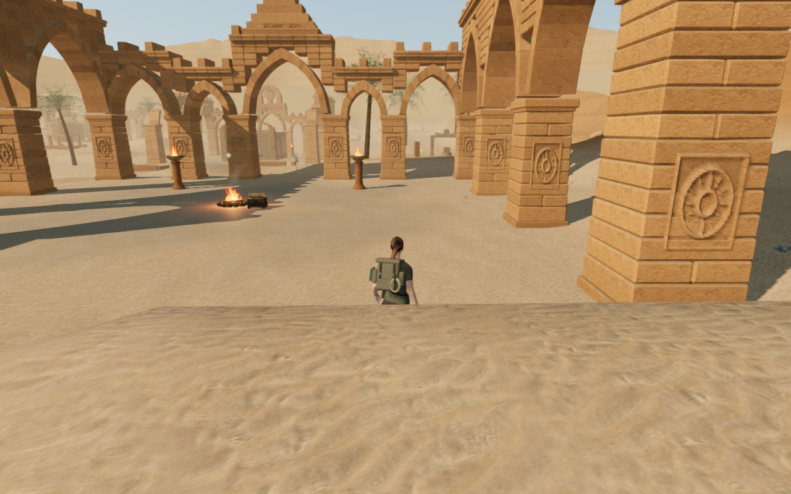 | 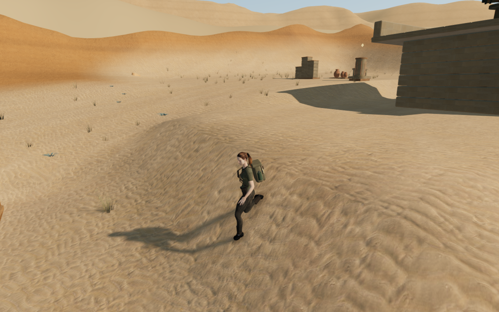 |

| Cavern bank before                                                                              | Cavern bank after                                                                     |
| ----------------------------------------------------------------------------------------------- | ------------------------------------------------------------------------------------- |
| 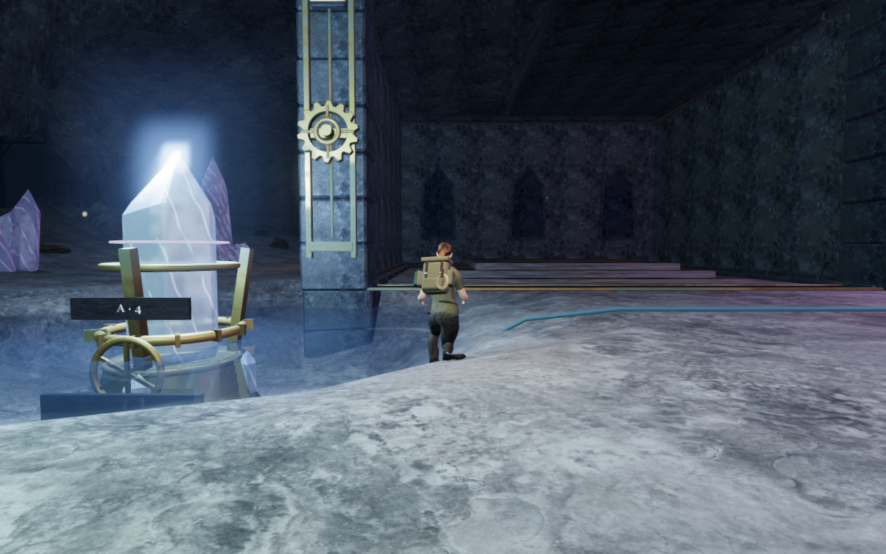 | 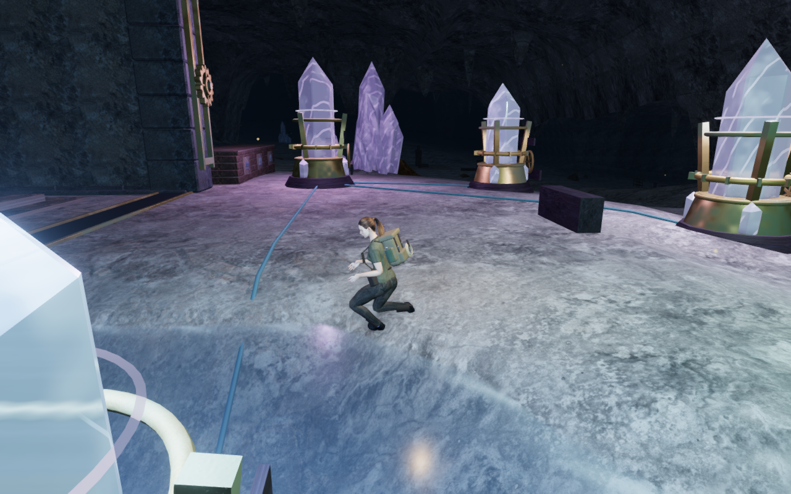 |

| Jungle bank before                                                                                    | Jungle bank after                                                               |
| ----------------------------------------------------------------------------------------------------- | ------------------------------------------------------------------------------- |
| 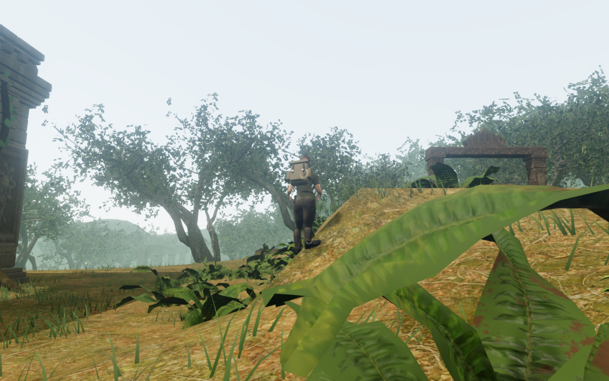 | 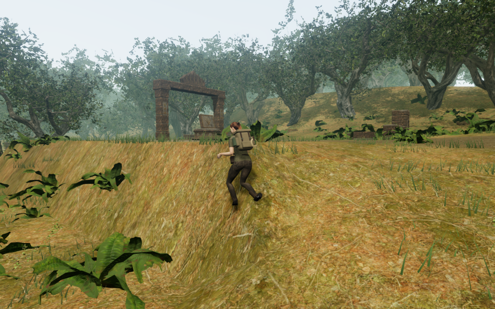 |

| Sky camp before                                                                                           | Sky camp after                                                                            |
| --------------------------------------------------------------------------------------------------------- | ----------------------------------------------------------------------------------------- |
| 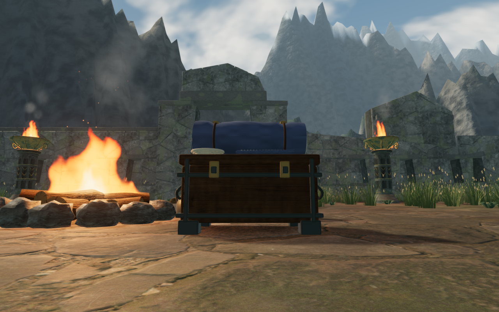 | 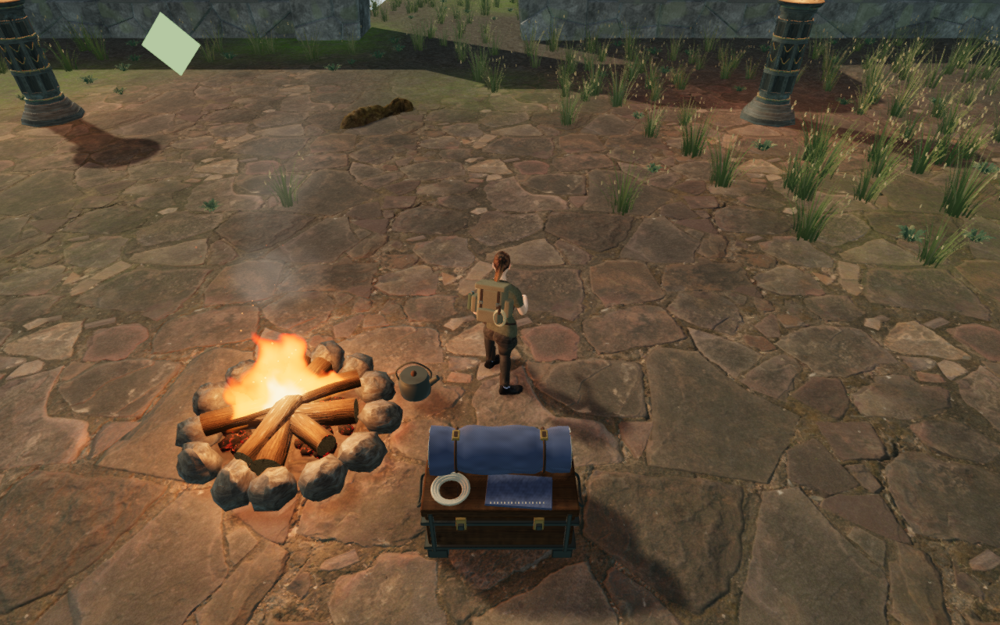 |

| Eclipse                                                                        | Snow                                                                      |
| ------------------------------------------------------------------------------ | ------------------------------------------------------------------------- |
| 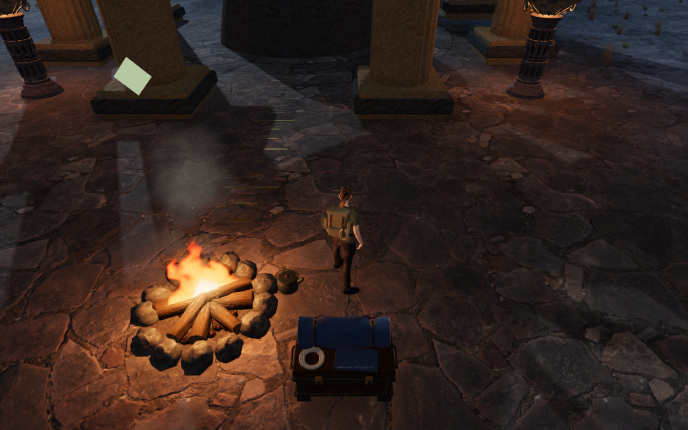 | 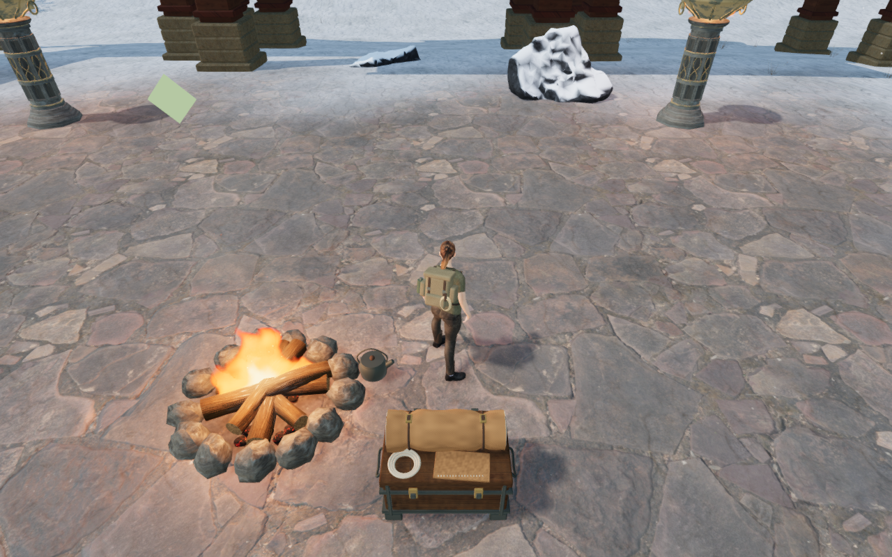 |

| Coast                                                                        | Volcano                                                                        |
| ---------------------------------------------------------------------------- | ------------------------------------------------------------------------------ |
| 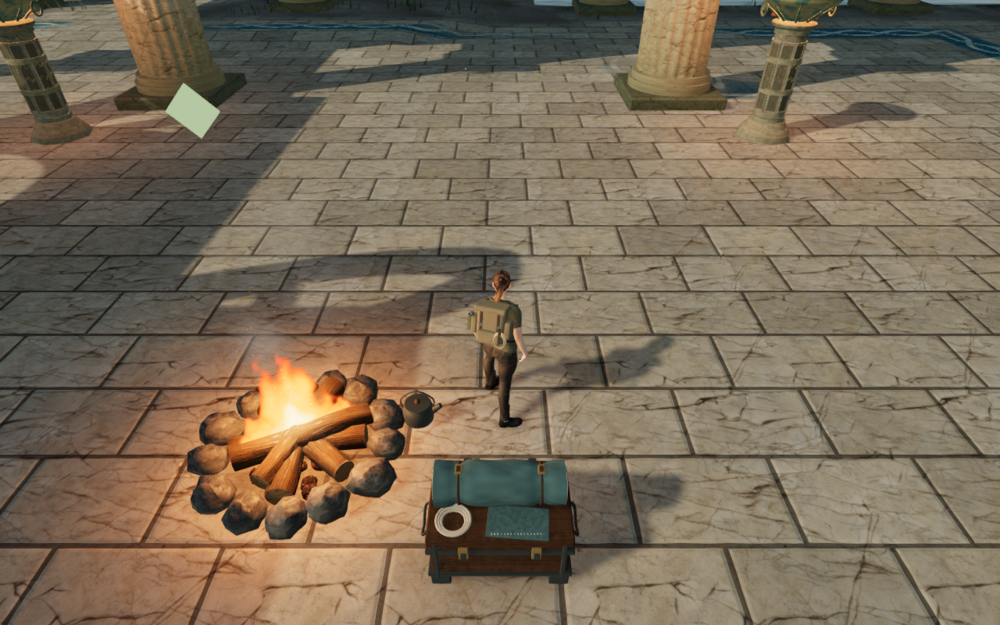 | 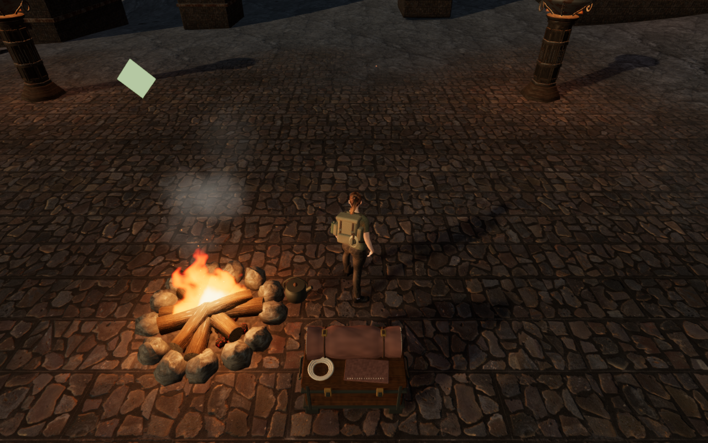 |

## Built release controls and saves

The release build passes with its existing large-chunk advisory. Its actual
interface accepts keyboard input in the cavern on High at 1280 × 800 and touch
input in the desert on Low at 540 × 900. Movement covers 1.5 m and 2.1 m
respectively. Both cases exercise crouching, look, jumping, landing and map
access, then preserve the entire campaign store through two reloads each,
excluding the expected `lastPlayed` timestamp changes. Health stays at 100 and
both earned roots settle back to ground height. Neither viewport overflows.

The development hook is absent. The loaded bundle filenames match the current
build, and all six character responses match the delivered model's SHA-256.
No application errors, HTTP failures or warnings occur. Both native screenshots
are reviewed. Saves are prepared and audio muted; these checks do not establish
listening quality or chapter pacing. The close portrait bank view and perceived
weight still need refinement.

| Cavern keyboard / High                                                                              | Desert touch / Low                                                                          |
| --------------------------------------------------------------------------------------------------- | ------------------------------------------------------------------------------------------- |
| 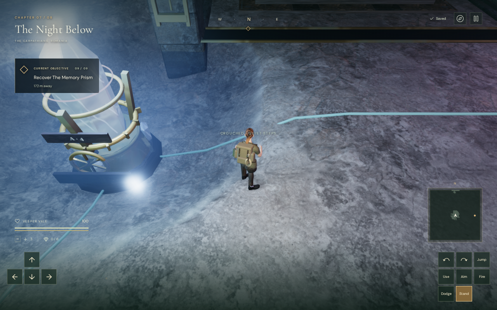 | 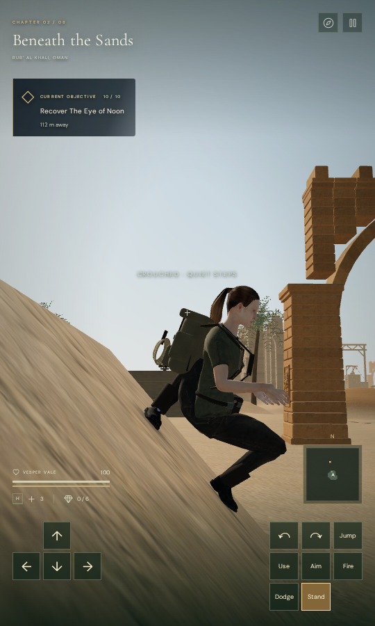 |

All fourteen public documentation images preserve the captures' decoded RGBA
pixels and dimensions through lossless WebP conversion.

## Camera cost and resource limits

These sandbox timings measure the camera solve alone, over the last thirty
updates of each settled view. They do not establish a whole-frame budget,
consumer-device performance or smooth continuous traversal.

| View                | Previous median, standing / crouching | Revised median, standing / crouching | Revised 95th percentile, standing / crouching |
| ------------------- | ------------------------------------: | -----------------------------------: | --------------------------------------------: |
| Desert bank         |                        16.5 / 14.8 ms |                       14.0 / 11.9 ms |                                17.8 / 13.5 ms |
| Cavern bank         |                          0.7 / 4.2 ms |                         4.0 / 3.7 ms |                                  6.1 / 4.3 ms |
| Clear cavern corner |                          1.1 / 0.7 ms |                         1.1 / 1.0 ms |                                  1.8 / 1.5 ms |
| Jungle bank         |                          1.2 / 1.0 ms |                         4.7 / 4.6 ms |                                 10.0 / 6.6 ms |
| Sky camp            |                         10.0 / 9.2 ms |                       22.0 / 18.2 ms |                                22.9 / 20.4 ms |
| Eclipse camp        |                          7.4 / 6.8 ms |                       13.6 / 13.3 ms |                                17.6 / 15.9 ms |

The current-only snow, coast and volcano samples have median ranges of
7.4–8.8 ms, 5.2–5.6 ms and 5.3–6.3 ms respectively. More accurate framing
adds cost in several scenes. A first prototype repeated moving-parent refreshes
and cost about 40 ms in the desert; that incomplete review was stopped before
publication. Sharing the refresh repairs that overhead, while further camera
optimization remains necessary.

Verification uses the locked shared allowance of nine out of sixteen available
CPUs, one browser and serial heavy checks. Every owned browser process/thread
is audited within that helper's process namespace. Closing the survey leaves
only its helper process, which then exits; the temporary server is stopped.
Image conversion uses two Sharp workers with its cache disabled.

## Still open

Legal hearth-centre positions can overlap the opaque hearth and flames. Those
positions require a physical-placement repair; they are not camera-clearance
acceptance cases. Wider moving-camera routes, instanced foliage, body contact,
scene composition, listening and consumer-device performance remain open.

The recorded hearth-centre positions are `(84, 42)` in the sky chapter and
`(385, 210)` in the eclipse chapter. The accepted supply approaches are two
metres to their side and 0.6 m behind them. No physical hearth-placement repair
is included here. Some bank poses also retain the perceived-weight problems
tracked in the [boot and bank-contact review](bank-contact-shadows.md).
