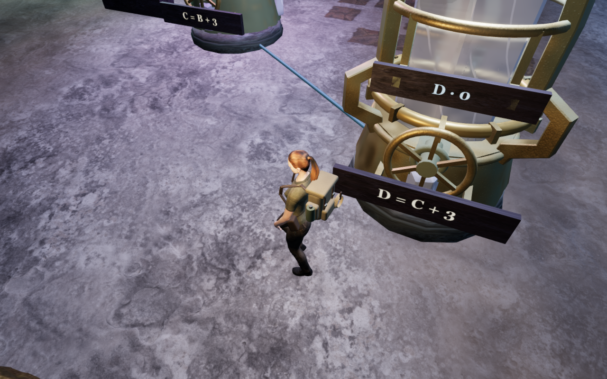
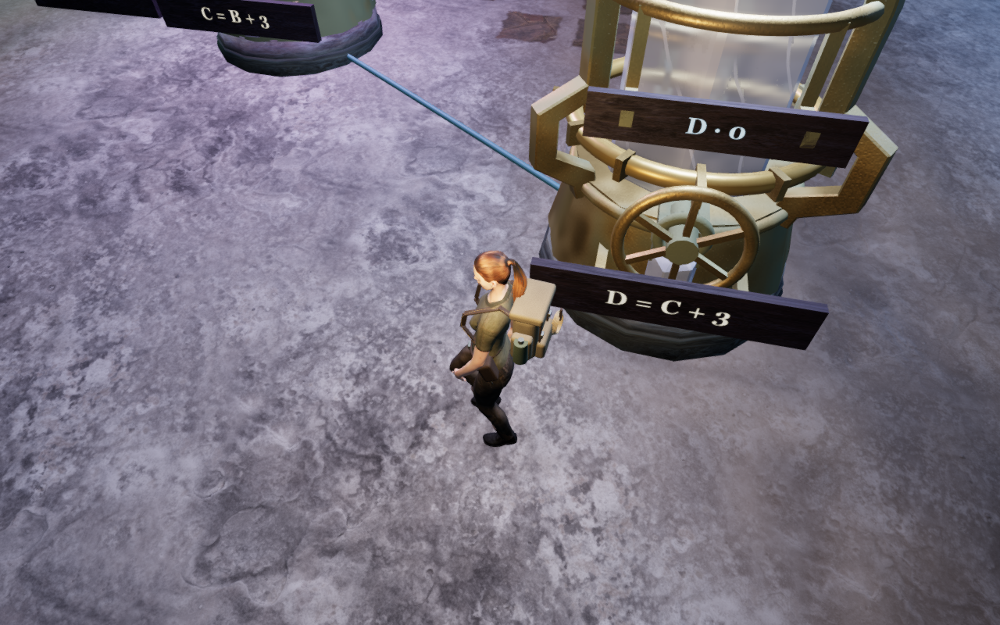
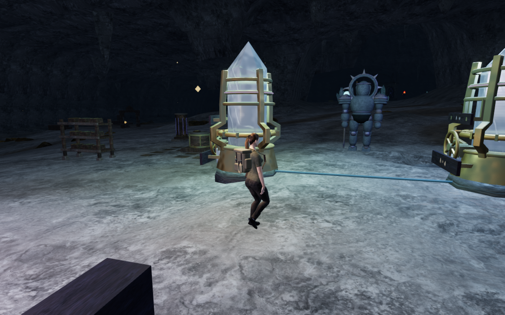
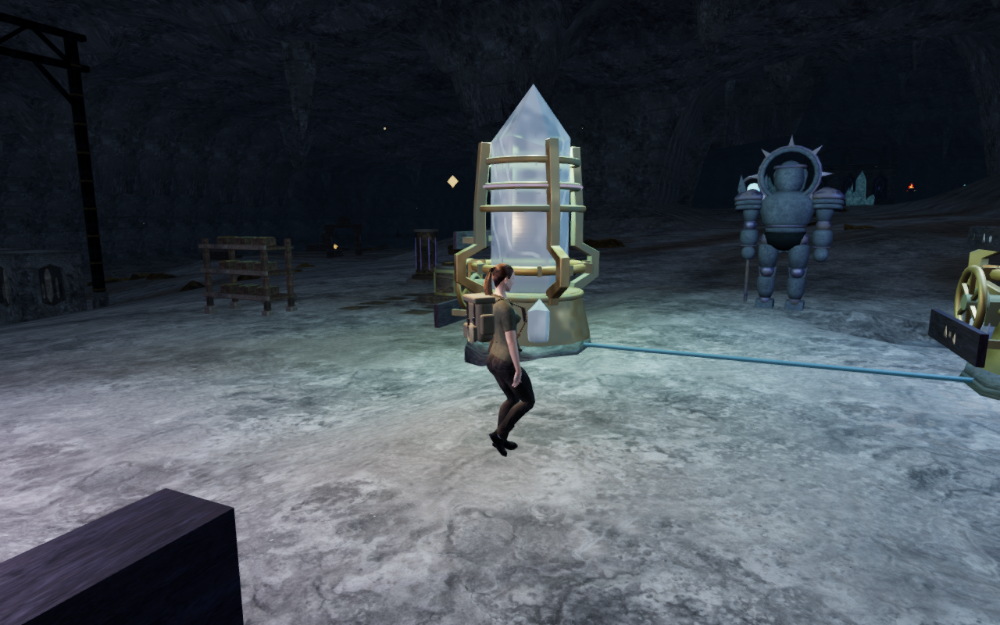
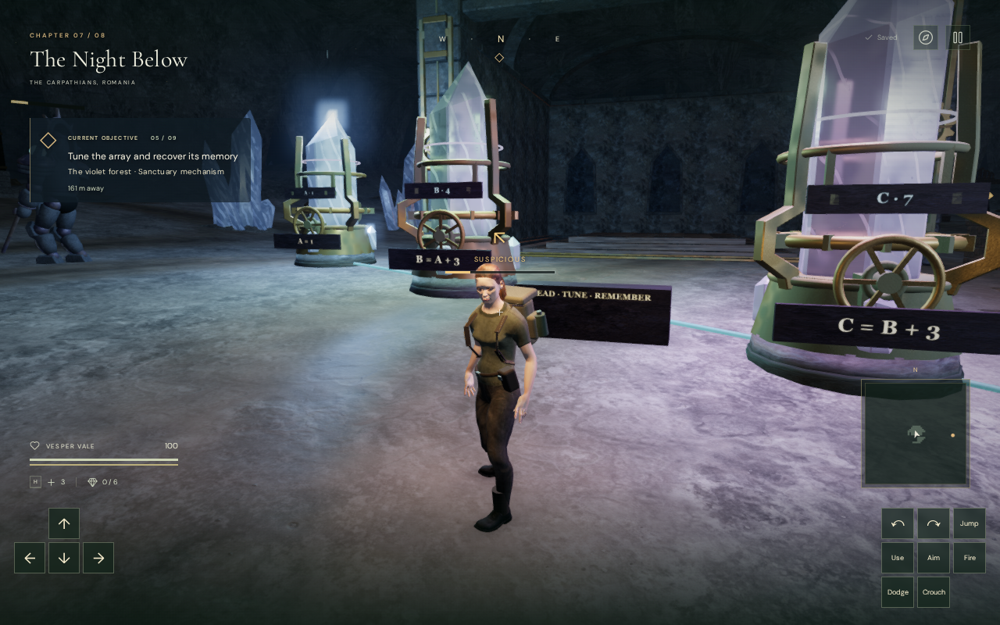
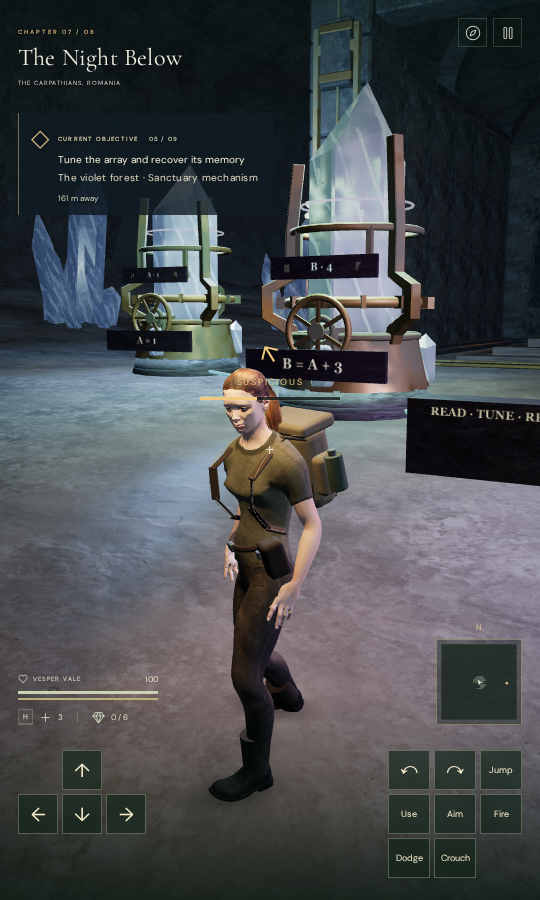

# Gentler walking camera turns

The walking camera now limits a large, clear angular step instead of rushing
around a short arm when it leaves a collision detour or follows a new heading.
It carries the previous arm with the moving target, retains the collision
solver's radial correction, and rotates toward the selected view at up to
three radians per second when the gentler view is safe.

The proposed view must pass camera-space, central arm, translated lens-path
and posed-body visibility checks. If any check fails, the original correction
still applies. Anticipatory contact detours retain their existing slower
follow path. Aimed, water, airborne, climbing and rope views, first arrivals
and large timesteps keep their preceding camera behavior. The selected yaw
and pitch remain player input, rather than becoming collision-response angles.

## Recorded movement

The three controller replays use the current dry crystal terrain and delivered
instrument geometry. Their control substitutes the preceding camera module
into the current world; it does not run an earlier complete application.
Prepared field progress, disabled enemies and muted audio isolate the local
approaches and reversible wheel turns.

| Route | Previous largest angular step | Current largest angular step |
| --- | ---: | ---: |
| Mirrored front instrument | 2.654° | 2.654° |
| Ascending array and return | 11.086° | 6.887° |
| Paired-heart front instrument | 6.973° | 2.865° |

These angles compare camera arms relative to their respective moving targets
between consecutive 60 Hz updates. The three-radian limit corresponds to
2.865° per such update when accepted. It is not a universal bound: required
obstruction corrections and planned contact detours retain their own response.
The ascending route's remaining larger steps need continued motion review.

Across the three replays, 1,494 recorded camera updates retain clear camera
space and swept central arms. All 286 registered posed body targets pass each
update's scenery and terrain visibility queries, and explorer coverage remains
exactly one. Eight local controller legs and six reversible physical wheel
turns reach the same arrivals. Every recorded controller position, target,
selected look and movement velocity matches the control.

On the ascending route, steps above three degrees fall from 132 to 28; the
paired-heart approach falls from nine to zero. The mirrored route has none
in either version. These counts describe the same recorded updates and inputs.

The current route views keep the water, materials, lighting and all rendering
effects enabled. No runtime asset, dependency, save schema, puzzle solution or audio
recording is added or changed by this camera pass.

## Limits and delivery

The new regression against the preceding camera fails at the clear walking
turn's angular-step assertion. The current selected camera and resonance
suite passes all 52 checks, including the new moving-target, obstructed-arm
and posed-foot cases. An additional lens-path isolation passes with three
clear camera arms and a blocked gentler lens journey, while the ordinary
journey remains clear: 53 distinct checks pass in total. The existing detour
test still requires 120 stationary updates with exactly the same blocked view;
once the obstruction opens, it
now checks a gentler first step, continuous body and arm clearance, and eventual
convergence to the selected view. The production build passes in 6.24 seconds
with the existing large-chunk advisory.

Native built-game checks pass with keyboard/High at 1280×800 and touch/Low at
540×900. Each solves the ascending objective `[1, 4, 7, 10]` in twelve turns and
advances from objective 3 to objective 4. Movement, look, crouch, jump/landing
and map inputs pass. An earned tuning reload and two subsequent gameplay-store
reloads retain the saved fields; comparisons exclude `lastPlayed` timestamps.
The page has no development game hook, and the loaded JavaScript/CSS filenames
and explorer model hash match the current delivery files. Neither mode records
an error or warning apart from the separately filtered GPU readback diagnostic.

The movement evidence covers these local approaches, rather than every possible
campaign route. Registered body targets and camera arms do not establish
visibility of every rendered face or every intermediate airborne pose. Wider
cavern composition, camera motion and full campaign visual acceptance remain
open. These checks do not establish consumer hardware performance, subjective
audio quality, human playthrough duration or AAA graphics.

Verification uses the shared CPU launcher, locked to nine of sixteen available
CPUs (56.25%), one test worker and one browser at a time. Private helpers,
seeded player stores, raw captures and logs stay in ignored local staging.
Every owned browser and temporary server closed after its check. The final
process and port audit finds none remaining, and the temporary browser runtime
directory is empty.

## Captures

All 50 comparison, diagnostic and native captures are reviewed. The pairs
below are actual rendered controller updates at the same recorded index, using
the preceding or current camera module in the current world. They show the
different camera histories; individual stills do not measure motion smoothness.
The alternate stationary diagnostic lenses remain in private staging. Checked
lossless WebP delivery preserves decoded RGBA pixels and dimensions.

| Recorded walking update | Previous camera | Current camera |
| --- | --- | --- |
| Ascending, update 589 |  |  |
| Paired-heart, update 68 |  |  |

| Native built view | Capture |
| --- | --- |
| Keyboard/High after landing |  |
| Touch/Low portrait after landing |  |

The implementation is in [camera-follow.js](../src/camera-follow.js). The
walking-turn and obstruction regressions are in
[camera-follow.test.js](../tests/camera-follow.test.js), with stable detour and
gentle release coverage in [explorer-camera.test.js](../tests/explorer-camera.test.js).
