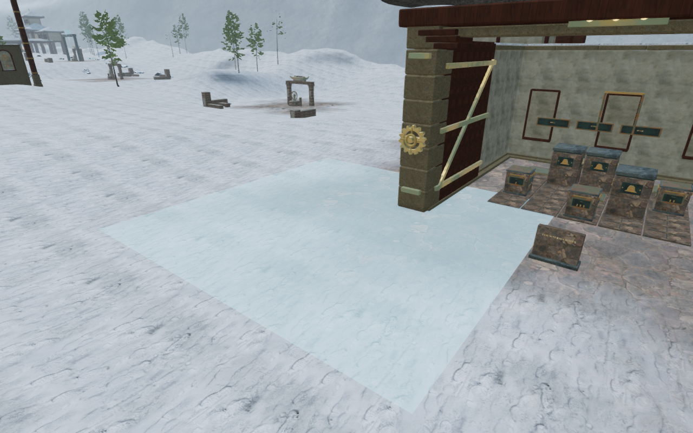
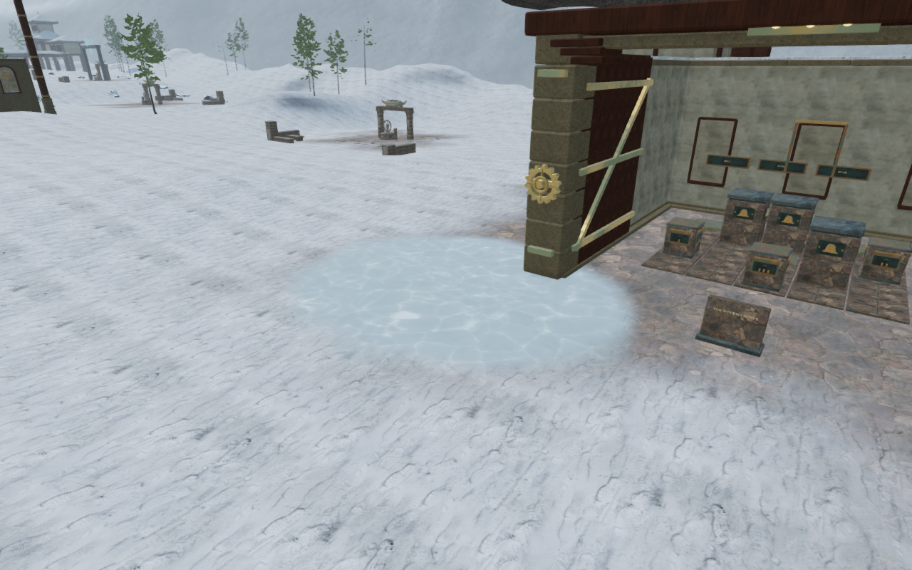
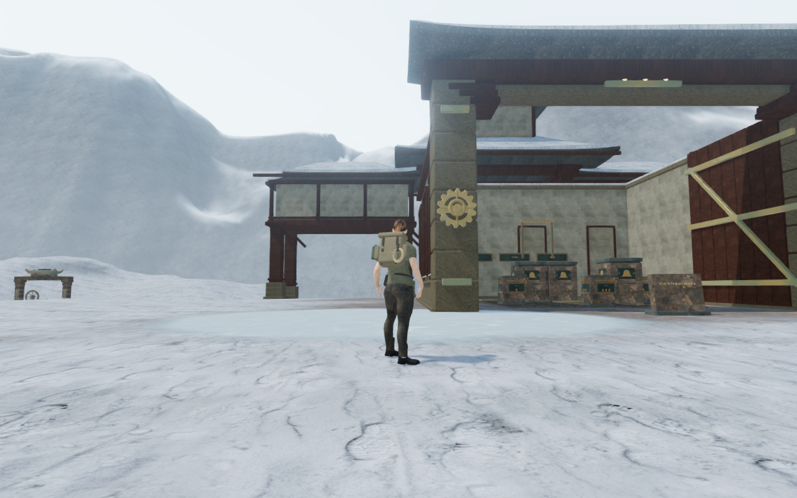
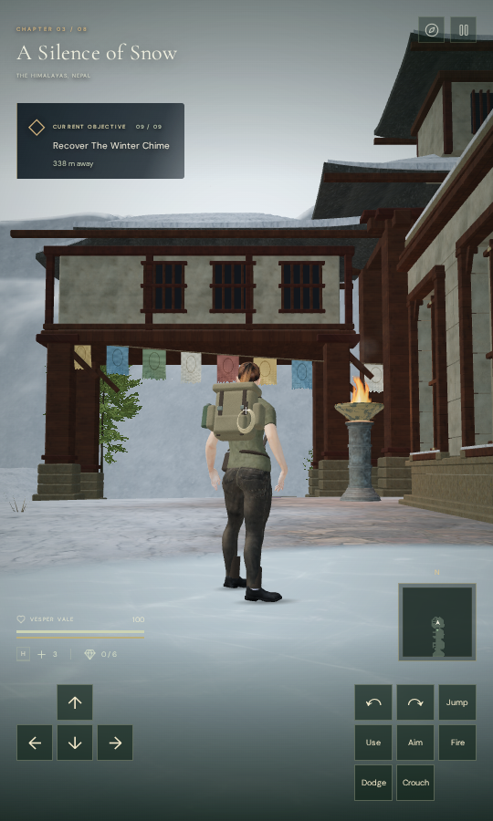
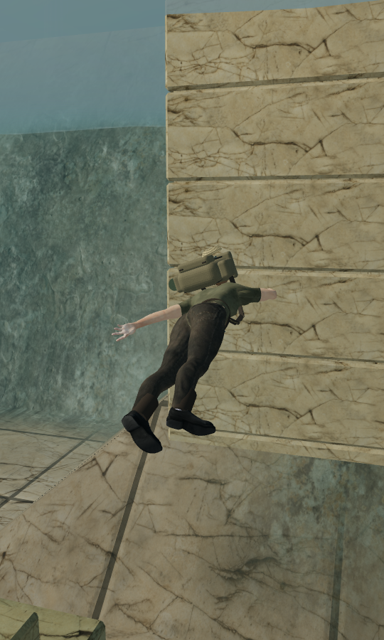
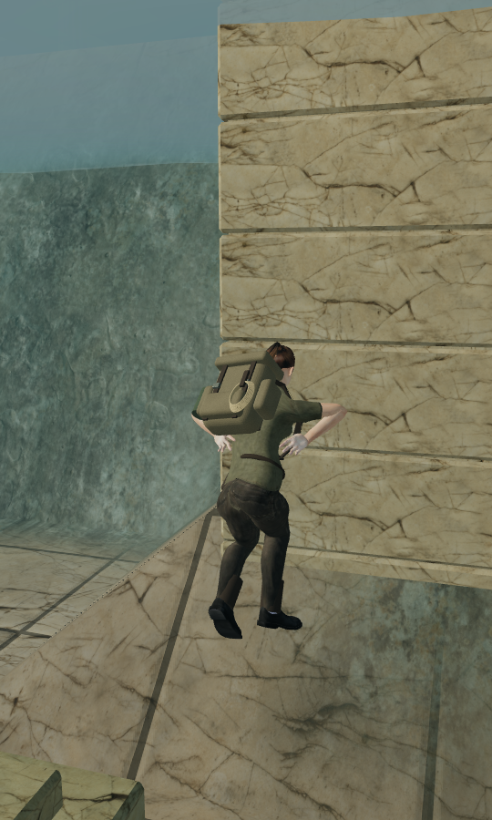
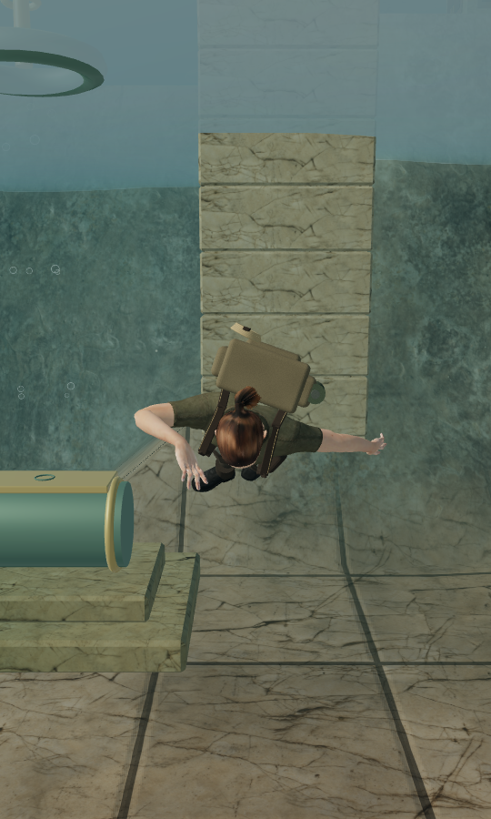
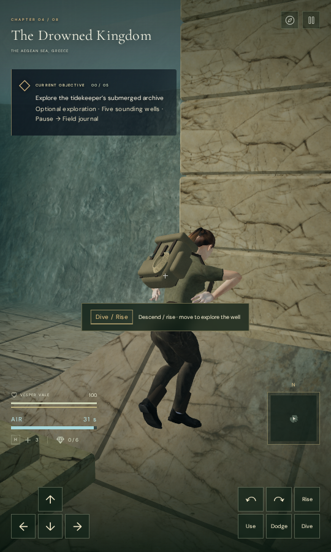

# Water ripple detail

The water uses twenty-four waves with a spread of wavelengths, directions,
phases and speeds. Their overlapping crests break up the regular crossing
pattern visible in the previous eight-band surface. Open sea retains the
strongest ripples; reservoirs use half that strength and the crystal pools
use one quarter, preserving their quieter reflections.

Each wave uses a signed sinc weight to average its slope across a screen
pixel. This is the box average of a linear phase in screen space; the world
projection is approximated locally by its pixel derivatives. Small waves
therefore lose contrast with distance without an abrupt frequency cutoff.
The same averaging function handles swimming rings, waterfall impact ripples
and shoreline foam, using their local phase gradients. Foam retains its mean
brightness when its pattern becomes too fine to resolve.

The shader adds arithmetic but no texture, geometry, render target or runtime
dependency. The small vertex displacement, physical swimming surface, water
levels, drainage and existing reflection system remain in use. This is an
animated surface treatment, not a fluid simulation.

## Actual game comparison

These 1280 × 800 High-quality images use the same coastal scene, camera and
animation time. The previous material is from commit `62e552d`; the revised
material is switched into that same scene. The lossless WebP exports preserve
the decoded capture pixels and dimensions exactly.

| Previous | Revised |
| --- | --- |
|  |  |

The comparison covers elevated and low sea views on High and Low, plus two
later animation samples. All fourteen captured frames were reviewed. The two
harbor pairs are largely obstructed by architecture, so they do not establish
reservoir surface coverage; separate chapter and swimming views cover that work.

## Filtering measurement

The [GPU fixture](../scripts/verify-water-ripples-browser.js) compares the actual
shader against the same waves without filtering. Its reference averages
16 × 16 samples per output pixel. It measures two linear slope channels,
without lighting, reflections or tone mapping, and retains the requirement
that filtering reduce error by at least 75% in all six cases.

Readback now uses half-float targets. The previous 8-bit target introduced an
approximately 0.00113 normalized rounding floor, which dominated this shader's
filtered result. The fixture now detects readback errors and nonfinite results
as well as shader-link failures. Its temporary targets and renderer are disposed.

| Metres per pixel | Error without filtering | Error with filtering | Reduction |
| ---: | ---: | ---: | ---: |
| 0.25 | 0.004343 | 0.000113 | 97.4% |
| 1 | 0.021436 | 0.000121 | 99.4% |
| 2 | 0.031544 | 0.000127 | 99.6% |

Each row averages times 25 and 26.3 seconds. Error is root-mean-square error
in the fixture's linear encoded slope channels. These measurements describe
spatial filtering, not complete graphics quality or motion on every device.

## Rendering cost

A fixed coastal overview used four alternating previous/current/current/previous
batches of four timed frames on High. The mean query times were 1782.65 ms for
the previous shader and 1747.08 ms for the revision, with substantial variation
within both groups. All sixteen queries completed without a disjoint event.

This sandbox uses ANGLE/Vulkan **llvmpipe software rendering**, restricted to
five CPUs. These short, slow software-rendered samples do not establish consumer
GPU frame rates or a performance improvement. The revision evaluates more wave
terms; a hardware-browser performance review remains open.

## Playable verification

The following results describe the ripple milestone `13e6315`, before the
frozen-ground revision below. In particular, its identical frozen comparison
is historical evidence; the ice material has since changed.

The twenty-one selected water, diving, horizon and rendering-settings tests
pass. The release build passes in 4.51 seconds with the existing large-chunk
advisory. Ten additional captures cover one surface in each of the eight
chapters, the coastal pool on Balanced, and the frozen comparison. They were
reviewed; rendered channels were finite, shaders linked, and the browser
reported no application errors or warnings. The volcanic view shows restored,
cooled crust. The frozen comparison has zero differing RGBA values.

The actual public GPU fixture passes all six cases. Source hashes stayed fixed
through the chapter run. Built-release keyboard/High and portrait touch/Low
cases swam 1.37 m and 1.25 m, turned the camera, dived to a displayed 31 seconds
of air and resurfaced. Both finished at 100 health. Each complete local save
matched after reload except for its play timestamp; persisted settings matched.
All eight production captures were reviewed.

The release served the expected bundles and four matching character-model
responses, with no development hook, application errors or asset failures.
Two driver diagnostics reported stalls during synchronous pixel readback.
Browser and worker affinity stayed within the shared five-CPU allowance. All
owned browsers, workers and preview servers closed; temporary runtime folders
were empty after the checks.

## Frozen ground

The mountain chapter's four ice patches now share the terrain's actual walking
triangles. Previously, separate 15 m square planes sat 25 mm above their
centres and exposed straight edges against the snow. The new shader shapes
uneven, differently oriented patches and fades them at the snow margin, on
steep ground and where the terrain rises away from the frozen pool. It adds
no displacement, obstacle or swimming volume.

Color, normal and roughness detail comes from ambientCG's CC0 **Ice 002**
procedural material. The runtime shader softens its contrast and normal strength;
all three delivered 1K JPEG maps retain their original pixels. They add
2,826,300 downloaded bytes and approximately 16 MiB of GPU texture storage
with RGBA8 mipmaps. These maps load only for terrain with frozen patches and
are registered with the existing terrain texture disposal path. Four separate
ice meshes are removed. No consumer-GPU frame-rate claim is based on this work.

| Previous flat sheet | Ice on the walking terrain |
| --- | --- |
|  |  |

The comparison reconstructs the preceding ice planes in the current scene and
alternates them with the new ground material at the same camera and time.
It uses prepared restored progress, muted sound and hidden guardians. All
sixteen High/Low overview frames and four ground-level approaches were reviewed.
Each rendered finite output with linked shaders; Low output was populated.
The second patch's overview has a nearby snow bank in the foreground, with
the ice still visible. These inspection views do not demonstrate traversal.

Thirteen selected terrain and water tests pass. A downward ray against the
rendered geometry agrees with walking support at twenty sampled ice positions;
reintroducing an old sheet detects its greater-than-20 mm gap. Frozen patches
remain outside the swimming query, and terrain heights are unchanged. The
release build passes in 3.87 seconds with the existing large-chunk advisory.

Built-release keyboard/High (1280 × 800) and portrait touch/Low (540 × 900)
cases walked 3.97 m and 4.80 m across the first patch. Both crouched, turned,
jumped and landed at 100 health. After reload, each complete local save matched
except for its play timestamp, including settings and prepared field progress.
These checks start from a prepared restored save and use native controls;
they do not represent an unassisted chapter playthrough. All twelve release
captures were reviewed, with the pause dialog hidden for the photographs.

The served bundles matched the release build and four character-model responses
matched the delivered file. The production development hook was absent. There
were no application errors, failed asset requests or application warnings; two
driver messages reported stalls during synchronous pixel readback. Browser
threads stayed within the shared five-CPU allowance. The browsers, workers and
preview servers closed after verification. The four public WebP images preserve
the decoded source pixels and dimensions exactly.

This repairs the observed rectangular boundary in VA-134. Broader mountain
composition, other routes and moving body contact remain part of the visual audit.

## Swimmer clearance

The harbor-pillar dive view exposed a real body intersection (VA-135). In the
previous controller, the swimmer's centre cleared the masonry while the prone
head and arm stroke extended into it. Sixteen animation samples of the delivered
character measured up to 24.3 cm of penetration into the rendered closed stone
geometry. Each sample inspected all 48,095 body and equipment vertices,
independently of the movement collision queries.

The controller now checks the rotated torso, boot and hand reaches before a
translation or turn. Near a wall, the swimmer draws the arms in and lowers the
legs into a compact treading pose, provided there is enough room above the bed.
The fold increases with proximity and eases out when moving away. Air-bell
breathing and the gallery wheel retain their existing interaction poses.
On arrival, a saved camera orbit first selects a clear body heading at the
saved position. If no heading fits, an older save whose extended body already
occupies masonry searches nearby water, preserving depth and rejecting paths
that cross a solid with the player centre. This recovery is limited to 1.5 m.
The swimming pose is initialized before the paused arrival screen renders,
preventing a temporary standing pose above the water.

| Previous prone stroke | Treading beside the pillar |
| --- | --- |
|  |  |

These Low-quality inspection views use prepared restored progress, hidden
guardians and muted sound. The chosen look and animation phase match; recovery
moves the revised player 10 cm away from the pillar, and the follow camera moves
with it. They are not identical-camera material comparisons.

Twenty-eight selected swimming, diving and gallery tests pass. The new test
inspects the actual skinned character at five distances, eight headings and
sixteen stroke phases (640 poses and over 25 million vertex reads), checks
accepted turns, retains a saved position when a different heading fits, and
verifies that recovery from treading does not put the feet through a shallow
bed. Reinstating centre-only clearance detects the original
intersection in its positive control.

In the actual harbor scene, sixteen fixed phases, 120 approach frames and sixty
retreat frames contain zero embedded or nonfinite body/equipment vertices.
That is 196 poses and 9,426,620 vertex reads against the nearby closed rendered
components. The approach moves 2.84 m and the retreat returns to the full stroke.
All three inspection captures were reviewed. These samples establish clearance
at this pillar, not every possible swimming contact throughout the campaign.

The assisted gallery route still breathes in both air bells, operates the wheel,
passes both gates, recovers the archive and returns to the surface at 100 health.
Its fixture now turns half a metre farther past the final colonnade pier to
accommodate the stroke clearance. This is a route regression check, not an
unassisted chapter playthrough. The release build passes in 5.06 seconds with
the existing large-chunk advisory. No external asset or dependency is added.

Built-release keyboard/High (1280 × 800) and portrait touch/Low (540 × 900)
cases swam 1.11 m and 1.12 m, turned, dived to a displayed 31 seconds of air,
and resurfaced at 100 health. Each complete local save matched after reload
except for its play timestamp, including position, settings and field progress.
The cases start from a prepared save and use native controls with muted sound.
All ten release captures were reviewed, including paused arrivals; dialogs
were hidden for the photographs. The initial and restored swimming poses
are placed in the water before active animation resumes.

The served bundles and four character-model responses matched the delivered
files, and the development hook was absent. There were no application errors,
asset failures or application warnings. Three driver diagnostics reported
stalls during synchronous pixel readback. Browser threads stayed within the
shared five-CPU allowance; all owned browsers, workers and preview servers
closed, and the temporary runtime directory was empty. The four public WebP
exports preserve the source captures' decoded pixels and dimensions exactly.

## Remaining scope

The physical swimming plane remains flat beneath small visual height changes.
The former rectangular frozen-water boundary (VA-134) is addressed by the
frozen-ground revision above.

The portrait dive view below records the original right-arm intersection with
the nearby stone support. The swimmer-clearance revision above addresses that
observed defect, VA-135; broader moving body contact remains part of the audit.

High captures one nearby reflected surface; other surfaces and quality settings
use the sky-color approximation. See [reflection continuity](water-reflections.md).

Broader ground and water composition, moving body contact, full-world visual
coverage, subjective audio review and broader browser/device acceptance remain
open. There is no minimum chapter duration; AAA is the artistic direction.
[Production status](production-status.md) records the full target and
[asset credits](asset-credits.md) retain the existing artwork attribution.
