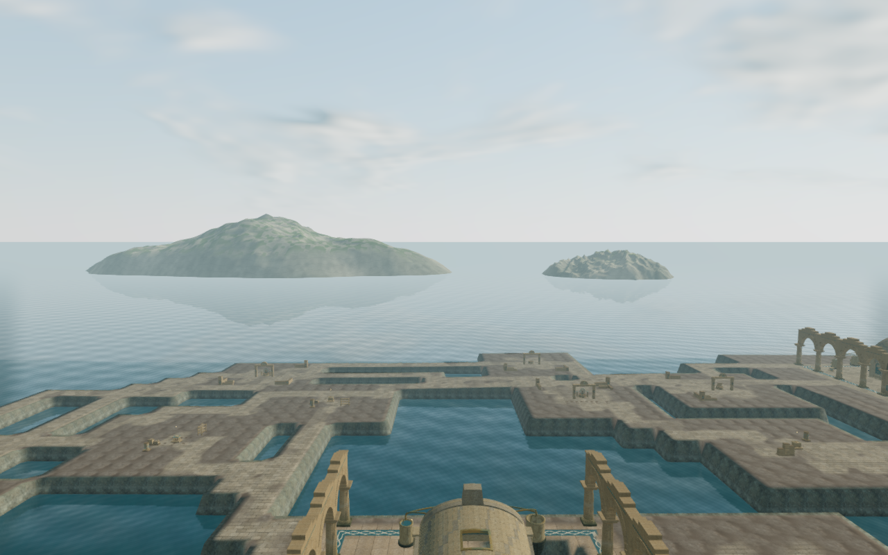
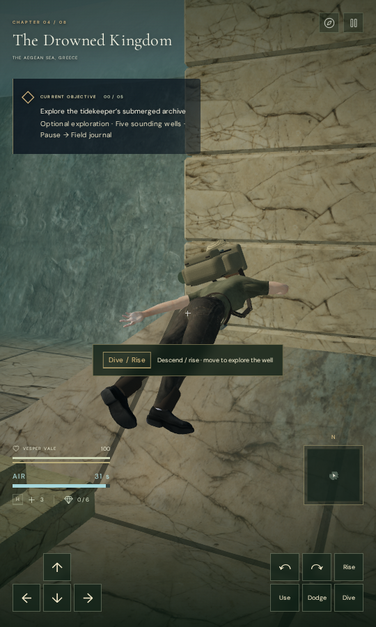

# Water ripple detail

The water uses twenty-four waves with a spread of wavelengths, directions,
phases and speeds. Their overlapping crests break up the regular crossing
pattern visible in the previous eight-band surface. Open sea retains the
strongest ripples; reservoirs use half that strength and the crystal pools
use one quarter, preserving their quieter reflections.

Each wave uses a signed sinc weight to average its slope across a screen
pixel. This is the box average of a linear phase in screen space; the world
projection is approximated locally by its pixel derivatives. Small waves
therefore lose contrast with distance without an abrupt frequency cutoff.
The same averaging function handles swimming rings, waterfall impact ripples
and shoreline foam, using their local phase gradients. Foam retains its mean
brightness when its pattern becomes too fine to resolve.

The shader adds arithmetic but no texture, geometry, render target or runtime
dependency. The small vertex displacement, physical swimming surface, water
levels, drainage and existing reflection system remain in use. This is an
animated surface treatment, not a fluid simulation.

## Actual game comparison

These 1280 × 800 High-quality images use the same coastal scene, camera and
animation time. The previous material is from commit `62e552d`; the revised
material is switched into that same scene. The lossless WebP exports preserve
the decoded capture pixels and dimensions exactly.

| Previous | Revised |
| --- | --- |
|  |  |

The comparison covers elevated and low sea views on High and Low, plus two
later animation samples. All fourteen captured frames were reviewed. The two
harbor pairs are largely obstructed by architecture, so they do not establish
reservoir surface coverage; separate chapter and swimming views cover that work.

## Filtering measurement

The [GPU fixture](../scripts/verify-water-ripples-browser.js) compares the actual
shader against the same waves without filtering. Its reference averages
16 × 16 samples per output pixel. It measures two linear slope channels,
without lighting, reflections or tone mapping, and retains the requirement
that filtering reduce error by at least 75% in all six cases.

Readback now uses half-float targets. The previous 8-bit target introduced an
approximately 0.00113 normalized rounding floor, which dominated this shader's
filtered result. The fixture now detects readback errors and nonfinite results
as well as shader-link failures. Its temporary targets and renderer are disposed.

| Metres per pixel | Error without filtering | Error with filtering | Reduction |
| ---: | ---: | ---: | ---: |
| 0.25 | 0.004343 | 0.000113 | 97.4% |
| 1 | 0.021436 | 0.000121 | 99.4% |
| 2 | 0.031544 | 0.000127 | 99.6% |

Each row averages times 25 and 26.3 seconds. Error is root-mean-square error
in the fixture's linear encoded slope channels. These measurements describe
spatial filtering, not complete graphics quality or motion on every device.

## Rendering cost

A fixed coastal overview used four alternating previous/current/current/previous
batches of four timed frames on High. The mean query times were 1782.65 ms for
the previous shader and 1747.08 ms for the revision, with substantial variation
within both groups. All sixteen queries completed without a disjoint event.

This sandbox uses ANGLE/Vulkan **llvmpipe software rendering**, restricted to
five CPUs. These short, slow software-rendered samples do not establish consumer
GPU frame rates or a performance improvement. The revision evaluates more wave
terms; a hardware-browser performance review remains open.

## Playable verification

The twenty-one selected water, diving, horizon and rendering-settings tests
pass. The release build passes in 4.51 seconds with the existing large-chunk
advisory. Ten additional captures cover one surface in each of the eight
chapters, the coastal pool on Balanced, and the frozen comparison. They were
reviewed; rendered channels were finite, shaders linked, and the browser
reported no application errors or warnings. The volcanic view shows restored,
cooled crust. The frozen comparison has zero differing RGBA values.

The actual public GPU fixture passes all six cases. Source hashes stayed fixed
through the chapter run. Built-release keyboard/High and portrait touch/Low
cases swam 1.37 m and 1.25 m, turned the camera, dived to a displayed 31 seconds
of air and resurfaced. Both finished at 100 health. Each complete local save
matched after reload except for its play timestamp; persisted settings matched.
All eight production captures were reviewed.

The release served the expected bundles and four matching character-model
responses, with no development hook, application errors or asset failures.
Two driver diagnostics reported stalls during synchronous pixel readback.
Browser and worker affinity stayed within the shared five-CPU allowance. All
owned browsers, workers and preview servers closed; temporary runtime folders
were empty after the checks.

## Remaining scope

The physical swimming plane remains flat beneath small visual height changes.
The frozen chapter's inspected reservoir also has a conspicuous rectangular
ice boundary against the snow. Its before/after pixels are identical: the
ripple change neither causes nor repairs that existing composition issue.
This is recorded as an open finding, VA-134.

The portrait dive view also shows a possible right-arm intersection with the
nearby stone support. This remains an open body-clearance review, VA-135;
the functional swimming and persistence checks do not resolve it.

High captures one nearby reflected surface; other surfaces and quality settings
use the sky-color approximation. See [reflection continuity](water-reflections.md).

Broader ground and water composition, moving body contact, full-world visual
coverage, subjective audio review and broader browser/device acceptance remain
open. There is no minimum chapter duration; AAA is the artistic direction.
[Production status](production-status.md) records the full target and
[asset credits](asset-credits.md) retain the existing artwork attribution.
