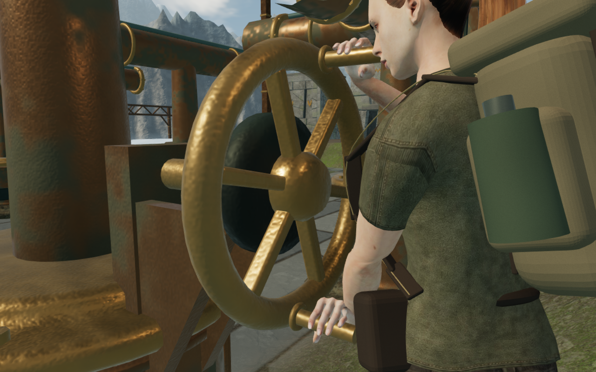
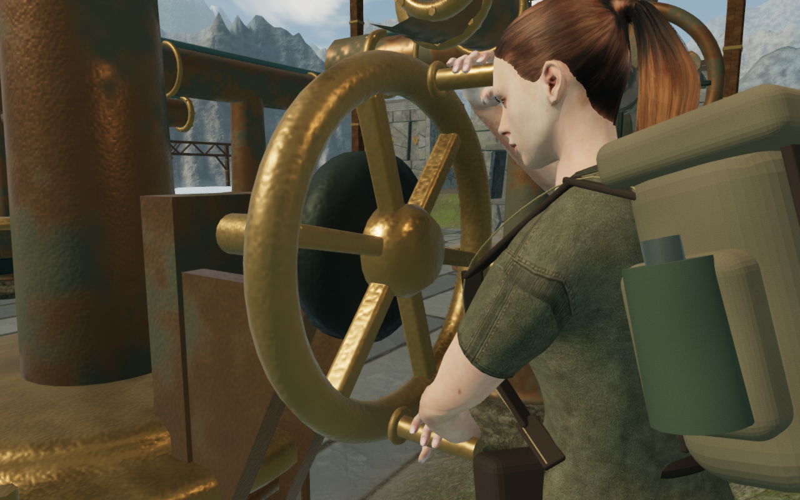

# Wind bearings on banked working ground

Some rotating wind-engine handles fell outside the planted explorer's reach
on the banked courts. The first failing regression measured a 3.107 mm thumb
penetration. Broader inspection found larger contact errors, including a
11.932 mm thumb penetration in the loaded browser world.

The bearing height previously sampled the ground 28 cm ahead of the control
stance, near the front of the foot. It now samples 14 cm ahead, between that
point and the stance centre. This keeps the turning sleeves within reach of
the grounded character. **Forty-three working bearings move upward**, by at
most **9.61 cm**. The remaining working bearings and fixed castings keep their
previous height. Plates, gussets, shafts, camera bounds and bearing sound
origins follow the same mount height.

The controller stance remains 1.52 m in front of its casting. Character
geometry, bone lengths and scales, the finger solver, grip dimensions and
contact tolerances are unchanged.

The sixth engine's lower sleeve before the correction:

The first turning frame with the corrected bearing support:

These are complete, unretouched 1280 × 800 game captures. The close observer
uses the same angle relative to the wheel; its world-space height follows the
changed bearing. These figures are contact inspections, not normal play views.

## Verification

All **30 selected tests**, three CPU guard checks and the production build
pass. The original delivered-rig regression completes all **110 working
wheels**, four legal turns and five samples per turn: **2,200 poses**, followed
by four walking-approach cases. Its −2/+4 mm finger allowance, separate
+11 mm palm allowance, bone constraints, fixed controller position and boot
checks are unchanged. The fixture now uses the game's actual ground-height
method rather than overriding it with the smooth generation sampler.

The complete wind suite also checks approach interruption, legal solutions,
partial saves, camera clearance and framing, rendered mouths, batching,
moving instance transforms and positioned sources. The construction
comparison retains all 110 control positions, terrain heights, node body and
rotor positions, puzzle values, targets and fixed castings. Its renderer
inventory remains at **435 instance batches and 1,491 slots**. No model,
texture, dependency or rendering batch is added.

Browser pose inspection covers four controls at five turning phases, plus
close, ordinary follow-camera and Performance views. Across those sampled
poses, hand minima span **−0.456 to +2.469 mm**, the boot minima stay at
approximately **+6 mm**, and the controller position does not move. Two
representative left-thumb measurements are:

| Control, zero-based stage / node | Previous minimum | Corrected minimum |
| --- | ---: | ---: |
| 3 / 13 | −4.761 mm | +0.675 mm |
| 5 / 10 | −11.932 mm | +0.675 mm |

All eight final development captures are reviewed. Recorded shader and pixel
checks pass; High views include finite HDR observations. All 119 wind controls
and recorded active source fronts remain clear. Bearing source positions
match the adjusted wheels, retaining their existing gain and distance range.
The sky score is unchanged; this pass does not evaluate the subjective mix.

Replacing the chapter disposes all **1,963 tracked wind resources** exactly
once: 1,378 geometries, 146 materials, four textures and 435 instance buffers.
The next chapter has no old wind sites or source IDs. Verification helpers
close under the shared five-of-sixteen CPU allowance.

Native production checks use keyboard High at 1280 × 800 and simulated touch
Performance at 540 × 900. From prepared sixth-engine states, both accept one
legal turn at node 10, preserve the controller position during the action,
and retain health 100. Keyboard and touch then retreat 5.4 m and 6 m,
respectively. Four complete-store reload comparisons match apart from
last-played timestamps. Both cases load the exact built JS/CSS set without a
development handle, page overflow, browser errors or warnings. All six release
captures are reviewed. Nearby castings still obscure parts of some working
views; the wider camera-composition review remains open. These checks do not
establish a continuous mission playthrough or consumer hardware performance.

This repairs the recorded wheel contact defect VA-251. Wider court and
landscape composition, other body contact, continuous route coverage,
listening and consumer-device coverage remain open in the
[playable-world audit](visual-audit.md). The full eight-world goal remains
incomplete.
