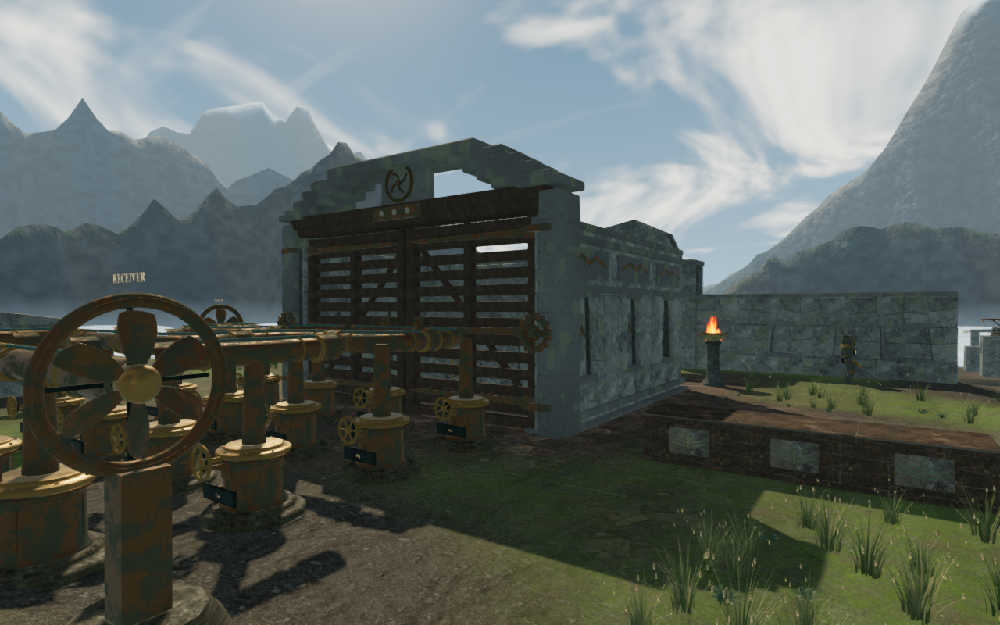
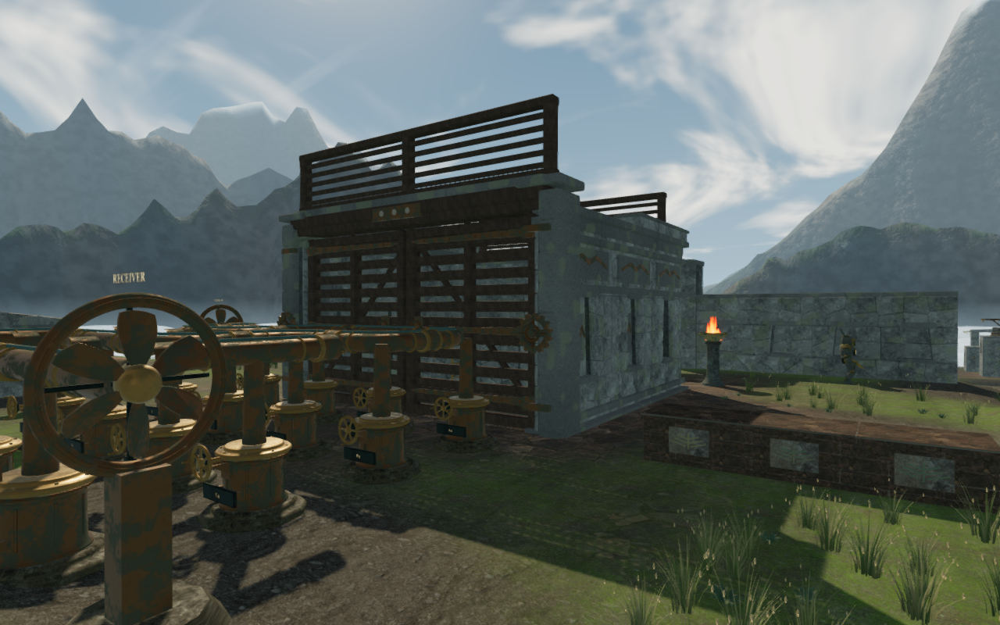
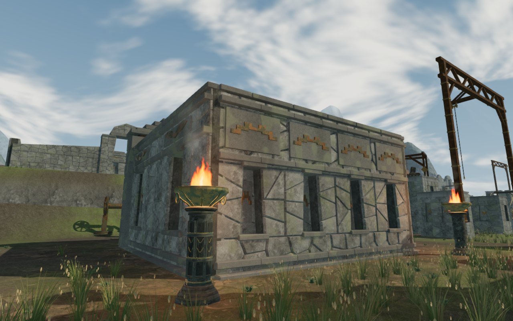
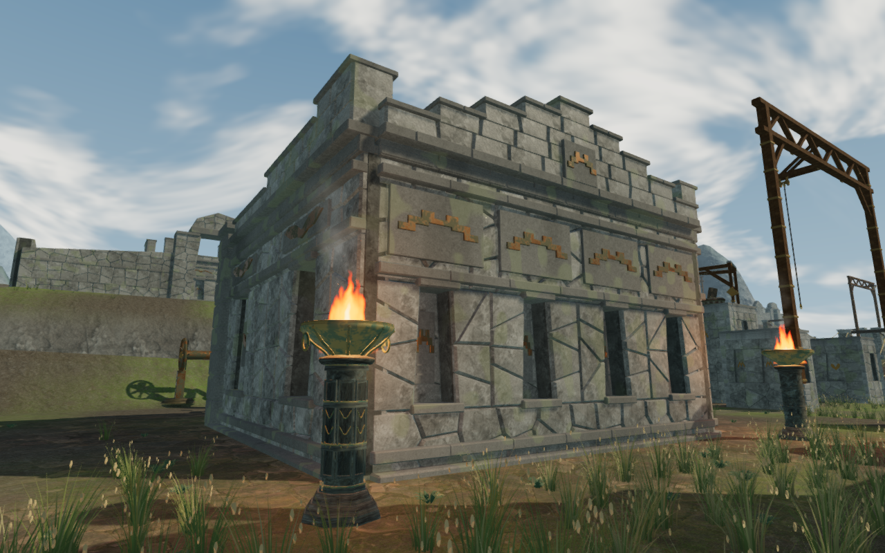

# Nine open-air wind chambers

The sky city's mechanism chambers repeated one stepped entrance crown and flat
wall tops. They now have distinct upper forms tied to the nine wind trials.
The rear walls and side returns carry those forms as well as the entrance.
The courts remain open to the sky.

| Trial | Upper form |
| --- | --- |
| The first breath | A broad central crest and low stepped returns |
| The pilgrim's return | Paired towers with a low central passage of sky |
| The hanging garden | Nested terraces and a taller rear pediment |
| The weaver's court | Framed timber wind screens with pitched laths |
| The immovable bearings | Paired, thick stone pylons |
| The reversed stair | An asymmetric stair rising across the front and rear |
| The high receiver | A narrow, tall central crest |
| The eagle's labyrinth | Two descending wings with a central notch |
| The city's last breath | A broad stepped crest and three rear stelae |

The upper stonework uses the city's existing fitted granite, backed joints,
staggered dressed courses and shallow coping stones. Bronze birds, returning
winds and terrace reliefs sit on attached plaques. Timber uses the existing
weathered wood. No external asset, new texture or material is introduced.

The existing door leaves, their joinery, drive sound sources and forty-five
original movement obstacles retain their delivered data. The crown builder has
its own seeded sequence and preserves the eleven steps formerly consumed by
the old crown, so new masonry does not change downstream leaf geometry.

Each fixed upper assembly supplies copied triangle contact before the render
parts merge by material. The neighbouring original jambs and lintel join that
contact, so the new coping cannot offer a landing inside an older visible cap.
Camera bounds capture the individual members. New fixed geometry does not add
material batches to the delivered chamber roots.

## Counterweight motion

The wider collision assembly exposed an older assumption in the stone-slide
check: it treated a compound object's enclosing rectangle as a solid column
through the court. A valid first-chamber pull then failed despite empty space
under the upper stonework.

The sweep now checks the finite bounds of the assembly's individual closed
members with the moving stone's full radius. The player sweep uses standing
height. The regression passes beneath a hollow frame and rejects a thin member
placed across the slide. All eight authored counterweight chambers solve again
through the walking, grip and swept-motion rules.

## Verification

All 122 selected regressions and the production build pass. The build retains
its existing bundle-size advisory. The new construction regression checks
1,092 bearings against rendered faces, 756 cap/support and camera queries,
and twenty-one opening amounts on each of nine gates. The closest conservative
separation between the new pieces and the complete moving leaves is about
3.29 cm. Every sampled course overlaps its supporting upward face by at least
1.93 cm. All eighteen delivered leaves retain their vertex attributes and
transforms exactly, and the positioned drive sources retain their coordinates.

All forty final scenery captures are reviewed: each of the nine fronts and a
selected rear offset with its doors open and closed in High quality, plus four
open Performance views. Their shaders link and the sampled HDR output is finite.
The four published comparisons share the preceding camera, simulation time and
quality; their lossless exports preserve source pixels and dimensions.

Eighteen assisted entry/return legs cover 121.79 m over 1,170 normal controller
and follow-camera updates, at full health and character visibility. The route
uses a legal lane through each opened entrance. Forty-six resting body poses
check 48,095 delivered character vertices each against independent chamber
triangles and nearby rendered terrain, with no embedding beyond the 15 mm
tolerance and no missing terrain samples. These are endpoint, standing-cap,
crouched-cap and restored-cap inspections; the cap positions are prepared,
and the observer does not inspect every moving pose. A deliberate 20 cm body
lowering embeds 809 vertices, confirming that the contact observer detects
intersection. All nineteen route/contact/reload captures are reviewed.

Same-chapter reload and a chapter change each dispose all 44 outgoing fixed
gate-batch geometries once and detach the nine copied physical assemblies.
No new material batch is added to the chamber roots. Owned browser descendants
and previews close after their checks, within the shared locked five-of-sixteen
CPU allowance.

Built keyboard/High and portrait-touch/Performance cases grip, pull and release
the first counterweight, then walk and reload. The keyboard case earns one
stone slide; touch earns two. Each preserves the complete local save apart
from play timestamps. All ten corresponding input-state images are reviewed.

Both control schemes also turn the fifth wind engine from thirteen to fourteen
saved moves, reload that earned turn, then walk, crouch, look, jump, land and
open the map. Each compares the complete save through three reloads, excluding
play timestamps. Combined with the counterweight cases, all eight production
store comparisons pass and all twenty-two release captures are reviewed.
Served bundles match the build, and the character responses match the delivered
model hash. No application error or warning is recorded; software-driver
readback diagnostics are retained separately. These prepared cases do not
establish complete campaign or consumer-device acceptance.

A separate raised-cap rerun proves a fresh save write: after restoring normal
runtime state, the private helper removes the local-storage key and requires
the game's save to recreate it. The complete store matches apart from play
timestamps, the player returns to exactly the same position, and the restored
body clears both independent observers. Its additional capture is reviewed.
The initial assisted reload's store equality is excluded as fresh-write
evidence because that helper had left the game in its preparation state.

Broader landscape composition,
straight terrace silhouettes, field/discovery/traversal/water coverage and
listening/device acceptance remain in the open [visual audit](visual-audit.md).
