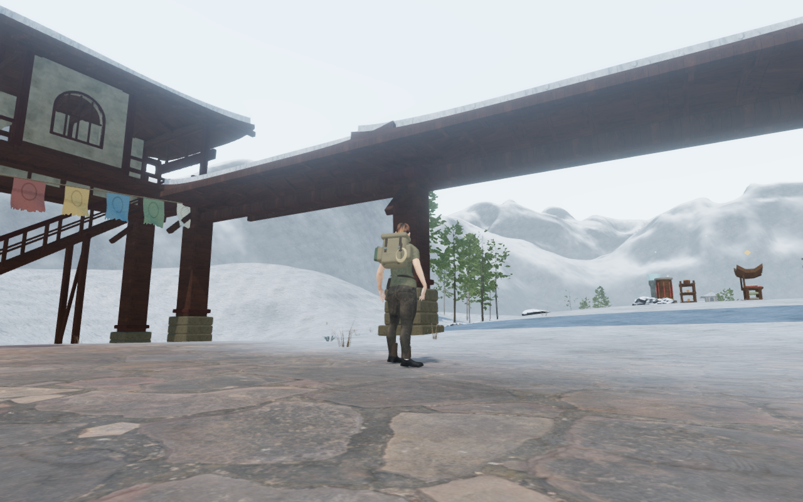
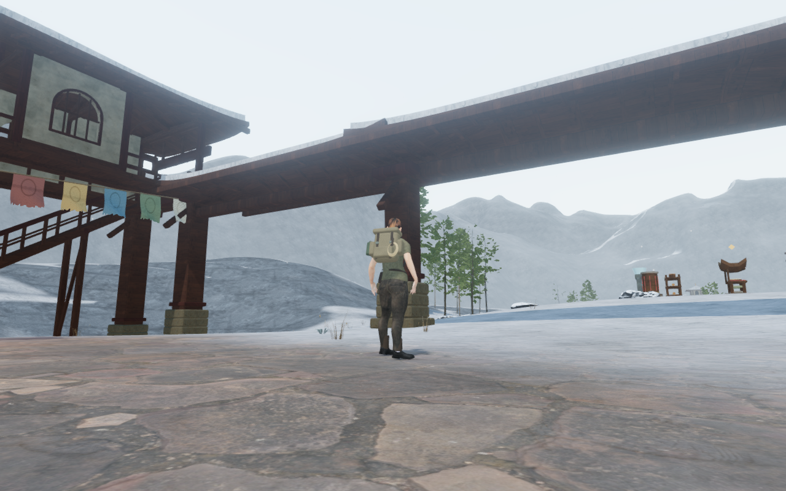
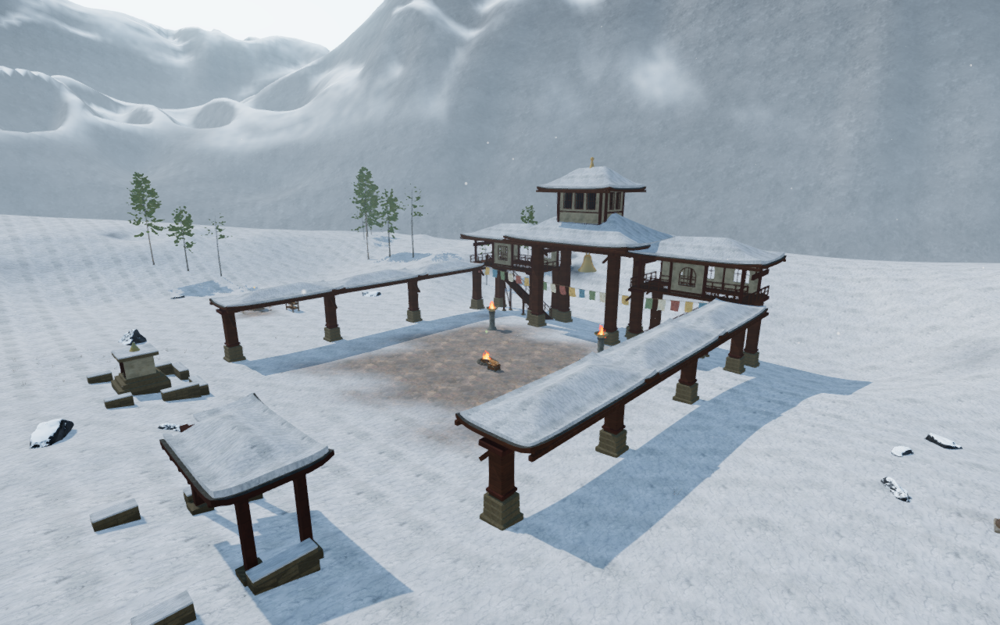
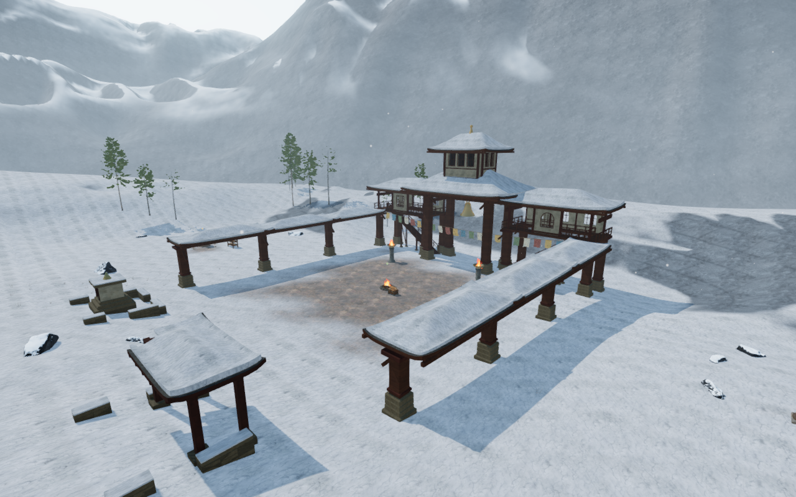

# Wind-scoured winter slopes

Wind-facing snowbanks and mountain shoulders now expose more of their rock.
The previous snow cover hid much of the existing relief, leaving broad white
surfaces around the monastery courts. A shared prevailing-wind treatment
breaks up those surfaces while retaining snow on flat and sheltered ground.

| Published bank | Revised bank |
| --- | --- |
|  |  |

These High game captures use the same supported player position, camera and
scene time. Other animation can differ. All four documentation images preserve
their decoded source RGB pixels and 1280 × 800 dimensions through lossless
WebP conversion. Existing [asset attribution](asset-credits.md) remains
applicable; the change adds no external asset.

The same world-space exposure function serves the playable terrain, its
transition foreland and the distant ranges. Slope direction, tilt and existing
weather variation control the exposed rock. This is a static prevailing wind,
not a weather simulation. It adds no geometry, texture request, displacement,
collision surface or saved field. The established projection, sampling, haze
and terrain-to-range blend remain in place.

| Published entrance landscape | Revised entrance landscape |
| --- | --- |
|  |  |

## Verification

- All 29 selected checks pass, covering alpine ranges and foreland, snow
  geology, frozen ground, groundcover and monastery construction. Three
  CPU-budget checks and the production build pass. The build retains its
  existing bundle-size advisory.
- Fifteen final development views are reviewed: nine court overviews, four
  ordinary entrance headings, an opposite view of the fourth court and a
  supported stance beside the entrance bank. A foreground tree obscures the
  original fourth-court overview, so the opposite view supplies that court's
  landscape coverage. All captures have finite HDR inputs, linked shaders
  and zero GL errors.
- The actual shared exposure function passes 42 floating-point GPU cases,
  including flat, windward, leeward and shelf-transition normals. A deliberate
  reversal of the wind direction triggers six expected failures. The accepted
  shelf transition is monotonic.
- Independently compiled old/new terrain fixtures retain identical pixels
  across 21 flat, windward and leeward cases in the other seven themes:
  5,548,116 compared half-float channels. Flat and leeward winter fixtures also
  match. All five windward fixtures change: terrain, range and three foreland
  blend positions. These isolated fixtures are narrower than full-world or
  device coverage.
- Six terrain/foreland and foreland/range endpoint comparisons match exactly
  in both the old and current materials. All 96 fixture renders contain
  finite values across 25,362,816 read channels. The separate existing sampler
  observer retains eighteen accepted cases, with maximum RGB jump 0.000189;
  eighteen deliberate broken-weight controls reach a maximum jump of 0.6571.
- Old/new terrain factories retain identical vertex hooks, map data, height
  fields, requested texture URLs and existing uniform values in all eight
  themes. The other seven cache keys and defines match. The winter cache
  keys change to select the revised shaders.
- Temporary probe materials, maps, geometry and render targets are disposed.
  Renderer counts return to the starting 2,887 geometries and 235 textures.

Production keyboard/High at 1280 × 800 and actual portrait touch/Performance
at 540 × 900 both crouch and walk on supported snow. Movement covers
6.0 m / 6.6 m at health 100. Four complete-store reload comparisons pass,
apart from chapter timestamps. All six release images are reviewed. Loaded
JS/CSS names match the current build, the development hook is absent and
there is no horizontal overflow. No page errors, missing resources or
unexpected console warnings are recorded. These checks use a prepared chapter
save with guardians defeated and audio muted.

All 429 runtime source hashes match the final capture sets and reviewed code.
The original thirteen before views match the 428 source files in published
`8396d93`. Two additional controls deliver that version's four material files;
their submitted GPU shaders contain no wind-scour function. All fifteen
comparisons retain the prepared camera/player coordinates and scene time.
Owned browsers and preview servers close after checks. Work uses the shared
locked five-of-sixteen CPU set at lower priority, with at most two test workers
and one browser.

## Remaining work

The exposed rock improves local landscape contrast, but large mountain forms
remain smooth and some surrounding paths remain sparse. Court massing and
ancillary structures still repeat. Broader discovery and traversal coverage,
continuous body contact, listening review and consumer-device performance
remain open. Sound-source placement, distance falloff and adaptive music code
are unchanged. These checks do not establish a complete human campaign
playthrough, subjective sound quality or AAA parity.
