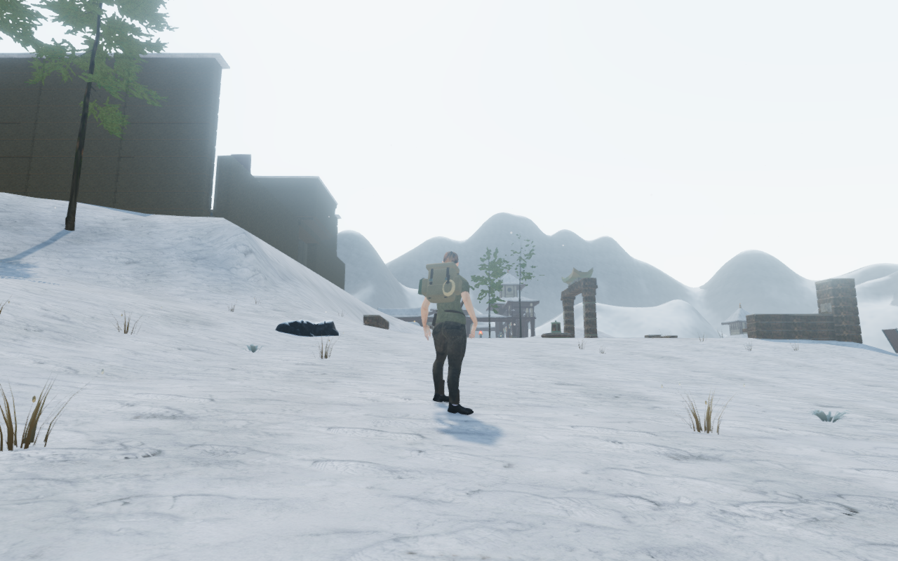
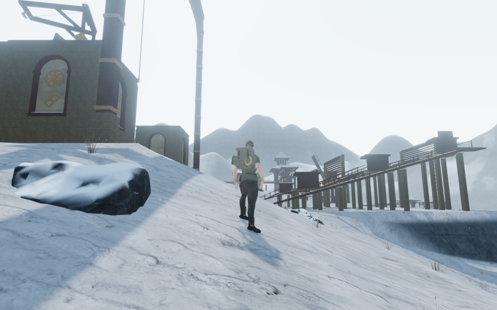

# Broken stone along the winter trails

The winter chapter's connecting snow banks had little detail between the older
large boulders and sparse dry plants. Six original fragment forms now scatter
in irregular fans along the terrain edges. Flat fracture bases, uneven
shoulders and varied proportions keep the stones low against the banks.
They share the existing repeatable rock maps; textured snow collects on their
crowns while leaving darker stone exposed on the sides.

| Previous trail bank | Broken stone on the bank |
| --- | --- |
|  |  |

| Previous hoist approach | Ground detail near the hoist |
| --- | --- |
|  |  |

Placement uses its own random sequence and reserves walking lanes, court
floors, discoveries, traversal courses, trees, water, gates and the stair/hoist
machinery. Conservative spacing separates fragments from one another and older
boulders. Groundcover avoids their occupied space, changing planting counts
where plants would enter the new stone.

Both detail tiers share an irregular footprint. Seating takes the minimum over
terrain triangles clipped to the footprint's bounds, including dips between the
original grounding probes. Fragments with insufficient exposed height are
rejected. Instances share six geometry pairs and one material, with detail
distances following the selected quality. They participate in the existing
finite rock contact queries.

All 2,281 delivered fragments pass 91,668 underside probes against actual
rendered terrain triangles. Both tiers use packed Float32 instance transforms.
Lifting the render vertices three local metres detects every probe; the control
restores the exact original bytes. A separate lane check finds no new obstruction
in 29,083 deduplicated samples along all 59 authored paths, including both edges
two metres from the centre line.

Independent inspection finds 117,884 closed near triangles in 2,281 closed
components. Every component's interior witness detects its solid. All 77
sound-source origins remain outside the new geometry.

An initial test dropped the player on an off-grid bank. Its landing cleared the
rendered body, but the position and camera were outside the walkable map.
The gameplay checks use six prepared legal bank positions, actual controller
approaches and jumps beside each form, then returns toward the paths. Player,
camera and rendered-body assertions stay in place;
the rejected centre drop is not counted as a passing gameplay pose.

All 37 selected tests across eight files pass, together with the build and three
CPU-budget tests. Coverage includes both closed tiers, deterministic placement,
protected lanes and independently raycast uneven ground. The build retains its
existing bundle-size advisory.

Twenty-nine final-source game views are reviewed: twelve trail positions, six
landings, six returns, four close material views and a native-input seed. Close
material views use diagnostic cameras. All 2,700 local controller updates retain
legal positions. Thirteen stopped body poses each clear 48,095 delivered
character vertices against both the new rock and actual terrain at the 15 mm
threshold. This does not establish continuous moving-body acceptance.

Changing to the jungle chapter releases all 37 tracked resources exactly once:
twelve instanced meshes, twelve geometry wrappers, twelve depth materials and
the shared stone material. The snow-scree state clears after replacement.
The development browser and server close after verification. All 436 runtime
hashes match the tested and rendered source. Shaders link, HDR inputs remain
finite, and there are no GL errors, page errors, missing resources or unexpected
console warnings.

Production keyboard/High at 1280 × 800 and actual portrait touch/Performance at
540 × 900 both crouch and walk 6.0–6.6 m at full health. Four complete-store
reload comparisons pass apart from chapter timestamps. Saved elevation stays
on the ground, loaded JS/CSS names match the build, the development hook is
absent and there is no horizontal overflow. The prepared save has guardians
defeated and audio muted. All six release captures are reviewed, with no page
errors, missing resources or unexpected console warnings. Owned helpers close.

The paired High documentation views retain player/camera framing and scene
time; all four lossless WebPs preserve source RGB pixels.
Verification uses the shared locked five-of-sixteen CPU set at lower priority,
at most two test workers and one browser.

This improves the recorded sparse winter trail banks. Wider court composition,
shared structures, other landscape details and discovery/traversal/water coverage
remain open, as do continuous moving-body contact, surface-specific footsteps,
listening review and consumer-device performance. The game goal remains active.
